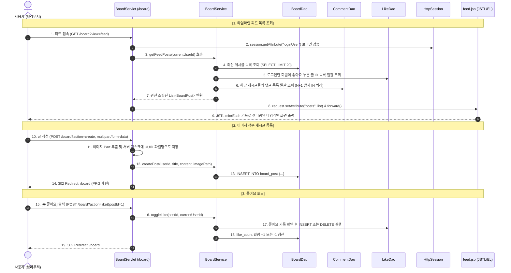

# [실습 & 설계 가이드] 타임라인 피드(Feed)형 SNS 스타일 게시판 구현하기

이 문서는 전통적인 단순 표(Table) 형태의 텍스트 리스트를 벗어나, **페이스북(Facebook)이나 인스타그램, 트위터(X)처럼 사용자가 스크롤을 내리며 글 본문과 첨부 이미지를 즉시 확인할 수 있는 '타임라인 피드(Feed)형 게시판'**을 현재 프로젝트(`Survlet_practice`, Jakarta EE 10, Servlet 6.1, Tomcat 10+, MySQL, Gradle) 환경에 맞추어 처음부터 끝까지 직접 구현해볼 수 있도록 작성된 **종합 실습 & 풀스택 아키텍처 설계 가이드**입니다.

기존의 `2.JSP_TODO_LOGIN_GUIDE.md`와 동일하게, **초보자도 주석만 읽고 그대로 따라 칠 수 있도록 DTO, DAO(인터페이스 & 구현체), Service, Controller, View(JSP), CSS 전 계층의 완성된 소스코드와 친절한 한 줄 해설**을 수록하였습니다.

> 💡 **수석 기획자 & 풀스택 아키텍트의 설계 노트**:  
> 현대 웹 UI/UX의 패러다임은 "목록을 보고 클릭해서 본문으로 들어가는 단절된 탐색(List-Detail Pattern)"에서, **"스트림을 따라 자연스럽게 콘텐츠를 소비하는 인라인 피드 탐색(Continuous Feed Pattern)"**으로 진화했습니다.  
> 특히 이번 실습에서는 **오늘 학습한 JSTL(`<c:forEach>`, `<c:if>`, `<c:choose>`)과 EL(`${...}`)**을 집중 활용하여, 서버 사이드 렌더링(SSR) 환경에서도 매끄러운 반응형 SNS 인터랙션을 완성합니다.

---

## 📌 목차
1. [기획 개요 & UI/UX 콘셉트 (피드형 vs 리스트형)](#1-기획-개요--uiux-콘셉트-피드형-vs-리스트형)
2. [화면 레이아웃 스케치 (와이어프레임)](#2-화면-레이아웃-스케치-와이어프레임)
3. [전체 동작 흐름 (시퀀스 다이어그램)](#3-전체-동작-흐름-시퀀스-다이어그램)
4. [프로젝트 구조 및 작업 파일 배치도](#4-프로젝트-구조-및-작업-파일-배치도)
5. [Step 1: 데이터베이스 스키마 및 샘플 데이터 (`sql/board_schema.sql`)](#step-1-데이터베이스-스키마-및-샘플-데이터-sqlboard_schemasql)
6. [Step 2: 데이터 모델 DTO (`BoardPost`, `BoardComment`, `BoardLike`)](#step-2-데이터-모델-dto-boardpost-boardcomment-boardlike)
7. [Step 3: 데이터 접근 DAO 인터페이스 및 JDBC 구현체](#step-3-데이터-접근-dao-인터페이스-및-jdbc-구현체)
   - 3.1 게시글 DAO (`BoardDao.java`, `JdbcBoardDao.java`)
   - 3.2 댓글 DAO (`CommentDao.java`, `JdbcCommentDao.java` - N+1 방지 쿼리 포함)
   - 3.3 좋아요 DAO (`LikeDao.java`, `JdbcLikeDao.java`)
8. [Step 4: 비즈니스 로직 Service (`BoardService.java`)](#step-4-비즈니스-로직-service-boardservicejava)
9. [Step 5: 요청 처리 Controller (`BoardServlet.java`)](#step-5-요청-처리-controller-boardservletjava)
10. [Step 6: 스타일시트 UI (`board.css`)](#step-6-스타일시트-ui-boardcss)
11. [Step 7: 화면 UI 뷰 (JSP & JSTL)](#step-7-화면-ui-뷰-jsp--jstl)
   - 7.1 타임라인 메인 피드 (`board/feed.jsp`)
   - 7.2 전통적 리스트 목록 (`board/list.jsp`)
   - 7.3 게시글 수정 화면 (`board/edit.jsp`)
   - 7.4 메인 대시보드 연동 (`main.jsp` 수정)
12. [Step 8: 향후 확장: 무한 스크롤(Infinite Scroll) & 커서 기반 페이징 아이디어](#step-8-향후-확장-무한-스크롤infinite-scroll--커서-기반-페이징-아이디어)
13. [Step 9: 실행 및 동작 테스트 시나리오](#step-9-실행-및-동작-테스트-시나리오)
14. [핵심 개념 정리 & 자주 묻는 질문 (FAQ)](#핵심-개념-정리--자주-묻는-질문-faq)

---

## 1. 기획 개요 & UI/UX 콘셉트 (피드형 vs 리스트형)

### 📊 1. 전통적인 리스트형과 피드형 게시판 비교

| 비교 항목 | 전통적인 리스트형 (List Board) | 피드형 타임라인 (Feed Timeline) |
| :--- | :--- | :--- |
| **콘텐츠 노출 방식** | 번호, 제목, 작성자, 날짜만 표(table)에 나열 | **작성자 프로필, 본문 전체/미리보기, 이미지**가 하나의 카드에 즉시 노출 |
| **사용자 인터랙션** | 제목 클릭 ➜ 상세 페이지 ➜ 뒤로 가기 (단절된 경험) | **스크롤 다운**으로 연속 소비, 카드 내에서 **'좋아요' & '댓글' 즉시 작성** |
| **이미지 소비** | 첨부파일 아이콘을 클릭하거나 상세로 들어가야 확인 | 타임라인 상에서 **시각적 미디어 카드**를 바로 감상 |
| **주요 용도** | 공지사항, 문서 아카이빙, 사내 결재 문서 | **사내 커뮤니티, 팀 일상 공유, 아이디어 피드, SNS 스타일 소통** |

### 🎯 2. 핵심 UI/UX 설계 원칙
1. **카드 중심 디자인 (Card-Based Feed)**:
   - 각 글은 그림자(`box-shadow`)와 둥근 모서리(`border-radius: 12px`)를 가진 흰색 독립 카드로 표현됩니다.
2. **원스톱 인라인 인터랙션 (In-Place Reaction)**:
   - 상세 페이지로 이동하지 않고도 카드 안에서 즉시 좋아요를 누르고, 댓글을 확인/작성할 수 있습니다.
3. **듀얼 뷰 스위처 (Dual-View Switcher)**:
   - 빠른 제목 훑어보기를 선호하는 사용자를 위해 우측 상단에 `[🖼️ 피드형]` / `[📑 리스트형]` 보기 전환 토글을 제공합니다 (`?view=feed` ⮂ `?view=list`).

---

## 2. 화면 레이아웃 스케치 (와이어프레임)

### 🖥️ 1. 메인 타임라인 피드 뷰 (`view=feed`)

```text
+-----------------------------------------------------------------------------------+
|  [Logo] 교보 웹 포털       [🏠 대시보드]   [📝 TODO]   [📋 피드게시판]    백종민님 [로그아웃]  |
+-----------------------------------------------------------------------------------+
|                                                                                   |
|                                [ 메인 피드 컨테이너 (최대 너비: 680px) ]                  |
|                                                                                   |
|  +-----------------------------------------------------------------------------+  |
|  |  📝 [새로운 소식 작성하기] (Quick Post Box)                                     |  |
|  |  +-----------------------------------------------------------------------+  |  |
|  |  | 글 제목을 입력하세요...                                                |  |  |
|  |  +-----------------------------------------------------------------------+  |  |
|  |  | 나누고 싶은 이야기나 생각을 자유롭게 공유해보세요...                    |  |  |
|  |  |                                                                       |  |  |
|  |  +-----------------------------------------------------------------------+  |  |
|  |  [ 📷 사진 첨부 (파일선택) ]   [미리보기: sample.png]           [ 게시하기 (등록) ] |  |
|  +-----------------------------------------------------------------------------+  |
|                                                                                   |
|  [ 🔄 최신순 정렬 ]                                         보기 방식: [🖼️ 피드] [📑 목록] |
|                                                                                   |
|  +-----------------------------------------------------------------------------+  |
|  | [피드 카드 #1]                                                               |  |
|  | 👤 김유진  ·  2026.10.12 11:20                          [ ⋯ 메뉴: 수정 / 삭제 ]|  |
|  | --------------------------------------------------------------------------- |  |
|  | 📌 오늘 팀 점심 회식 다녀왔습니다! (제목)                                      |  |
|  |                                                                             |  |
|  | 광화문 교보문고 옆 맛집에서 다 같이 파스타 먹었어요!                            |  |
|  | 날씨도 좋고 오랜만에 팀원들과 즐거운 시간이었습니다. 😊                        |  |
|  |                                                                             |  |
|  | +-------------------------------------------------------------------------+ |  |
|  | |                                                                         | |  |
|  | |                        [ 첨부된 고화질 이미지 영역 ]                      | |  |
|  | |                                                                         | |  |
|  | +-------------------------------------------------------------------------+ |  |
|  |                                                                             |  |
|  | [ ❤️ 좋아요 5 ]      [ 💬 댓글 2 ]                                           |  |
|  | --------------------------------------------------------------------------- |  |
|  | 💬 댓글 목록:                                                               |  |
|  |   - 백종민: 정말 맛있어 보이네요! 다음엔 저도 같이 가요~ (11:25) [x]          |  |
|  |   - 박지성: 파스타 비주얼 대박입니다 👍 (11:40)                                |  |
|  |                                                                             |  |
|  | +---------------------------------------------------------+ +-------------+ |  |
|  | | 따뜻한 댓글을 남겨보세요...                             | | [댓글 작성] | |  |
|  | +---------------------------------------------------------+ +-------------+ |  |
|  +-----------------------------------------------------------------------------+  |
|                                                                                   |
|                         [ ⬇️ 더 많은 이야기 불러오기 (더보기) ]                     |
+-----------------------------------------------------------------------------------+
```

---

## 3. 전체 동작 흐름 (시퀀스 다이어그램)



---

## 4. 프로젝트 구조 및 작업 파일 배치도

```text
Survlet_practice/
 ├── sql/
 │    ├── todo_schema.sql         (기존)
 │    └── board_schema.sql        [신규 생성] 게시글, 댓글, 좋아요 테이블 DDL 및 샘플 데이터
 └── src/
      └── main/
           ├── java/
           │    └── com/kyobo/web/
           │         ├── config/
           │         │    └── ConnectionProvider.java   (기존 유지 - DB 커넥션 제공)
           │         ├── controller/
           │         │    ├── LoginServlet.java         (기존)
           │         │    ├── TodoServlet.java          (기존)
           │         │    ├── MainServlet.java          (기존)
           │         │    └── BoardServlet.java         [신규 생성] 피드/목록/CRUD/댓글/좋아요 컨트롤러
           │         ├── dao/
           │         │    ├── MemberDao.java / JdbcMemberDao.java (기존)
           │         │    ├── TodoDao.java / JdbcTodoDao.java     (기존)
           │         │    ├── BoardDao.java             [신규 생성] 게시글 DAO 규격 인터페이스
           │         │    ├── JdbcBoardDao.java         [신규 생성] 게시글 JDBC 구현체
           │         │    ├── CommentDao.java           [신규 생성] 댓글 DAO 규격 인터페이스
           │         │    ├── JdbcCommentDao.java       [신규 생성] 댓글 JDBC 구현체 (N+1 방지)
           │         │    ├── LikeDao.java              [신규 생성] 좋아요 DAO 규격 인터페이스
           │         │    └── JdbcLikeDao.java          [신규 생성] 좋아요 JDBC 구현체
           │         ├── model/
           │         │    ├── Member.java / TodoItem.java (기존)
           │         │    ├── BoardPost.java            [신규 생성] 게시글 DTO (댓글리스트, 좋아요여부 포함)
           │         │    ├── BoardComment.java         [신규 생성] 댓글 DTO
           │         │    └── BoardLike.java            [신규 생성] 좋아요 DTO
           │         └── service/
           │              ├── TodoService.java          (기존)
           │              └── BoardService.java         [신규 생성] 피드 조합, 좋아요 토글, 권한 검증 비즈니스 로직
           └── webapp/
                ├── assets/
                │    ├── css/
                │    │    ├── todo.css                  (기존)
                │    │    └── board.css                 [신규 생성] SNS 타임라인 전용 모던 스타일시트
                │    └── uploads/
                │         └── board/                    [신규 생성] 업로드된 이미지 파일 저장소
                └── WEB-INF/
                     └── views/
                          ├── main.jsp                  [기존 수정] '자유 게시판' 카드 링크 활성화 (/board)
                          └── board/
                               ├── feed.jsp             [신규 생성] 메인 타임라인 피드 뷰 (JSTL & EL)
                               ├── list.jsp             [신규 생성] 전통적인 표 목록 뷰
                               └── edit.jsp             [신규 생성] 게시글 수정 화면
```

---

## Step 1: 데이터베이스 스키마 및 샘플 데이터 (`sql/board_schema.sql`)

### 📌 파일 역할
게시글(`board_post`), 댓글(`board_comment`), 좋아요(`board_like`)를 저장할 3개 테이블을 정의합니다.  
`board_like` 테이블은 `(post_id, user_id)` 복합 기본키를 통해 한 회원이 같은 글에 중복 좋아요를 누를 수 없도록 물리적으로 차단합니다.

- **파일 위치**: `sql/board_schema.sql` (신규 파일 생성)

```sql
-- [1] kyobo 데이터베이스 사용
USE kyobo;

-- [2] 피드 게시글 테이블 (board_post)
CREATE TABLE IF NOT EXISTS board_post (
    post_id BIGINT AUTO_INCREMENT PRIMARY KEY COMMENT '게시글 고유 번호 (PK)',
    user_id VARCHAR(50) NOT NULL COMMENT '작성자 회원 아이디 (FK)',
    title VARCHAR(200) NOT NULL COMMENT '게시글 제목',
    content TEXT NOT NULL COMMENT '게시글 본문 내용 (엔터 개행 포함)',
    image_path VARCHAR(255) NULL COMMENT '업로드된 이미지의 웹 경로 (예: /assets/uploads/board/uuid.jpg)',
    like_count INT DEFAULT 0 COMMENT '좋아요 누적 수 (조회 성능 최적화 캐시 컬럼)',
    comment_count INT DEFAULT 0 COMMENT '댓글 누적 수 (조회 성능 최적화 캐시 컬럼)',
    created_at TIMESTAMP DEFAULT CURRENT_TIMESTAMP COMMENT '최초 등록일시',
    updated_at TIMESTAMP DEFAULT CURRENT_TIMESTAMP ON UPDATE CURRENT_TIMESTAMP COMMENT '최종 수정일시',

    -- 작성자 회원이 삭제되면 작성한 글도 일괄 삭제
    CONSTRAINT fk_board_post_member FOREIGN KEY (user_id) REFERENCES member(user_id) ON DELETE CASCADE,
    INDEX idx_board_post_created (created_at DESC)
) ENGINE=InnoDB DEFAULT CHARSET=utf8mb4 COLLATE=utf8mb4_0900_ai_ci COMMENT='피드 게시글 테이블';

-- [3] 피드 댓글 테이블 (board_comment)
CREATE TABLE IF NOT EXISTS board_comment (
    comment_id BIGINT AUTO_INCREMENT PRIMARY KEY COMMENT '댓글 고유 번호 (PK)',
    post_id BIGINT NOT NULL COMMENT '소속 게시글 번호 (FK)',
    user_id VARCHAR(50) NOT NULL COMMENT '댓글 작성자 아이디 (FK)',
    content VARCHAR(1000) NOT NULL COMMENT '댓글 내용',
    created_at TIMESTAMP DEFAULT CURRENT_TIMESTAMP COMMENT '댓글 작성일시',

    -- 게시글이 삭제되면 달린 댓글도 함께 삭제
    CONSTRAINT fk_board_comment_post FOREIGN KEY (post_id) REFERENCES board_post(post_id) ON DELETE CASCADE,
    CONSTRAINT fk_board_comment_member FOREIGN KEY (user_id) REFERENCES member(user_id) ON DELETE CASCADE,
    INDEX idx_board_comment_post (post_id, created_at ASC)
) ENGINE=InnoDB DEFAULT CHARSET=utf8mb4 COLLATE=utf8mb4_0900_ai_ci COMMENT='피드 댓글 테이블';

-- [4] 좋아요 테이블 (board_like)
-- 복합 기본키 (post_id, user_id)로 한 사람이 1개 글에 단 한 번만 좋아요 가능하도록 보장
CREATE TABLE IF NOT EXISTS board_like (
    post_id BIGINT NOT NULL COMMENT '게시글 번호 (FK)',
    user_id VARCHAR(50) NOT NULL COMMENT '좋아요 누른 회원 아이디 (FK)',
    created_at TIMESTAMP DEFAULT CURRENT_TIMESTAMP COMMENT '좋아요 클릭 일시',

    PRIMARY KEY (post_id, user_id),
    CONSTRAINT fk_board_like_post FOREIGN KEY (post_id) REFERENCES board_post(post_id) ON DELETE CASCADE,
    CONSTRAINT fk_board_like_member FOREIGN KEY (user_id) REFERENCES member(user_id) ON DELETE CASCADE
) ENGINE=InnoDB DEFAULT CHARSET=utf8mb4 COLLATE=utf8mb4_0900_ai_ci COMMENT='게시글 좋아요 테이블';

-- [5] 테스트용 초기 피드 샘플 데이터 삽입
INSERT INTO board_post (user_id, title, content, image_path, like_count, comment_count, created_at)
VALUES
    ('김유진', '오늘 팀 점심 회식 다녀왔습니다! 🍕', 
     '광화문 교보빌딩 근처 맛집에서 팀원들과 점심 회식했어요!\n피자와 파스타가 정말 훌륭했습니다. 다들 즐거운 한 주 보내세요 :)', 
     NULL, 1, 2, '2026-10-12 11:20:00'),
    ('백종민', 'Servlet 6.1과 JSTL 3.0 설정 시 유의사항', 
     'Jakarta EE 10으로 오면서 JSTL 태그 라이브러리 URI가 변경되었습니다.\n기존 http://java.sun.com 대신 jakarta.tags.core 를 꼭 사용하세요!', 
     NULL, 1, 0, '2026-10-12 09:15:00')
ON DUPLICATE KEY UPDATE title = VALUES(title);

-- [6] 테스트용 댓글 샘플 데이터 삽입
INSERT INTO board_comment (post_id, user_id, content, created_at)
VALUES
    (1, '백종민', '와 비주얼 대박이네요! 다음엔 저도 꼭 불러주세요 ㅎㅎ', '2026-10-12 11:25:00'),
    (1, '김유진', '네 종민님! 다음엔 팀 전체 다 같이 가요~', '2026-10-12 11:30:00');

-- [7] 테스트용 좋아요 샘플 데이터 삽입
INSERT INTO board_like (post_id, user_id)
VALUES
    (1, '백종민'),
    (2, '김유진')
ON DUPLICATE KEY UPDATE created_at = CURRENT_TIMESTAMP;
```

---

## Step 2: 데이터 모델 DTO (`BoardPost`, `BoardComment`, `BoardLike`)

### 2.1 `BoardPost.java` (게시글 DTO)
피드 카드를 그릴 때 필요한 게시글 정보 외에, 작성자 이름(`authorName`), 내가 좋아요를 눌렀는지 여부(`likedByMe`), 그리고 해당 글에 달린 댓글 목록(`comments`)을 하나의 상자에 함께 담을 수 있도록 설계합니다.

- **파일 위치**: `src/main/java/com/kyobo/web/model/BoardPost.java`

```java
package com.kyobo.web.model;

import java.io.Serializable;
import java.time.LocalDateTime;
import java.util.ArrayList;
import java.util.List;

public class BoardPost implements Serializable {
    private static final long serialVersionUID = 1L;

    private Long postId;              // 게시글 고유 번호 (PK)
    private String userId;            // 작성자 회원 아이디 (FK)
    private String authorName;        // 작성자 실명/닉네임 (member 테이블 JOIN)
    private String title;             // 글 제목
    private String content;           // 글 본문
    private String imagePath;         // 업로드 이미지 경로 (예: /assets/uploads/board/uuid.png)
    private int likeCount;            // 좋아요 누적 수
    private int commentCount;         // 댓글 누적 수
    private LocalDateTime createdAt;  // 작성 일시
    private LocalDateTime updatedAt;  // 수정 일시

    // [피드 화면 구성을 위한 확장 필드]
    private boolean likedByMe;        // 현재 로그인한 사용자가 좋아요를 눌렀는지 여부
    private List<BoardComment> comments = new ArrayList<>(); // 해당 게시글에 달린 댓글 목록

    public BoardPost() {}

    public BoardPost(String userId, String title, String content, String imagePath) {
        this.userId = userId;
        this.title = title;
        this.content = content;
        this.imagePath = imagePath;
    }

    // --- Getter & Setter 메서드들 ---
    public Long getPostId() { return postId; }
    public void setPostId(Long postId) { this.postId = postId; }

    public String getUserId() { return userId; }
    public void setUserId(String userId) { this.userId = userId; }

    public String getAuthorName() { return authorName; }
    public void setAuthorName(String authorName) { this.authorName = authorName; }

    public String getTitle() { return title; }
    public void setTitle(String title) { this.title = title; }

    public String getContent() { return content; }
    public void setContent(String content) { this.content = content; }

    public String getImagePath() { return imagePath; }
    public void setImagePath(String imagePath) { this.imagePath = imagePath; }

    public int getLikeCount() { return likeCount; }
    public void setLikeCount(int likeCount) { this.likeCount = likeCount; }

    public int getCommentCount() { return commentCount; }
    public void setCommentCount(int commentCount) { this.commentCount = commentCount; }

    public LocalDateTime getCreatedAt() { return createdAt; }
    public void setCreatedAt(LocalDateTime createdAt) { this.createdAt = createdAt; }

    public LocalDateTime getUpdatedAt() { return updatedAt; }
    public void setUpdatedAt(LocalDateTime updatedAt) { this.updatedAt = updatedAt; }

    public boolean isLikedByMe() { return likedByMe; }
    public void setLikedByMe(boolean likedByMe) { this.likedByMe = likedByMe; }

    public List<BoardComment> getComments() { return comments; }
    public void setComments(List<BoardComment> comments) { this.comments = comments; }
}
```

---

### 2.2 `BoardComment.java` (댓글 DTO)
댓글 1건의 속성을 담는 상자입니다.

- **파일 위치**: `src/main/java/com/kyobo/web/model/BoardComment.java`

```java
package com.kyobo.web.model;

import java.io.Serializable;
import java.time.LocalDateTime;

public class BoardComment implements Serializable {
    private static final long serialVersionUID = 1L;

    private Long commentId;           // 댓글 고유 번호 (PK)
    private Long postId;              // 소속 게시글 번호 (FK)
    private String userId;            // 댓글 작성자 아이디 (FK)
    private String authorName;        // 댓글 작성자 이름 (member JOIN)
    private String content;           // 댓글 본문 내용
    private LocalDateTime createdAt;  // 작성 일시

    public BoardComment() {}

    public BoardComment(Long postId, String userId, String content) {
        this.postId = postId;
        this.userId = userId;
        this.content = content;
    }

    // --- Getter & Setter 메서드들 ---
    public Long getCommentId() { return commentId; }
    public void setCommentId(Long commentId) { this.commentId = commentId; }

    public Long getPostId() { return postId; }
    public void setPostId(Long postId) { this.postId = postId; }

    public String getUserId() { return userId; }
    public void setUserId(String userId) { this.userId = userId; }

    public String getAuthorName() { return authorName; }
    public void setAuthorName(String authorName) { this.authorName = authorName; }

    public String getContent() { return content; }
    public void setContent(String content) { this.content = content; }

    public LocalDateTime getCreatedAt() { return createdAt; }
    public void setCreatedAt(LocalDateTime createdAt) { this.createdAt = createdAt; }
}
```

---

### 2.3 `BoardLike.java` (좋아요 DTO)
누가 어떤 글에 좋아요를 눌렀는지의 정보를 담는 DTO입니다.

- **파일 위치**: `src/main/java/com/kyobo/web/model/BoardLike.java`

```java
package com.kyobo.web.model;

import java.io.Serializable;
import java.time.LocalDateTime;

public class BoardLike implements Serializable {
    private static final long serialVersionUID = 1L;

    private Long postId;              // 좋아요가 눌린 게시글 번호
    private String userId;            // 좋아요를 누른 회원 아이디
    private LocalDateTime createdAt;  // 좋아요 누른 시간

    public BoardLike() {}

    public BoardLike(Long postId, String userId) {
        this.postId = postId;
        this.userId = userId;
    }

    // --- Getter & Setter 메서드들 ---
    public Long getPostId() { return postId; }
    public void setPostId(Long postId) { this.postId = postId; }

    public String getUserId() { return userId; }
    public void setUserId(String userId) { this.userId = userId; }

    public LocalDateTime getCreatedAt() { return createdAt; }
    public void setCreatedAt(LocalDateTime createdAt) { this.createdAt = createdAt; }
}
```

---

## Step 3: 데이터 접근 DAO 인터페이스 및 JDBC 구현체

### 3.1 게시글 DAO: `BoardDao.java` & `JdbcBoardDao.java`

- **인터페이스 위치**: `src/main/java/com/kyobo/web/dao/BoardDao.java`
```java
package com.kyobo.web.dao;

import com.kyobo.web.model.BoardPost;
import java.sql.SQLException;
import java.util.List;
import java.util.Optional;

public interface BoardDao {
    // 1. 최신 게시글 목록 조회 (페이징: limit 개수, offset 시작위치)
    List<BoardPost> findAll(int limit, int offset) throws SQLException;

    // 2. 특정 게시글 1건 상세 조회
    Optional<BoardPost> findById(Long postId) throws SQLException;

    // 3. 신규 게시글 저장 (생성된 PK post_id 반환)
    Long save(BoardPost post) throws SQLException;

    // 4. 게시글 수정 (제목, 본문, 이미지)
    boolean update(BoardPost post) throws SQLException;

    // 5. 게시글 삭제
    boolean delete(Long postId) throws SQLException;

    // 6. 좋아요 개수 증감 (+1 또는 -1)
    void updateLikeCount(Long postId, int delta) throws SQLException;

    // 7. 댓글 개수 증감 (+1 또는 -1)
    void updateCommentCount(Long postId, int delta) throws SQLException;
}
```

- **구현체 위치**: `src/main/java/com/kyobo/web/dao/JdbcBoardDao.java`
```java
package com.kyobo.web.dao;

import com.kyobo.web.config.ConnectionProvider;
import com.kyobo.web.model.BoardPost;

import java.sql.*;
import java.util.ArrayList;
import java.util.List;
import java.util.Optional;

public class JdbcBoardDao implements BoardDao {

    private BoardPost map(ResultSet rs) throws SQLException {
        BoardPost p = new BoardPost();
        p.setPostId(rs.getLong("post_id"));
        p.setUserId(rs.getString("user_id"));
        p.setAuthorName(rs.getString("author_name"));
        p.setTitle(rs.getString("title"));
        p.setContent(rs.getString("content"));
        p.setImagePath(rs.getString("image_path"));
        p.setLikeCount(rs.getInt("like_count"));
        p.setCommentCount(rs.getInt("comment_count"));

        Timestamp cTs = rs.getTimestamp("created_at");
        if (cTs != null) p.setCreatedAt(cTs.toLocalDateTime());

        Timestamp uTs = rs.getTimestamp("updated_at");
        if (uTs != null) p.setUpdatedAt(uTs.toLocalDateTime());

        return p;
    }

    @Override
    public List<BoardPost> findAll(int limit, int offset) throws SQLException {
        String sql = "SELECT p.post_id, p.user_id, m.name AS author_name, p.title, p.content, "
                   + "       p.image_path, p.like_count, p.comment_count, p.created_at, p.updated_at "
                   + "FROM board_post p "
                   + "JOIN member m ON p.user_id = m.user_id "
                   + "ORDER BY p.created_at DESC "
                   + "LIMIT ? OFFSET ?";

        List<BoardPost> list = new ArrayList<>();
        try (Connection conn = ConnectionProvider.getConnection();
             PreparedStatement ps = conn.prepareStatement(sql)) {
            ps.setInt(1, limit);
            ps.setInt(2, offset);
            try (ResultSet rs = ps.executeQuery()) {
                while (rs.next()) {
                    list.add(map(rs));
                }
            }
        }
        return list;
    }

    @Override
    public Optional<BoardPost> findById(Long postId) throws SQLException {
        String sql = "SELECT p.post_id, p.user_id, m.name AS author_name, p.title, p.content, "
                   + "       p.image_path, p.like_count, p.comment_count, p.created_at, p.updated_at "
                   + "FROM board_post p "
                   + "JOIN member m ON p.user_id = m.user_id "
                   + "WHERE p.post_id = ?";

        try (Connection conn = ConnectionProvider.getConnection();
             PreparedStatement ps = conn.prepareStatement(sql)) {
            ps.setLong(1, postId);
            try (ResultSet rs = ps.executeQuery()) {
                return rs.next() ? Optional.of(map(rs)) : Optional.empty();
            }
        }
    }

    @Override
    public Long save(BoardPost post) throws SQLException {
        String sql = "INSERT INTO board_post (user_id, title, content, image_path) VALUES (?, ?, ?, ?)";
        try (Connection conn = ConnectionProvider.getConnection();
             PreparedStatement ps = conn.prepareStatement(sql, Statement.RETURN_GENERATED_KEYS)) {
            ps.setString(1, post.getUserId());
            ps.setString(2, post.getTitle());
            ps.setString(3, post.getContent());
            ps.setString(4, post.getImagePath());
            ps.executeUpdate();

            try (ResultSet gk = ps.getGeneratedKeys()) {
                if (gk.next()) {
                    return gk.getLong(1);
                }
            }
        }
        throw new SQLException("게시글 번호(PK)를 생성하지 못했습니다.");
    }

    @Override
    public boolean update(BoardPost post) throws SQLException {
        String sql = "UPDATE board_post SET title = ?, content = ?, image_path = ? WHERE post_id = ?";
        try (Connection conn = ConnectionProvider.getConnection();
             PreparedStatement ps = conn.prepareStatement(sql)) {
            ps.setString(1, post.getTitle());
            ps.setString(2, post.getContent());
            ps.setString(3, post.getImagePath());
            ps.setLong(4, post.getPostId());
            return ps.executeUpdate() > 0;
        }
    }

    @Override
    public boolean delete(Long postId) throws SQLException {
        String sql = "DELETE FROM board_post WHERE post_id = ?";
        try (Connection conn = ConnectionProvider.getConnection();
             PreparedStatement ps = conn.prepareStatement(sql)) {
            ps.setLong(1, postId);
            return ps.executeUpdate() > 0;
        }
    }

    @Override
    public void updateLikeCount(Long postId, int delta) throws SQLException {
        String sql = "UPDATE board_post SET like_count = GREATEST(0, like_count + ?) WHERE post_id = ?";
        try (Connection conn = ConnectionProvider.getConnection();
             PreparedStatement ps = conn.prepareStatement(sql)) {
            ps.setInt(1, delta);
            ps.setLong(2, postId);
            ps.executeUpdate();
        }
    }

    @Override
    public void updateCommentCount(Long postId, int delta) throws SQLException {
        String sql = "UPDATE board_post SET comment_count = GREATEST(0, comment_count + ?) WHERE post_id = ?";
        try (Connection conn = ConnectionProvider.getConnection();
             PreparedStatement ps = conn.prepareStatement(sql)) {
            ps.setInt(1, delta);
            ps.setLong(2, postId);
            ps.executeUpdate();
        }
    }
}
```

---

### 3.2 댓글 DAO: `CommentDao.java` & `JdbcCommentDao.java` (N+1 방지 일괄 쿼리 포함)

피드에서 가장 중요한 성능 문제는 **게시글 20개를 가져왔을 때 댓글을 가져오려고 20번의 SELECT를 실행하는 N+1 문제**입니다.  
`findByPostIds(List<Long> postIds)` 메서드를 통해 단 1번의 `IN (...)` 쿼리로 모든 게시글의 댓글을 일괄 수집하는 고급 기술을 구현합니다.

- **인터페이스 위치**: `src/main/java/com/kyobo/web/dao/CommentDao.java`
```java
package com.kyobo.web.dao;

import com.kyobo.web.model.BoardComment;
import java.sql.SQLException;
import java.util.List;
import java.util.Map;
import java.util.Optional;

public interface CommentDao {
    // 1. 단일 게시글의 댓글 목록 조회
    List<BoardComment> findByPostId(Long postId) throws SQLException;

    // 2. [N+1 방지 핵심] 여러 게시글들의 댓글들을 한 번에 조회하여 postId별로 묶어 반환
    Map<Long, List<BoardComment>> findByPostIds(List<Long> postIds) throws SQLException;

    // 3. 댓글 1건 상세 조회
    Optional<BoardComment> findById(Long commentId) throws SQLException;

    // 4. 신규 댓글 저장
    Long save(BoardComment comment) throws SQLException;

    // 5. 댓글 삭제
    boolean delete(Long commentId) throws SQLException;
}
```

- **구현체 위치**: `src/main/java/com/kyobo/web/dao/JdbcCommentDao.java`
```java
package com.kyobo.web.dao;

import com.kyobo.web.config.ConnectionProvider;
import com.kyobo.web.model.BoardComment;

import java.sql.*;
import java.util.*;

public class JdbcCommentDao implements CommentDao {

    private BoardComment map(ResultSet rs) throws SQLException {
        BoardComment c = new BoardComment();
        c.setCommentId(rs.getLong("comment_id"));
        c.setPostId(rs.getLong("post_id"));
        c.setUserId(rs.getString("user_id"));
        c.setAuthorName(rs.getString("author_name"));
        c.setContent(rs.getString("content"));
        Timestamp ts = rs.getTimestamp("created_at");
        if (ts != null) c.setCreatedAt(ts.toLocalDateTime());
        return c;
    }

    @Override
    public List<BoardComment> findByPostId(Long postId) throws SQLException {
        String sql = "SELECT c.comment_id, c.post_id, c.user_id, m.name AS author_name, c.content, c.created_at "
                   + "FROM board_comment c "
                   + "JOIN member m ON c.user_id = m.user_id "
                   + "WHERE c.post_id = ? "
                   + "ORDER BY c.created_at ASC";

        List<BoardComment> list = new ArrayList<>();
        try (Connection conn = ConnectionProvider.getConnection();
             PreparedStatement ps = conn.prepareStatement(sql)) {
            ps.setLong(1, postId);
            try (ResultSet rs = ps.executeQuery()) {
                while (rs.next()) list.add(map(rs));
            }
        }
        return list;
    }

    @Override
    public Map<Long, List<BoardComment>> findByPostIds(List<Long> postIds) throws SQLException {
        Map<Long, List<BoardComment>> result = new HashMap<>();
        if (postIds == null || postIds.isEmpty()) {
            return result;
        }

        // 동적으로 IN (?, ?, ?) 플레이스홀더 문자열 생성
        StringBuilder placeholders = new StringBuilder();
        for (int i = 0; i < postIds.size(); i++) {
            if (i > 0) placeholders.append(",");
            placeholders.append("?");
        }

        String sql = "SELECT c.comment_id, c.post_id, c.user_id, m.name AS author_name, c.content, c.created_at "
                   + "FROM board_comment c "
                   + "JOIN member m ON c.user_id = m.user_id "
                   + "WHERE c.post_id IN (" + placeholders + ") "
                   + "ORDER BY c.created_at ASC";

        try (Connection conn = ConnectionProvider.getConnection();
             PreparedStatement ps = conn.prepareStatement(sql)) {
            for (int i = 0; i < postIds.size(); i++) {
                ps.setLong(i + 1, postIds.get(i));
            }

            try (ResultSet rs = ps.executeQuery()) {
                while (rs.next()) {
                    BoardComment c = map(rs);
                    result.computeIfAbsent(c.getPostId(), k -> new ArrayList<>()).add(c);
                }
            }
        }
        return result;
    }

    @Override
    public Optional<BoardComment> findById(Long commentId) throws SQLException {
        String sql = "SELECT c.comment_id, c.post_id, c.user_id, m.name AS author_name, c.content, c.created_at "
                   + "FROM board_comment c "
                   + "JOIN member m ON c.user_id = m.user_id "
                   + "WHERE c.comment_id = ?";

        try (Connection conn = ConnectionProvider.getConnection();
             PreparedStatement ps = conn.prepareStatement(sql)) {
            ps.setLong(1, commentId);
            try (ResultSet rs = ps.executeQuery()) {
                return rs.next() ? Optional.of(map(rs)) : Optional.empty();
            }
        }
    }

    @Override
    public Long save(BoardComment comment) throws SQLException {
        String sql = "INSERT INTO board_comment (post_id, user_id, content) VALUES (?, ?, ?)";
        try (Connection conn = ConnectionProvider.getConnection();
             PreparedStatement ps = conn.prepareStatement(sql, Statement.RETURN_GENERATED_KEYS)) {
            ps.setLong(1, comment.getPostId());
            ps.setString(2, comment.getUserId());
            ps.setString(3, comment.getContent());
            ps.executeUpdate();

            try (ResultSet gk = ps.getGeneratedKeys()) {
                if (gk.next()) return gk.getLong(1);
            }
        }
        throw new SQLException("댓글 번호(PK)를 생성하지 못했습니다.");
    }

    @Override
    public boolean delete(Long commentId) throws SQLException {
        String sql = "DELETE FROM board_comment WHERE comment_id = ?";
        try (Connection conn = ConnectionProvider.getConnection();
             PreparedStatement ps = conn.prepareStatement(sql)) {
            ps.setLong(1, commentId);
            return ps.executeUpdate() > 0;
        }
    }
}
```

---

### 3.3 좋아요 DAO: `LikeDao.java` & `JdbcLikeDao.java`

- **인터페이스 위치**: `src/main/java/com/kyobo/web/dao/LikeDao.java`
```java
package com.kyobo.web.dao;

import java.sql.SQLException;
import java.util.List;
import java.util.Set;

public interface LikeDao {
    // 1. 특정 사용자가 특정 글에 좋아요를 눌렀는지 확인
    boolean exists(Long postId, String userId) throws SQLException;

    // 2. [성능 최적화] 주어진 글 목록 중에서 해당 사용자가 좋아요를 누른 글 ID 목록 일괄 조회
    Set<Long> findLikedPostIds(String userId, List<Long> postIds) throws SQLException;

    // 3. 좋아요 추가
    boolean save(Long postId, String userId) throws SQLException;

    // 4. 좋아요 취소 (삭제)
    boolean delete(Long postId, String userId) throws SQLException;
}
```

- **구현체 위치**: `src/main/java/com/kyobo/web/dao/JdbcLikeDao.java`
```java
package com.kyobo.web.dao;

import com.kyobo.web.config.ConnectionProvider;

import java.sql.Connection;
import java.sql.PreparedStatement;
import java.sql.ResultSet;
import java.sql.SQLException;
import java.util.HashSet;
import java.util.List;
import java.util.Set;

public class JdbcLikeDao implements LikeDao {

    @Override
    public boolean exists(Long postId, String userId) throws SQLException {
        String sql = "SELECT 1 FROM board_like WHERE post_id = ? AND user_id = ?";
        try (Connection conn = ConnectionProvider.getConnection();
             PreparedStatement ps = conn.prepareStatement(sql)) {
            ps.setLong(1, postId);
            ps.setString(2, userId);
            try (ResultSet rs = ps.executeQuery()) {
                return rs.next();
            }
        }
    }

    @Override
    public Set<Long> findLikedPostIds(String userId, List<Long> postIds) throws SQLException {
        Set<Long> likedSet = new HashSet<>();
        if (postIds == null || postIds.isEmpty()) return likedSet;

        StringBuilder placeholders = new StringBuilder();
        for (int i = 0; i < postIds.size(); i++) {
            if (i > 0) placeholders.append(",");
            placeholders.append("?");
        }

        String sql = "SELECT post_id FROM board_like WHERE user_id = ? AND post_id IN (" + placeholders + ")";
        try (Connection conn = ConnectionProvider.getConnection();
             PreparedStatement ps = conn.prepareStatement(sql)) {
            ps.setString(1, userId);
            for (int i = 0; i < postIds.size(); i++) {
                ps.setLong(i + 2, postIds.get(i));
            }
            try (ResultSet rs = ps.executeQuery()) {
                while (rs.next()) {
                    likedSet.add(rs.getLong("post_id"));
                }
            }
        }
        return likedSet;
    }

    @Override
    public boolean save(Long postId, String userId) throws SQLException {
        String sql = "INSERT IGNORE INTO board_like (post_id, user_id) VALUES (?, ?)";
        try (Connection conn = ConnectionProvider.getConnection();
             PreparedStatement ps = conn.prepareStatement(sql)) {
            ps.setLong(1, postId);
            ps.setString(2, userId);
            return ps.executeUpdate() > 0;
        }
    }

    @Override
    public boolean delete(Long postId, String userId) throws SQLException {
        String sql = "DELETE FROM board_like WHERE post_id = ? AND user_id = ?";
        try (Connection conn = ConnectionProvider.getConnection();
             PreparedStatement ps = conn.prepareStatement(sql)) {
            ps.setLong(1, postId);
            ps.setString(2, userId);
            return ps.executeUpdate() > 0;
        }
    }
}
```

---

## Step 4: 비즈니스 로직 Service (`BoardService.java`)

### 📌 파일 역할
유효성 검증(빈칸 체크), 본인 글/댓글 수정·삭제 권한 검증, 그리고 **게시글 + 댓글 + 좋아요 상태를 단 3번의 쿼리로 결합하는 피드 조합 로직**을 담당합니다.

- **파일 위치**: `src/main/java/com/kyobo/web/service/BoardService.java`

```java
package com.kyobo.web.service;

import com.kyobo.web.dao.BoardDao;
import com.kyobo.web.dao.CommentDao;
import com.kyobo.web.dao.LikeDao;
import com.kyobo.web.model.BoardComment;
import com.kyobo.web.model.BoardPost;

import java.sql.SQLException;
import java.util.*;
import java.util.stream.Collectors;

public class BoardService {

    private final BoardDao boardDao;
    private final CommentDao commentDao;
    private final LikeDao likeDao;

    public BoardService(BoardDao boardDao, CommentDao commentDao, LikeDao likeDao) {
        this.boardDao = boardDao;
        this.commentDao = commentDao;
        this.likeDao = likeDao;
    }

    /**
     * [피드 목록 조회 - N+1 문제 해결 조립 로직]
     * 1) 게시글 20개 조회
     * 2) 20개 글 중 내가 좋아요 누른 postId 일괄 조회
     * 3) 20개 글에 달린 댓글들 일괄 조회
     * 4) 메모리 상에서 매핑하여 반환 (총 쿼리 단 3회!)
     */
    public List<BoardPost> getFeedPosts(String currentUserId, int limit, int offset) throws SQLException {
        List<BoardPost> posts = boardDao.findAll(limit, offset);
        if (posts.isEmpty()) return posts;

        List<Long> postIds = posts.stream().map(BoardPost::getPostId).collect(Collectors.toList());

        // 일괄 좋아요 여부 및 일괄 댓글 조회
        Set<Long> likedPostIds = likeDao.findLikedPostIds(currentUserId, postIds);
        Map<Long, List<BoardComment>> commentMap = commentDao.findByPostIds(postIds);

        for (BoardPost p : posts) {
            p.setLikedByMe(likedPostIds.contains(p.getPostId()));
            p.setComments(commentMap.getOrDefault(p.getPostId(), Collections.emptyList()));
        }
        return posts;
    }

    // 신규 글 등록
    public Long createPost(String userId, String title, String content, String imagePath) throws SQLException {
        if (title == null || title.trim().isEmpty()) {
            throw new IllegalArgumentException("제목을 입력해주세요.");
        }
        if (content == null || content.trim().isEmpty()) {
            throw new IllegalArgumentException("본문 내용을 입력해주세요.");
        }
        BoardPost post = new BoardPost(userId, title.trim(), content.trim(), imagePath);
        return boardDao.save(post);
    }

    // 수정용 게시글 조회 (본인 글 검증)
    public BoardPost getPostForEdit(Long postId, String currentUserId) throws SQLException {
        BoardPost post = boardDao.findById(postId)
                .orElseThrow(() -> new IllegalArgumentException("존재하지 않는 게시글입니다."));
        if (!post.getUserId().equals(currentUserId)) {
            throw new SecurityException("본인이 작성한 글만 수정할 수 있습니다.");
        }
        return post;
    }

    // 글 수정 처리
    public void updatePost(Long postId, String currentUserId, String title, String content, String newImagePath) throws SQLException {
        BoardPost post = getPostForEdit(postId, currentUserId);
        post.setTitle(title.trim());
        post.setContent(content.trim());
        if (newImagePath != null && !newImagePath.isBlank()) {
            post.setImagePath(newImagePath);
        }
        boardDao.update(post);
    }

    // 글 삭제 처리
    public void deletePost(Long postId, String currentUserId) throws SQLException {
        BoardPost post = boardDao.findById(postId)
                .orElseThrow(() -> new IllegalArgumentException("존재하지 않는 게시글입니다."));
        if (!post.getUserId().equals(currentUserId)) {
            throw new SecurityException("본인이 작성한 글만 삭제할 수 있습니다.");
        }
        boardDao.delete(postId);
    }

    // 좋아요 토글 (누른 적 없으면 추가+카운트증가, 누른 적 있으면 취소+카운트감소)
    public boolean toggleLike(Long postId, String currentUserId) throws SQLException {
        boolean alreadyLiked = likeDao.exists(postId, currentUserId);
        if (alreadyLiked) {
            likeDao.delete(postId, currentUserId);
            boardDao.updateLikeCount(postId, -1);
            return false;
        } else {
            likeDao.save(postId, currentUserId);
            boardDao.updateLikeCount(postId, +1);
            return true;
        }
    }

    // 댓글 등록
    public void addComment(Long postId, String currentUserId, String content) throws SQLException {
        if (content == null || content.trim().isEmpty()) {
            throw new IllegalArgumentException("댓글 내용을 입력해주세요.");
        }
        boardDao.findById(postId).orElseThrow(() -> new IllegalArgumentException("게시글이 존재하지 않습니다."));
        BoardComment c = new BoardComment(postId, currentUserId, content.trim());
        commentDao.save(c);
        boardDao.updateCommentCount(postId, +1);
    }

    // 댓글 삭제
    public void deleteComment(Long commentId, Long postId, String currentUserId) throws SQLException {
        BoardComment c = commentDao.findById(commentId)
                .orElseThrow(() -> new IllegalArgumentException("댓글이 존재하지 않습니다."));
        if (!c.getUserId().equals(currentUserId)) {
            throw new SecurityException("본인이 작성한 댓글만 삭제할 수 있습니다.");
        }
        commentDao.delete(commentId);
        boardDao.updateCommentCount(postId, -1);
    }
}
```

---

## Step 5: 요청 처리 Controller (`BoardServlet.java`)

### 📌 파일 역할
- `@WebServlet("/board")`: 피드 페이지 조회(GET), 글 등록/수정/삭제/댓글/좋아요(POST)를 전담.
- `@MultipartConfig`: 이미지 파일 업로드를 표준 서블릿 방식으로 처리.

- **파일 위치**: `src/main/java/com/kyobo/web/controller/BoardServlet.java`

```java
package com.kyobo.web.controller;

import com.kyobo.web.dao.JdbcBoardDao;
import com.kyobo.web.dao.JdbcCommentDao;
import com.kyobo.web.dao.JdbcLikeDao;
import com.kyobo.web.model.BoardPost;
import com.kyobo.web.model.Member;
import com.kyobo.web.service.BoardService;
import jakarta.servlet.ServletException;
import jakarta.servlet.annotation.MultipartConfig;
import jakarta.servlet.annotation.WebServlet;
import jakarta.servlet.http.*;

import java.io.File;
import java.io.IOException;
import java.nio.file.Paths;
import java.util.List;
import java.util.UUID;

@WebServlet("/board")
@MultipartConfig(
    fileSizeThreshold = 1024 * 1024,      // 1MB 이상 시 임시 디스크 사용
    maxFileSize = 1024 * 1024 * 10,       // 업로드 파일 최대 10MB
    maxRequestSize = 1024 * 1024 * 20     // 전체 요청 최대 20MB
)
public class BoardServlet extends HttpServlet {

    private BoardService boardService;

    @Override
    public void init() {
        this.boardService = new BoardService(
            new JdbcBoardDao(),
            new JdbcCommentDao(),
            new JdbcLikeDao()
        );
    }

    @Override
    protected void doGet(HttpServletRequest req, HttpServletResponse resp) throws ServletException, IOException {
        Member loginUser = getLoginUser(req);
        if (loginUser == null) {
            resp.sendRedirect(req.getContextPath() + "/login");
            return;
        }

        String action = req.getParameter("action");
        String view = req.getParameter("view");
        if (view == null || view.isBlank()) {
            view = "feed"; // 기본 뷰는 타임라인 피드형
        }

        try {
            // [1] 수정 화면 이동
            if ("edit".equals(action)) {
                Long postId = Long.parseLong(req.getParameter("postId"));
                BoardPost post = boardService.getPostForEdit(postId, loginUser.getUserId());
                req.setAttribute("post", post);
                req.getRequestDispatcher("/WEB-INF/views/board/edit.jsp").forward(req, resp);
                return;
            }

            // [2] 피드 / 리스트 목록 조회
            List<BoardPost> posts = boardService.getFeedPosts(loginUser.getUserId(), 20, 0);
            req.setAttribute("posts", posts);
            req.setAttribute("currentView", view);

            if ("list".equals(view)) {
                req.getRequestDispatcher("/WEB-INF/views/board/list.jsp").forward(req, resp);
            } else {
                req.getRequestDispatcher("/WEB-INF/views/board/feed.jsp").forward(req, resp);
            }

        } catch (Exception e) {
            throw new ServletException("게시판 조회 중 오류가 발생했습니다.", e);
        }
    }

    @Override
    protected void doPost(HttpServletRequest req, HttpServletResponse resp) throws ServletException, IOException {
        req.setCharacterEncoding("UTF-8");

        Member loginUser = getLoginUser(req);
        if (loginUser == null) {
            resp.sendRedirect(req.getContextPath() + "/login");
            return;
        }

        String action = req.getParameter("action");
        String currentUserId = loginUser.getUserId();

        try {
            if ("create".equals(action)) {
                // 1. 피드 글 등록 + 사진 업로드
                String title = req.getParameter("title");
                String content = req.getParameter("content");
                Part filePart = req.getPart("imageFile");
                String savedImagePath = processImageUpload(filePart, req);

                boardService.createPost(currentUserId, title, content, savedImagePath);
                resp.sendRedirect(req.getContextPath() + "/board");

            } else if ("update".equals(action)) {
                // 2. 글 수정 처리
                Long postId = Long.parseLong(req.getParameter("postId"));
                String title = req.getParameter("title");
                String content = req.getParameter("content");
                Part filePart = req.getPart("imageFile");
                String newImagePath = processImageUpload(filePart, req);

                boardService.updatePost(postId, currentUserId, title, content, newImagePath);
                resp.sendRedirect(req.getContextPath() + "/board#post-" + postId);

            } else if ("delete".equals(action)) {
                // 3. 글 삭제 처리
                Long postId = Long.parseLong(req.getParameter("postId"));
                boardService.deletePost(postId, currentUserId);
                resp.sendRedirect(req.getContextPath() + "/board");

            } else if ("like".equals(action)) {
                // 4. 좋아요 토글 (PRG 패턴 + 해당 카드로 앵커 이동)
                Long postId = Long.parseLong(req.getParameter("postId"));
                boardService.toggleLike(postId, currentUserId);
                resp.sendRedirect(req.getContextPath() + "/board#post-" + postId);

            } else if ("comment".equals(action)) {
                // 5. 댓글 등록
                Long postId = Long.parseLong(req.getParameter("postId"));
                String commentContent = req.getParameter("commentContent");
                boardService.addComment(postId, currentUserId, commentContent);
                resp.sendRedirect(req.getContextPath() + "/board#post-" + postId);

            } else if ("commentDelete".equals(action)) {
                // 6. 댓글 삭제
                Long commentId = Long.parseLong(req.getParameter("commentId"));
                Long postId = Long.parseLong(req.getParameter("postId"));
                boardService.deleteComment(commentId, postId, currentUserId);
                resp.sendRedirect(req.getContextPath() + "/board#post-" + postId);
            }

        } catch (IllegalArgumentException | SecurityException e) {
            req.getSession().setAttribute("flashError", e.getMessage());
            resp.sendRedirect(req.getContextPath() + "/board");
        } catch (Exception e) {
            throw new ServletException("게시판 처리 중 오류 발생", e);
        }
    }

    private String processImageUpload(Part filePart, HttpServletRequest req) throws IOException {
        if (filePart == null || filePart.getSize() == 0) return null;

        String submittedName = Paths.get(filePart.getSubmittedFileName()).getFileName().toString();
        if (submittedName == null || submittedName.isBlank()) return null;

        String ext = "";
        int dot = submittedName.lastIndexOf('.');
        if (dot >= 0) ext = submittedName.substring(dot);

        String uniqueName = UUID.randomUUID().toString() + ext;
        String uploadDir = req.getServletContext().getRealPath("/assets/uploads/board");

        File dir = new File(uploadDir);
        if (!dir.exists()) dir.mkdirs();

        filePart.write(uploadDir + File.separator + uniqueName);
        return "/assets/uploads/board/" + uniqueName;
    }

    private Member getLoginUser(HttpServletRequest req) {
        HttpSession session = req.getSession(false);
        return (session != null) ? (Member) session.getAttribute("loginUser") : null;
    }
}
```

---

## Step 6: 스타일시트 UI (`board.css`)

### 📌 파일 역할
페이스북/인스타그램 감성의 카드 그림자, 프로필 원형 아바타, 반응형 첨부 이미지 컨테이너, 댓글 말풍선, 좋아요 애니메이션을 담당합니다.

- **파일 위치**: `src/main/webapp/assets/css/board.css`

```css
/* 피드 전용 레이아웃 컨테이너 */
.feed-container {
    width: 100%;
    max-width: 680px;
    margin: 0 auto;
}

/* 상단 피드 헤더 바 및 토글 스위처 */
.feed-header-bar {
    display: flex;
    justify-content: space-between;
    align-items: center;
    margin-bottom: 20px;
}
.feed-title {
    font-size: 22px;
    font-weight: 700;
    color: #1a202c;
}
.feed-subtitle {
    font-size: 13px;
    color: #718096;
    margin-top: 4px;
}
.view-toggle-group {
    display: flex;
    background: #edf2f7;
    border-radius: 8px;
    padding: 3px;
}
.toggle-btn {
    padding: 6px 12px;
    font-size: 13px;
    font-weight: 600;
    color: #718096;
    text-decoration: none;
    border-radius: 6px;
    transition: all 0.2s;
}
.toggle-btn.active {
    background: #ffffff;
    color: #2b6cb0;
    box-shadow: 0 1px 3px rgba(0,0,0,0.1);
}

/* 빠른 글쓰기 카드 (Quick Post Box) */
.write-card {
    margin-bottom: 24px;
    border: 1px solid #e2e8f0;
}
.feed-input-title {
    width: 100%;
    padding: 10px 14px;
    border: 1px solid #e2e8f0;
    border-radius: 8px;
    font-size: 14px;
    font-weight: 600;
}
.feed-textarea {
    width: 100%;
    padding: 12px 14px;
    border: 1px solid #e2e8f0;
    border-radius: 8px;
    font-size: 14px;
    font-family: inherit;
    resize: vertical;
}
.write-card-footer {
    display: flex;
    justify-content: space-between;
    align-items: center;
    margin-top: 10px;
}
.btn-upload-file {
    font-size: 13px;
    color: #4a5568;
    background: #f7fafc;
    border: 1px solid #cbd5e0;
    padding: 6px 12px;
    border-radius: 6px;
    cursor: pointer;
}
.file-name-text {
    font-size: 12px;
    color: #3182ce;
    margin-left: 8px;
}
.btn-primary-post {
    background: #3182ce;
    color: #fff;
    border: none;
    padding: 8px 18px;
    font-size: 14px;
    font-weight: 600;
    border-radius: 6px;
    cursor: pointer;
}
.btn-primary-post:hover { background: #2b6cb0; }

/* 피드 카드 (Feed Card) */
.feed-card {
    background: #ffffff;
    border: 1px solid #e2e8f0;
    border-radius: 12px;
    box-shadow: 0 2px 6px rgba(0,0,0,0.04);
    margin-bottom: 24px;
    overflow: hidden;
}
.feed-card-header {
    display: flex;
    justify-content: space-between;
    align-items: center;
    padding: 16px 20px;
    border-bottom: 1px solid #f7fafc;
}
.author-info {
    display: flex;
    align-items: center;
    gap: 12px;
}
.avatar-circle {
    width: 40px;
    height: 40px;
    border-radius: 50%;
    background: linear-gradient(135deg, #667eea, #764ba2);
    color: #ffffff;
    display: flex;
    align-items: center;
    justify-content: center;
    font-weight: 700;
    font-size: 16px;
}
.author-name {
    font-size: 15px;
    font-weight: 700;
    color: #2d3748;
}
.author-id {
    font-size: 12px;
    font-weight: 400;
    color: #a0aec0;
}
.post-time {
    font-size: 12px;
    color: #a0aec0;
}
.post-owner-actions {
    display: flex;
    gap: 8px;
}
.btn-text {
    background: none;
    border: none;
    font-size: 12px;
    color: #718096;
    cursor: pointer;
    text-decoration: none;
}
.btn-text:hover { color: #3182ce; }
.btn-text.btn-delete:hover { color: #e53e3e; }

/* 피드 본문 & 이미지 */
.feed-body {
    padding: 16px 20px;
}
.post-title {
    font-size: 17px;
    font-weight: 700;
    color: #1a202c;
    margin-bottom: 10px;
}
.post-content {
    font-size: 14px;
    line-height: 1.6;
    color: #2d3748;
    white-space: pre-wrap; /* 엔터 개행 보존 필수! */
    margin-bottom: 14px;
}
.post-image-wrapper {
    width: 100%;
    max-height: 460px;
    overflow: hidden;
    border-radius: 8px;
    background: #000;
    margin-top: 10px;
}
.feed-image {
    width: 100%;
    height: 100%;
    object-fit: cover;
    display: block;
}

/* 인터랙션 액션 바 (좋아요 & 댓글 수) */
.feed-action-bar {
    display: flex;
    justify-content: space-between;
    align-items: center;
    padding: 10px 20px;
    border-top: 1px solid #edf2f7;
    background: #fafafa;
}
.btn-action-like {
    background: #fff;
    border: 1px solid #e2e8f0;
    padding: 6px 14px;
    border-radius: 9999px;
    font-size: 13px;
    font-weight: 600;
    color: #4a5568;
    cursor: pointer;
    transition: all 0.2s;
}
.btn-action-like:hover {
    background: #ffe3e3;
    border-color: #feb2b2;
}
.btn-action-like.liked {
    color: #e53e3e;
    border-color: #feb2b2;
    background: #fff5f5;
}
.comment-count-badge {
    font-size: 13px;
    font-weight: 600;
    color: #718096;
}

/* 댓글 목록 & 입력창 */
.comment-section {
    padding: 16px 20px;
    background: #f8fafc;
    border-top: 1px solid #edf2f7;
}
.comment-item {
    display: flex;
    justify-content: space-between;
    align-items: flex-start;
    margin-bottom: 10px;
}
.comment-bubble {
    background: #ffffff;
    border: 1px solid #e2e8f0;
    border-radius: 8px;
    padding: 8px 12px;
    font-size: 13px;
    color: #2d3748;
    max-width: 80%;
    word-break: break-word;
}
.comment-meta {
    font-size: 11px;
    color: #a0aec0;
    margin-left: 8px;
    white-space: nowrap;
}
.btn-comment-del {
    background: none;
    border: none;
    color: #e53e3e;
    cursor: pointer;
    margin-left: 4px;
}
.comment-input-form {
    display: flex;
    gap: 8px;
    margin-top: 12px;
}
.comment-input {
    flex: 1;
    padding: 8px 12px;
    border: 1px solid #cbd5e0;
    border-radius: 6px;
    font-size: 13px;
}
.btn-comment-submit {
    background: #4a5568;
    color: #fff;
    border: none;
    padding: 8px 14px;
    border-radius: 6px;
    font-size: 13px;
    cursor: pointer;
}
```

---

## Step 7: 화면 UI 뷰 (JSP & JSTL)

### 7.1 타임라인 메인 피드 (`WEB-INF/views/board/feed.jsp`)

- **파일 위치**: `src/main/webapp/WEB-INF/views/board/feed.jsp`

```jsp
<%@ page contentType="text/html; charset=UTF-8" pageEncoding="UTF-8" %>
<%@ taglib prefix="c" uri="jakarta.tags.core" %>
<%@ taglib prefix="fmt" uri="jakarta.tags.fmt" %>

<!DOCTYPE html>
<html lang="ko">
<head>
    <meta charset="UTF-8">
    <title>타임라인 피드 - 교보 웹 서비스</title>
    <link rel="stylesheet" href="${pageContext.request.contextPath}/assets/css/todo.css">
    <link rel="stylesheet" href="${pageContext.request.contextPath}/assets/css/board.css">
</head>
<body>

<div class="feed-container">

    <!-- 1. 상단 사용자 정보 바 -->
    <div class="user-bar">
        <div class="user-badge">
            👤 <strong>${sessionScope.loginUser.name}</strong> (${sessionScope.loginUser.userId})님 환영합니다!
        </div>
        <div style="display:flex; gap:10px; align-items:center;">
            <a href="${pageContext.request.contextPath}/main" class="nav-link" style="font-size:13px; text-decoration:none; color:#3182ce;">🏠 대시보드</a>
            <a href="${pageContext.request.contextPath}/logout" class="btn-logout">로그아웃</a>
        </div>
    </div>

    <!-- 2. 피드 타이틀 및 뷰 전환 토글 (Feed vs List) -->
    <div class="feed-header-bar">
        <div>
            <h1 class="feed-title">📰 타임라인 피드</h1>
            <p class="feed-subtitle">자유롭게 생각과 이미지를 공유해보세요.</p>
        </div>
        <div class="view-toggle-group">
            <a href="${pageContext.request.contextPath}/board?view=feed" 
               class="toggle-btn ${currentView eq 'feed' ? 'active' : ''}">🖼️ 피드형</a>
            <a href="${pageContext.request.contextPath}/board?view=list" 
               class="toggle-btn ${currentView eq 'list' ? 'active' : ''}">📑 리스트형</a>
        </div>
    </div>

    <!-- 3. 빠른 글쓰기 카드 (Quick Post Box) -->
    <div class="app-card write-card">
        <form action="${pageContext.request.contextPath}/board?action=create" 
              method="post" enctype="multipart/form-data">
            <div class="form-group" style="margin-bottom:8px;">
                <input type="text" name="title" class="feed-input-title" 
                       placeholder="어떤 소식을 전하고 싶으신가요? (제목)" required>
            </div>
            <div class="form-group" style="margin-bottom:8px;">
                <textarea name="content" class="feed-textarea" rows="3" 
                          placeholder="${sessionScope.loginUser.name}님의 이야기를 적어보세요..." required></textarea>
            </div>
            <div class="write-card-footer">
                <label class="btn-upload-file">
                    📷 사진 첨부 <input type="file" name="imageFile" accept="image/*" style="display:none;" onchange="updateFileName(this)">
                </label>
                <span id="fileNameDisplay" class="file-name-text"></span>
                <button type="submit" class="btn-primary-post">게시하기</button>
            </div>
        </form>
    </div>

    <!-- 4. 타임라인 피드 카드 스트림 (JSTL c:forEach) -->
    <c:choose>
        <c:when test="${empty posts}">
            <div class="app-card" style="text-align:center; padding:40px; color:#718096;">
                아직 등록된 게시글이 없습니다. 첫 번째 이야기를 공유해보세요! ✨
            </div>
        </c:when>
        <c:otherwise>
            <c:forEach items="${posts}" var="post">
                <article class="feed-card" id="post-${post.postId}">
                    
                    <!-- 피드 카드 상단 (작성자 + 작성시간 + 본인 글 관리메뉴) -->
                    <div class="feed-card-header">
                        <div class="author-info">
                            <div class="avatar-circle">${post.authorName.substring(0, 1)}</div>
                            <div>
                                <div class="author-name">${post.authorName} <span class="author-id">(@${post.userId})</span></div>
                                <div class="post-time">
                                    <fmt:formatDate value="${post.createdAt}" pattern="yyyy.MM.dd HH:mm" />
                                </div>
                            </div>
                        </div>

                        <!-- 작성자 본인에게만 수정/삭제 버튼 노출 -->
                        <c:if test="${post.userId eq sessionScope.loginUser.userId}">
                            <div class="post-owner-actions">
                                <a href="${pageContext.request.contextPath}/board?action=edit&postId=${post.postId}" class="btn-text">수정</a>
                                <form action="${pageContext.request.contextPath}/board?action=delete" method="post" style="display:inline;" onsubmit="return confirm('정말 삭제하시겠습니까?');">
                                    <input type="hidden" name="postId" value="${post.postId}">
                                    <button type="submit" class="btn-text btn-delete">삭제</button>
                                </form>
                            </div>
                        </c:if>
                    </div>

                    <!-- 피드 카드 본문 -->
                    <div class="feed-body">
                        <h2 class="post-title"><c:out value="${post.title}" /></h2>
                        <div class="post-content"><c:out value="${post.content}" /></div>

                        <!-- 첨부 이미지가 있을 때만 렌더링 -->
                        <c:if test="${not empty post.imagePath}">
                            <div class="post-image-wrapper">
                                
                            </div>
                        </c:if>
                    </div>

                    <!-- 인터랙션 바: 좋아요 토글 + 댓글 수 -->
                    <div class="feed-action-bar">
                        <form action="${pageContext.request.contextPath}/board?action=like" method="post" style="margin:0;">
                            <input type="hidden" name="postId" value="${post.postId}">
                            <button type="submit" class="btn-action-like ${post.likedByMe ? 'liked' : ''}">
                                <c:choose>
                                    <c:when test="${post.likedByMe}">❤️ 좋아요 ${post.likeCount}</c:when>
                                    <c:otherwise>🤍 좋아요 ${post.likeCount}</c:otherwise>
                                </c:choose>
                            </button>
                        </form>
                        <div class="comment-count-badge">
                            💬 댓글 ${post.commentCount}개
                        </div>
                    </div>

                    <!-- 인라인 댓글 목록 및 입력창 -->
                    <div class="comment-section">
                        <c:if test="${not empty post.comments}">
                            <div class="comment-list" style="margin-bottom:12px;">
                                <c:forEach items="${post.comments}" var="comment">
                                    <div class="comment-item">
                                        <div class="comment-bubble">
                                            <strong>${comment.authorName}</strong>: <c:out value="${comment.content}" />
                                        </div>
                                        <div class="comment-meta">
                                            <fmt:formatDate value="${comment.createdAt}" pattern="MM.dd HH:mm" />
                                            <c:if test="${comment.userId eq sessionScope.loginUser.userId}">
                                                <form action="${pageContext.request.contextPath}/board?action=commentDelete" method="post" style="display:inline;">
                                                    <input type="hidden" name="commentId" value="${comment.commentId}">
                                                    <input type="hidden" name="postId" value="${post.postId}">
                                                    <button type="submit" class="btn-comment-del" title="댓글 삭제">✕</button>
                                                </form>
                                            </c:if>
                                        </div>
                                    </div>
                                </c:forEach>
                            </div>
                        </c:if>

                        <!-- 댓글 입력 폼 -->
                        <form action="${pageContext.request.contextPath}/board?action=comment" method="post" class="comment-input-form">
                            <input type="hidden" name="postId" value="${post.postId}">
                            <input type="text" name="commentContent" class="comment-input" placeholder="따뜻한 댓글을 남겨주세요..." required>
                            <button type="submit" class="btn-comment-submit">등록</button>
                        </form>
                    </div>

                </article>
            </c:forEach>
        </c:otherwise>
    </c:choose>

</div>

<script>
    function updateFileName(input) {
        const display = document.getElementById('fileNameDisplay');
        if (input.files && input.files[0]) {
            display.innerText = '선택됨: ' + input.files[0].name;
        } else {
            display.innerText = '';
        }
    }
</script>

</body>
</html>
```

---

### 7.2 전통적인 리스트 목록 (`WEB-INF/views/board/list.jsp`)

- **파일 위치**: `src/main/webapp/WEB-INF/views/board/list.jsp`

```jsp
<%@ page contentType="text/html; charset=UTF-8" pageEncoding="UTF-8" %>
<%@ taglib prefix="c" uri="jakarta.tags.core" %>
<%@ taglib prefix="fmt" uri="jakarta.tags.fmt" %>

<!DOCTYPE html>
<html lang="ko">
<head>
    <meta charset="UTF-8">
    <title>게시판 목록 - 교보 웹 서비스</title>
    <link rel="stylesheet" href="${pageContext.request.contextPath}/assets/css/todo.css">
    <link rel="stylesheet" href="${pageContext.request.contextPath}/assets/css/board.css">
</head>
<body>

<div class="feed-container" style="max-width:800px;">

    <!-- 상단 내비게이션 바 -->
    <div class="user-bar">
        <div class="user-badge">
            👤 <strong>${sessionScope.loginUser.name}</strong> (${sessionScope.loginUser.userId})님
        </div>
        <div>
            <a href="${pageContext.request.contextPath}/main" class="nav-link" style="font-size:13px; text-decoration:none; color:#3182ce; margin-right:8px;">🏠 대시보드</a>
            <a href="${pageContext.request.contextPath}/logout" class="btn-logout">로그아웃</a>
        </div>
    </div>

    <!-- 헤더 & 뷰 전환 토글 -->
    <div class="feed-header-bar">
        <div>
            <h1 class="feed-title">📋 게시글 목록</h1>
            <p class="feed-subtitle">전체 게시글을 표 형태로 간결하게 확인합니다.</p>
        </div>
        <div class="view-toggle-group">
            <a href="${pageContext.request.contextPath}/board?view=feed" class="toggle-btn">🖼️ 피드형</a>
            <a href="${pageContext.request.contextPath}/board?view=list" class="toggle-btn active">📑 리스트형</a>
        </div>
    </div>

    <!-- 표(Table) 뷰 -->
    <div class="app-card" style="padding:0; overflow:hidden;">
        <table style="width:100%; border-collapse:collapse; text-align:left; font-size:14px;">
            <thead>
                <tr style="background:#f8fafc; border-bottom:1px solid #e2e8f0; color:#4a5568;">
                    <th style="padding:12px 16px; width:60px; text-align:center;">번호</th>
                    <th style="padding:12px 16px;">제목</th>
                    <th style="padding:12px 16px; width:100px;">작성자</th>
                    <th style="padding:12px 16px; width:110px;">작성일</th>
                    <th style="padding:12px 16px; width:70px; text-align:center;">좋아요</th>
                    <th style="padding:12px 16px; width:70px; text-align:center;">댓글</th>
                </tr>
            </thead>
            <tbody>
                <c:choose>
                    <c:when test="${empty posts}">
                        <tr>
                            <td colspan="6" style="padding:40px; text-align:center; color:#a0aec0;">등록된 게시글이 없습니다.</td>
                        </tr>
                    </c:when>
                    <c:otherwise>
                        <c:forEach items="${posts}" var="p">
                            <tr style="border-bottom:1px solid #edf2f7;">
                                <td style="padding:12px 16px; text-align:center; color:#a0aec0;">${p.postId}</td>
                                <td style="padding:12px 16px;">
                                    <a href="${pageContext.request.contextPath}/board?view=feed#post-${p.postId}" style="text-decoration:none; color:#2d3748; font-weight:600;">
                                        <c:out value="${p.title}" />
                                        <c:if test="${not empty p.imagePath}"><span style="font-size:12px;"> 📷</span></c:if>
                                    </a>
                                </td>
                                <td style="padding:12px 16px; color:#4a5568;">${p.authorName}</td>
                                <td style="padding:12px 16px; color:#a0aec0; font-size:12px;">
                                    <fmt:formatDate value="${p.createdAt}" pattern="yyyy.MM.dd" />
                                </td>
                                <td style="padding:12px 16px; text-align:center; color:#e53e3e;">❤️ ${p.likeCount}</td>
                                <td style="padding:12px 16px; text-align:center; color:#718096;">💬 ${p.commentCount}</td>
                            </tr>
                        </c:forEach>
                    </c:otherwise>
                </c:choose>
            </tbody>
        </table>
    </div>

</div>

</body>
</html>
```

---

### 7.3 게시글 수정 화면 (`WEB-INF/views/board/edit.jsp`)

- **파일 위치**: `src/main/webapp/WEB-INF/views/board/edit.jsp`

```jsp
<%@ page contentType="text/html; charset=UTF-8" pageEncoding="UTF-8" %>
<%@ taglib prefix="c" uri="jakarta.tags.core" %>

<!DOCTYPE html>
<html lang="ko">
<head>
    <meta charset="UTF-8">
    <title>게시글 수정 - 교보 웹 서비스</title>
    <link rel="stylesheet" href="${pageContext.request.contextPath}/assets/css/todo.css">
    <link rel="stylesheet" href="${pageContext.request.contextPath}/assets/css/board.css">
</head>
<body>

<div class="feed-container" style="max-width:540px;">
    <div class="app-card">
        <h2 style="font-size:18px; margin-bottom:16px;">✏️ 게시글 수정하기</h2>
        
        <form action="${pageContext.request.contextPath}/board?action=update" 
              method="post" enctype="multipart/form-data">
            <input type="hidden" name="postId" value="${post.postId}">

            <div class="form-group">
                <label class="form-label">제목</label>
                <input type="text" name="title" class="form-input" value="<c:out value='${post.title}' />" required>
            </div>

            <div class="form-group">
                <label class="form-label">본문 내용</label>
                <textarea name="content" class="feed-textarea" rows="6" required><c:out value="${post.content}" /></textarea>
            </div>

            <c:if test="${not empty post.imagePath}">
                <div style="margin-bottom:14px;">
                    <label class="form-label">현재 등록된 이미지</label>
                    
                </div>
            </c:if>

            <div class="form-group">
                <label class="form-label">새 이미지로 변경 (선택)</label>
                <input type="file" name="imageFile" accept="image/*">
            </div>

            <div style="display:flex; justify-content:flex-end; gap:8px; margin-top:20px;">
                <a href="${pageContext.request.contextPath}/board#post-${post.postId}" class="btn-logout" style="border:1px solid #cbd5e0; color:#4a5568;">취소</a>
                <button type="submit" class="btn-primary-post">수정 완료</button>
            </div>
        </form>
    </div>
</div>

</body>
</html>
```

---

### 7.4 메인 대시보드 연동 (`WEB-INF/views/main.jsp` 수정 가이드)

기존 `main.jsp`의 준비 중 상태였던 '자유 게시판' 카드를 '이용 가능' 상태로 활성화합니다.

```jsp
<!-- [기능 카드 2: 자유 게시판 바로가기] -->
<a href="${pageContext.request.contextPath}/board" class="menu-card">
    <div>
        <div class="menu-icon">📰</div>
        <div class="menu-title">피드형 자유 게시판</div>
        <div class="menu-desc">동료들과 새로운 소식 및 사진을 타임라인으로 자유롭게 공유합니다.</div>
    </div>
    <span class="menu-badge">이용 가능</span>
</a>
```

---

## Step 8: 향후 확장: 무한 스크롤(Infinite Scroll) & 커서 기반 페이징 아이디어

### 📐 1. 오프셋 페이징의 한계 vs 커서 기반 페이징(Cursor-based Pagination)

- **오프셋 시프트(Offset Shift) 문제**:
  - 전통적인 `LIMIT 10 OFFSET 10` 방식은 사용자가 스크롤을 내리는 동안 상단에 새 글 2개가 추가되면, 2번째 페이지 조회 시 1페이지 끝자락에서 본 글이 2페이지 상단에 다시 중복 노출됩니다.
- **커서 기반 페이징 해결책**:
  ```sql
  SELECT * FROM board_post 
  WHERE post_id < ? (직전 로딩된 마지막 글의 post_id)
  ORDER BY post_id DESC 
  LIMIT 10;
  ```
  - 기본키(PK) 인덱스를 즉시 조회하므로 데이터가 수백만 건 쌓여도 조회 속도가 항상 O(1)로 유지됩니다.

### 🚀 2. 점진적 프론트엔드 연동 로드맵
1. **MVP**: JSP 화면 하단에 `[ ⬇️ 더보기 ]` 버튼을 두고 클릭 시 `?cursor=${lastPostId}`로 이동.
2. **고도화 (SPA 경험)**: 브라우저 JavaScript의 `IntersectionObserver` API를 활용하여 스크롤이 화면 하단에 닿을 때마다 `fetch('/board?cursor=' + lastPostId)` 비동기 요청 후 카드를 동적으로 DOM에 추가(`appendChild`).

---

## Step 9: 실행 및 동작 테스트 시나리오

1. **DB 테이블 생성**:
   - `sql/board_schema.sql` 스크립트를 MySQL Workbench나 DBeaver에서 일괄 실행합니다.
2. **로그인**:
   - `http://localhost:8080/Survlet_practice/login` 접속 후 `백종민 / 1234`로 로그인합니다.
3. **대시보드 이동**:
   - `/main` 화면에서 [피드형 자유 게시판] 카드를 클릭하여 `/board`로 이동합니다.
4. **글 작성 & 사진 업로드 테스트**:
   - 상단 빠른 글쓰기 영역에서 제목과 본문 작성, 사진 1장을 첨부하고 [게시하기]를 클릭합니다.
   - 피드 최상단에 새 카드가 즉시 렌더링되는지 확인합니다.
5. **좋아요 & 댓글 인터랙션 테스트**:
   - 김유진 님이 올린 회식 글의 [🤍 좋아요] 버튼을 누르면 즉시 빨간 하트 [❤️ 좋아요 1]로 변경되는지 확인합니다.
   - 댓글 입력창에 "파스타 맛있어 보이네요" 입력 후 [등록]을 누르면 해당 카드 하단에 댓글이 실시간 반영되는지 확인합니다.
6. **뷰 전환 토글 테스트**:
   - 우측 상단 [📑 리스트형]을 클릭하여 표 형식으로 잘 바뀌는지 확인합니다.

---

## 핵심 개념 정리 & 자주 묻는 질문 (FAQ)

### Q1. 피드 카드에 댓글을 함께 보여줄 때 N+1 쿼리 문제는 어떻게 해결했나요?
> **답변**:  
> `CommentDao.findByPostIds(List<Long> postIds)` 메서드를 작성하여 `WHERE post_id IN (?, ?, ...)` 쿼리 한 번으로 모든 댓글을 긁어왔습니다.  
> 이를 통해 게시글이 20개든 100개든 상관없이 **[게시글 조회 1회] + [좋아요 조회 1회] + [댓글 조회 1회] = 총 3회의 DB 통신**만으로 타임라인 전체를 초고속으로 조립합니다.

### Q2. 좋아요를 누르면 페이지가 새로고침되는데 왜 스크롤이 제자리에 머무나요?
> **답변**:  
> `BoardServlet`에서 작업 처리 후 리다이렉트할 때 `response.sendRedirect(req.getContextPath() + "/board#post-" + postId);` 처럼 URL 뒤에 **HTML 앵커 해시(#post-{id})**를 붙였습니다. 브라우저는 페이지를 새로 불러오더라도 해당 `id` 속성을 가진 피드 카드로 자동 스크롤 이동시킵니다.

### Q3. 게시글 본문의 엔터 줄바꿈이 한 줄로 뭉개지지 않는 비결은 무엇인가요?
> **답변**:  
> `board.css`의 `.post-content` 클래스에 **`white-space: pre-wrap;`** 스타일을 지정했습니다. 이 속성을 주면 HTML 치환 태그 없이도 사용자가 작성한 줄바꿈과 띄어쓰기가 브라우저에 그대로 살아납니다.

---

> **구현 착수 안내**:  
> 이제 준비가 완료되었습니다! `sql/board_schema.sql` ➜ DTO 3개 ➜ DAO 6개 ➜ Service ➜ Controller ➜ JSP/CSS 순서로 코드를 추가하시면 완벽한 피드형 게시판이 완성됩니다.
