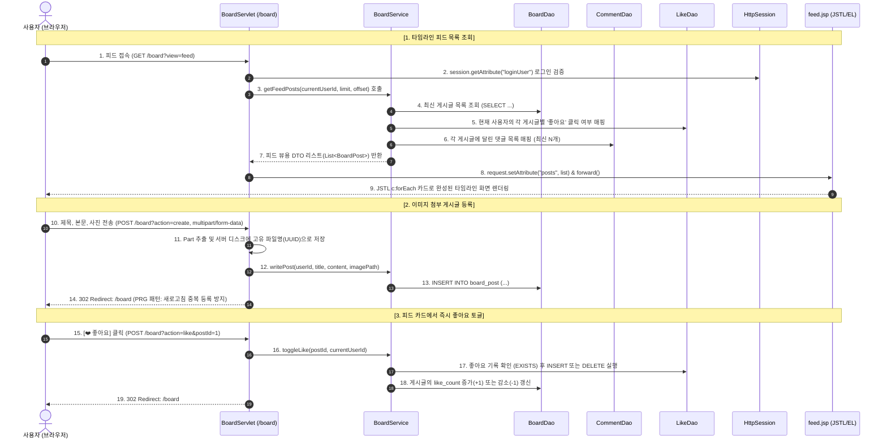

# [실습 & 설계 가이드] 타임라인 피드(Feed)형 SNS 스타일 게시판 기획 및 아키텍처 설계

이 문서는 전통적인 단순 표(Table) 형태의 텍스트 리스트를 벗어나, **페이스북(Facebook)이나 인스타그램, 트위터(X)처럼 사용자가 스크롤을 내리며 글 본문과 첨부 이미지를 즉시 확인할 수 있는 '타임라인 피드(Feed)형 게시판'**을 구축하기 위한 **수석 기획 및 풀스택 아키텍처 설계 가이드**입니다.

현재 프로젝트(`Survlet_practice`, Jakarta EE 10, Servlet 6.1, Tomcat 10+, MySQL, Gradle)의 MVC 패턴과 **오늘 학습한 JSTL(Jakarta Standard Tag Library) 및 EL(Expression Language)** 문법을 100% 활용하여 실무 수준의 완성도 높은 반응형 피드 서비스를 설계합니다.

> 💡 **수석 기획자 & 풀스택 아키텍트의 설계 노트**:  
> 현대 웹 UI/UX의 패러다임은 "목록을 보고 클릭해서 본문으로 들어가는 단절된 탐색(List-Detail Pattern)"에서, **"스트림을 따라 자연스럽게 콘텐츠를 소비하는 인라인 피드 탐색(Continuous Feed Pattern)"**으로 진화했습니다.  
> 복잡한 프론트엔드 프레임워크(React/Vue) 없이도, 서블릿의 정교한 데이터 모델링과 **JSTL(`<c:forEach>`, `<c:if>`, `<c:choose>`) / EL(`${...}`)의 서버 사이드 렌더링(SSR)** 역량을 극대화하면 유려하고 직관적인 SNS 피드 사용자 경험을 완벽하게 구현할 수 있습니다.

---

## 📌 목차
1. [기획 배경 및 UI/UX 콘셉트 (피드형 vs 리스트형)](#1-기획-배경-및-uiux-콘셉트-피드형-vs-리스트형)
2. [화면 레이아웃 스케치 및 와이어프레임 (UI Layout Sketch)](#2-화면-레이아웃-스케치-및-와이어프레임-ui-layout-sketch)
3. [전체 동작 흐름 (시퀀스 다이어그램)](#3-전체-동작-흐름-시퀀스-다이어그램)
4. [프로젝트 구조 및 작업 파일 배치도](#4-프로젝트-구조-및-작업-파일-배치도)
5. [데이터베이스 설계 (MySQL 스키마 & DDL)](#5-데이터베이스-설계-mysql-스키마--ddl)
6. [데이터 모델(DTO) 설계 (`BoardPost`, `BoardComment`, `BoardLike`)](#6-데이터-모델dto-설계-boardpost-boardcomment-boardlike)
7. [서블릿(Controller) 및 라우팅 흐름 설계 (`BoardServlet.java`)](#7-서블릿controller-및-라우팅-흐름-설계-boardservletjava)
8. [멀티파트(Multipart) 이미지 업로드 처리 아키텍처](#8-멀티파트multipart-이미지-업로드-처리-아키텍처)
9. [JSTL & EL 기반 피드 뷰 템플릿 설계 (`WEB-INF/views/board/feed.jsp`)](#9-jstl--el-기반-피드-뷰-템플릿-설계-web-infviewsboardfeedjsp)
10. [성능 및 UX 확장: 무한 스크롤(Infinite Scroll) & '더보기' 페이징 전략](#10-성능-및-ux-확장-무한-스크롤infinite-scroll--더보기-페이징-전략)
11. [핵심 체크리스트 & 자주 묻는 질문 (FAQ)](#11-핵심-체크리스트--자주-묻는-질문-faq)

---

## 1. 기획 배경 및 UI/UX 콘셉트 (피드형 vs 리스트형)

### 📊 1. 기존 게시판(List)과 피드형 게시판(Feed) 비교

| 비교 항목 | 전통적인 리스트형 (List Board) | 피드형 타임라인 (Feed Timeline) |
| :--- | :--- | :--- |
| **콘텐츠 노출 방식** | 글 번호, 제목, 작성자, 날짜만 표에 나열 | **작성자 프로필, 본문 미리보기/전체, 이미지**가 카드 한 장에 일체형 노출 |
| **사용자 인터랙션** | 제목 클릭 ➜ 상세 페이지 이동 ➜ 뒤로 가기 (화면 전환 빈번) | **스크롤 다운**으로 즉시 읽기, 카드 내에서 **'좋아요/댓글' 즉각 반응** |
| **미디어 소비 경험** | 첨부파일 아이콘을 누르거나 상세에 들어가야 사진 확인 가능 | 타임라인 상에서 **시각적 이미지 카드**를 바로 감상 |
| **주요 활용 목적** | 공지사항, 규정집, 사내 문서 검색 등 아카이빙 용도 | **사내 일상 공유, 소통, 사진 중심 포스팅, 트렌디한 커뮤니티** |

### 🎯 2. 핵심 UI/UX 설계 원칙
1. **Card-Centric Design (카드 중심 레이아웃)**:
   - 각 게시글은 독립된 그림자(`box-shadow`)와 둥근 모서리(`border-radius: 12px`)를 가진 흰색 카드로 렌더링됩니다.
   - 글 상단(작성자, 시간, 더보기 메뉴) ➜ 중단(제목, 본문, 이미지) ➜ 하단(좋아요 버튼, 댓글 카운터) ➜ 최하단(인라인 댓글 목록 및 입력창)으로 시선이 자연스럽게 흐릅니다.
2. **원스톱 인터랙션 (In-Place Interaction)**:
   - 상세 페이지로 굳이 이동하지 않고도 피드 카드에서 즉시 **'좋아요 토글'** 및 **'댓글 등록'**을 수행합니다.
3. **듀얼 뷰 토글 (Dual-View Switcher)**:
   - 빠른 스캔을 원하는 사용자와 비주얼 피드를 원하는 사용자 모두를 만족시키기 위해, 우측 상단에 `[🖼️ 피드형]` / `[📑 리스트형]` 뷰 전환 토글을 제공합니다 (`?view=feed` ⮂ `?view=list`).

---

## 2. 화면 레이아웃 스케치 및 와이어프레임 (UI Layout Sketch)

### 🖥️ 화면 1: 타임라인 메인 피드 뷰 (`view=feed`)

```text
+-----------------------------------------------------------------------------------+
|  [Logo] 교보 웹 포털       [🏠 대시보드]   [📝 TODO]   [📋 피드게시판]    백종민님 [로그아웃]  |
+-----------------------------------------------------------------------------------+
|                                                                                   |
|                                [ 메인 피드 컨테이너 (최대 너비: 680px) ]                  |
|                                                                                   |
|  +-----------------------------------------------------------------------------+  |
|  |  📝 [새로운 소식 작성하기] (Quick Post Box)                                     |  |
|  |  +-----------------------------------------------------------------------+  |  |
|  |  | 글 제목을 입력하세요...                                                |  |  |
|  |  +-----------------------------------------------------------------------+  |  |
|  |  | 나누고 싶은 이야기나 생각을 자유롭게 공유해보세요...                    |  |  |
|  |  |                                                                       |  |  |
|  |  +-----------------------------------------------------------------------+  |  |
|  |  [ 📷 사진 첨부 (파일선택) ]   [미리보기: sample.png]           [ 게시하기 (등록) ] |  |
|  +-----------------------------------------------------------------------------+  |
|                                                                                   |
|  [ 🔄 최신순 정렬 ]                                         보기 방식: [🖼️ 피드] [📑 목록] |
|                                                                                   |
|  +-----------------------------------------------------------------------------+  |
|  | [피드 카드 #1]                                                               |  |
|  | 👤 김유진  ·  2026.10.12 11:20                          [ ⋯ 메뉴: 수정 / 삭제 ]|  |
|  | --------------------------------------------------------------------------- |  |
|  | 📌 오늘 팀 점심 회식 다녀왔습니다! (제목)                                      |  |
|  |                                                                             |  |
|  | 광화문 교보문고 옆 맛집에서 다 같이 파스타 먹었어요!                            |  |
|  | 날씨도 좋고 오랜만에 팀원들과 즐거운 시간이었습니다. 😊                        |  |
|  |                                                                             |  |
|  | +-------------------------------------------------------------------------+ |  |
|  | |                                                                         | |  |
|  | |                        [ 첨부된 고화질 이미지 영역 ]                      | |  |
|  | |                                                                         | |  |
|  | +-------------------------------------------------------------------------+ |  |
|  |                                                                             |  |
|  | [ ❤️ 좋아요 5 ]      [ 💬 댓글 2 ]                                           |  |
|  | --------------------------------------------------------------------------- |  |
|  | 💬 댓글 목록:                                                               |  |
|  |   - 백종민: 정말 맛있어 보이네요! 다음엔 저도 같이 가요~ (11:25) [x]          |  |
|  |   - 박지성: 파스타 비주얼 대박입니다 👍 (11:40)                                |  |
|  |                                                                             |  |
|  | +---------------------------------------------------------+ +-------------+ |  |
|  | | 따뜻한 댓글을 남겨보세요...                             | | [댓글 작성] | |  |
|  | +---------------------------------------------------------+ +-------------+ |  |
|  +-----------------------------------------------------------------------------+  |
|                                                                                   |
|  +-----------------------------------------------------------------------------+  |
|  | [피드 카드 #2] (이미지가 없는 순수 텍스트 카드)                              |  |
|  | 👤 백종민  ·  2026.10.12 09:15                          [ ⋯ 메뉴: 수정 / 삭제 ]|  |
|  | --------------------------------------------------------------------------- |  |
|  | 📌 Servlet 6.1과 JSTL 3.0 연동 팁 공유                                      |  |
|  |                                                                             |  |
|  | webapp/WEB-INF/views 경로 보호와 JSTL core 태그 라이브러리 URI                 |  |
|  | jakarta.tags.core 로 변경하는 부분 잊지 마세요!                               |  |
|  |                                                                             |  |
|  | [ 🤍 좋아요 2 ]      [ 💬 댓글 0 ]                                           |  |
|  | --------------------------------------------------------------------------- |  |
|  | +---------------------------------------------------------+ +-------------+ |  |
|  | | 따뜻한 댓글을 남겨보세요...                             | | [댓글 작성] | |  |
|  | +---------------------------------------------------------+ +-------------+ |  |
|  +-----------------------------------------------------------------------------+  |
|                                                                                   |
|                         [ ⬇️ 더 많은 이야기 불러오기 (더보기) ]                     |
+-----------------------------------------------------------------------------------+
```

---

### 🖥️ 화면 2: 전통적 리스트 뷰 (`view=list`) (토글 전환 시)

```text
+-----------------------------------------------------------------------------------+
|  [Logo] 교보 웹 포털       [🏠 대시보드]   [📝 TODO]   [📋 피드게시판]    백종민님 [로그아웃]  |
+-----------------------------------------------------------------------------------+
|                                                                                   |
|  [전체 게시글 목록 (테이블 뷰)]                              보기 방식: [🖼️ 피드] [📑 목록] |
|  +-----------------------------------------------------------------------------+  |
|  | 번호  | 제목 (미디어 여부)                      | 작성자  | 작성일     | 좋아요 | 댓글 |  |
|  +-------+-----------------------------------------+---------+------------+--------+------+  |
|  |  2    | 오늘 팀 점심 회식 다녀왔습니다! [📷]     | 김유진  | 2026.10.12 |   5    |  2   |  |
|  |  1    | Servlet 6.1과 JSTL 3.0 연동 팁 공유     | 백종민  | 2026.10.12 |   2    |  0   |  |
|  +-----------------------------------------------------------------------------+  |
|                                                                                   |
|  [ ◀ 이전 ]                     [ 1 ]  2  3  4  5                      [ 다음 ▶ ]  |
+-----------------------------------------------------------------------------------+
```

---

## 3. 전체 동작 흐름 (시퀀스 다이어그램)

피드형 게시판의 주요 핵심 흐름인 **1) 피드 스트림 조회**, **2) 이미지 첨부 글 등록 (Multipart)**, **3) 좋아요 토글** 시퀀스입니다.



---

## 4. 프로젝트 구조 및 작업 파일 배치도

현재 프로젝트 구조(`com.kyobo.web`)와 폴더 컨벤션에 맞춰 확장 배치합니다.

```text
Survlet_practice/
 ├── sql/
 │    ├── todo_schema.sql         (기존 유지)
 │    └── board_schema.sql        [신규 생성] 게시글, 댓글, 좋아요 테이블 DDL 및 샘플 데이터
 └── src/
      └── main/
           ├── java/
           │    └── com/kyobo/web/
           │         ├── config/
           │         │    └── ConnectionProvider.java   (기존 유지 - DB 커넥션 제공)
           │         ├── controller/
           │         │    ├── LoginServlet.java         (기존 유지)
           │         │    ├── LogoutServlet.java        (기존 유지)
           │         │    ├── MainServlet.java          (기존 유지)
           │         │    ├── TodoServlet.java          (기존 유지)
           │         │    └── BoardServlet.java         [신규 생성] 피드/목록 라우팅, CRUD, 인터랙션 총괄
           │         ├── dao/
           │         │    ├── MemberDao.java / JdbcMemberDao.java (기존)
           │         │    ├── TodoDao.java / JdbcTodoDao.java     (기존)
           │         │    ├── BoardDao.java             [신규 생성] 게시글 CRUD 및 조회 인터페이스
           │         │    ├── JdbcBoardDao.java         [신규 생성] 게시글 JDBC 구현체
           │         │    ├── CommentDao.java           [신규 생성] 댓글 등록/삭제/조회 인터페이스
           │         │    ├── JdbcCommentDao.java       [신규 생성] 댓글 JDBC 구현체
           │         │    ├── LikeDao.java              [신규 생성] 좋아요 토글 및 여부 확인 인터페이스
           │         │    └── JdbcLikeDao.java          [신규 생성] 좋아요 JDBC 구현체
           │         ├── model/
           │         │    ├── Member.java / TodoItem.java (기존)
           │         │    ├── BoardPost.java            [신규 생성] 게시글 DTO (좋아요수, 댓글리스트 포함)
           │         │    ├── BoardComment.java         [신규 생성] 댓글 DTO
           │         │    └── BoardLike.java            [신규 생성] 좋아요 DTO
           │         └── service/
           │              ├── MemberService.java / TodoService.java (기존)
           │              └── BoardService.java         [신규 생성] 게시판 트랜잭션 및 유효성 비즈니스 로직
           └── webapp/
                ├── assets/
                │    ├── css/
                │    │    ├── style.css                 (기존)
                │    │    ├── todo.css                  (기존)
                │    │    └── board.css                 [신규 생성] 타임라인 피드 전용 모던 SNS 스타일시트
                │    └── uploads/
                │         └── board/                    [신규 생성] 첨부된 이미지 파일 실제 저장 폴더
                └── WEB-INF/
                     └── views/
                          ├── login.jsp                 (기존)
                          ├── main.jsp                  [기존 수정] '자유 게시판' 카드 링크 활성화 (/board)
                          ├── todo/list.jsp             (기존)
                          └── board/
                               ├── feed.jsp             [신규 생성] 타임라인 피드형 뷰 (메인)
                               ├── list.jsp             [신규 생성] 전통적 리스트 표 형태 뷰 (토글용)
                               └── edit.jsp             [신규 생성] 게시글 수정 화면
```

### 📂 파일별 역할 및 책임 분담표

| 계층 | 대상 파일 | 주요 역할 및 기능 |
| :--- | :--- | :--- |
| **SQL** | `board_schema.sql` | `board_post`, `board_comment`, `board_like` 테이블 스키마 및 외래키, 인덱스 설정 |
| **Model** | `BoardPost.java` | 게시글 번호, 제목, 본문, 작성자, 사진경로, `likeCount`, `commentCount`, `isLikedByMe`, `comments` 목록을 담는 핵심 DTO |
| **Model** | `BoardComment.java` | 댓글 번호, 게시글 번호, 댓글 작성자, 내용, 작성일시 DTO |
| **DAO** | `JdbcBoardDao.java` | 게시글 페이징 조회(`LIMIT, OFFSET`), 글 등록/수정/삭제, 카운트 증감 SQL 수행 |
| **DAO** | `JdbcCommentDao.java`| 특정 게시글에 달린 댓글 조회, 신규 댓글 추가, 본인 댓글 삭제 SQL 수행 |
| **DAO** | `JdbcLikeDao.java`   | 특정 사용자가 특정 글에 좋아요를 눌렀는지 확인(`EXISTS`), 추가(`INSERT`), 취소(`DELETE`) |
| **Service** | `BoardService.java` | 게시글 작성 시 유효성 검사, 수정/삭제 시 본인 권한 검증, 피드 조회 시 게시글+댓글+좋아요 조합 |
| **Controller** | `BoardServlet.java` | `@WebServlet("/board")`, `@MultipartConfig`. 피드 출력(GET), 글 등록/수정/삭제, 댓글, 좋아요(POST) 처리 |
| **View (UI)** | `board.css` | 페이스북/인스타 감성의 카드 섀도우, 반응형 이미지 컨테이너, 모달, 버튼 애니메이션 스타일 |
| **View (UI)** | `board/feed.jsp` | **JSTL `<c:forEach>`, `<c:if>`, `<c:choose>`와 EL**로 피드 카드를 조립하는 타임라인 뷰 |

---

## 5. 데이터베이스 설계 (MySQL 스키마 & DDL)

데이터 무결성을 위해 외래키(`FOREIGN KEY ... ON DELETE CASCADE`)를 적용하고, 빠른 피드 렌더링 성능을 위해 `like_count`, `comment_count`를 게시글 테이블에 비정규화(Denormalization) 캐싱 컬럼으로 배치합니다.

- **파일 위치**: `sql/board_schema.sql`

```sql
-- 1. kyobo 데이터베이스 사용
USE kyobo;

-- 2. 게시글 테이블 (board_post)
CREATE TABLE IF NOT EXISTS board_post (
    post_id BIGINT AUTO_INCREMENT PRIMARY KEY COMMENT '게시글 고유 번호',
    user_id VARCHAR(50) NOT NULL COMMENT '작성자 회원 아이디',
    title VARCHAR(200) NOT NULL COMMENT '게시글 제목',
    content TEXT NOT NULL COMMENT '게시글 본문 내용 (개행 포함)',
    image_path VARCHAR(255) NULL COMMENT '업로드된 첨부 이미지 웹 상대 경로 (예: /assets/uploads/board/uuid.jpg)',
    like_count INT DEFAULT 0 COMMENT '좋아요 누적 수 (조회 성능 최적화용)',
    comment_count INT DEFAULT 0 COMMENT '댓글 누적 수 (조회 성능 최적화용)',
    created_at TIMESTAMP DEFAULT CURRENT_TIMESTAMP COMMENT '최초 작성일시',
    updated_at TIMESTAMP DEFAULT CURRENT_TIMESTAMP ON UPDATE CURRENT_TIMESTAMP COMMENT '최종 수정일시',
    
    CONSTRAINT fk_board_post_member 
        FOREIGN KEY (user_id) REFERENCES member(user_id) ON DELETE CASCADE,
    INDEX idx_board_post_created (created_at DESC)
) ENGINE=InnoDB DEFAULT CHARSET=utf8mb4 COLLATE=utf8mb4_0900_ai_ci COMMENT='피드 게시판 본문 테이블';

-- 3. 댓글 테이블 (board_comment)
CREATE TABLE IF NOT EXISTS board_comment (
    comment_id BIGINT AUTO_INCREMENT PRIMARY KEY COMMENT '댓글 고유 번호',
    post_id BIGINT NOT NULL COMMENT '소속 게시글 번호',
    user_id VARCHAR(50) NOT NULL COMMENT '댓글 작성자 회원 아이디',
    content VARCHAR(1000) NOT NULL COMMENT '댓글 내용',
    created_at TIMESTAMP DEFAULT CURRENT_TIMESTAMP COMMENT '댓글 작성일시',
    
    CONSTRAINT fk_board_comment_post 
        FOREIGN KEY (post_id) REFERENCES board_post(post_id) ON DELETE CASCADE,
    CONSTRAINT fk_board_comment_member 
        FOREIGN KEY (user_id) REFERENCES member(user_id) ON DELETE CASCADE,
    INDEX idx_board_comment_post_created (post_id, created_at ASC)
) ENGINE=InnoDB DEFAULT CHARSET=utf8mb4 COLLATE=utf8mb4_0900_ai_ci COMMENT='피드 게시글 댓글 테이블';

-- 4. 좋아요 테이블 (board_like)
-- 복합 기본키(post_id, user_id)를 통해 1인당 1개 게시글에 1회만 좋아요 가능하도록 물리적 제약
CREATE TABLE IF NOT EXISTS board_like (
    post_id BIGINT NOT NULL COMMENT '게시글 번호',
    user_id VARCHAR(50) NOT NULL COMMENT '좋아요를 누른 회원 아이디',
    created_at TIMESTAMP DEFAULT CURRENT_TIMESTAMP COMMENT '좋아요 누른 시간',
    
    PRIMARY KEY (post_id, user_id),
    CONSTRAINT fk_board_like_post 
        FOREIGN KEY (post_id) REFERENCES board_post(post_id) ON DELETE CASCADE,
    CONSTRAINT fk_board_like_member 
        FOREIGN KEY (user_id) REFERENCES member(user_id) ON DELETE CASCADE
) ENGINE=InnoDB DEFAULT CHARSET=utf8mb4 COLLATE=utf8mb4_0900_ai_ci COMMENT='게시글 좋아요 상태 테이블';

-- 5. 테스트용 초기 피드 샘플 데이터 삽입
INSERT INTO board_post (user_id, title, content, image_path, like_count, comment_count, created_at)
VALUES
    ('김유진', '오늘 팀 점심 회식 다녀왔습니다! 🍕', 
     '광화문 교보빌딩 근처 맛집에서 팀원들과 점심 회식했어요!\n피자와 파스타가 정말 훌륭했습니다. 다들 즐거운 한 주 보내세요 :)', 
     '/assets/uploads/board/sample_pizza.jpg', 1, 2, '2026-10-12 11:20:00'),
    ('백종민', 'Servlet 6.1과 JSTL 3.0 설정 시 유의사항', 
     'Jakarta EE 10으로 오면서 JSTL 태그 라이브러리 URI가 변경되었습니다.\n기존 http://java.sun.com 대신 jakarta.tags.core 를 꼭 사용하세요!', 
     NULL, 1, 0, '2026-10-12 09:15:00')
ON DUPLICATE KEY UPDATE title = VALUES(title);

-- 6. 테스트용 댓글 샘플 데이터 삽입
INSERT INTO board_comment (post_id, user_id, content, created_at)
VALUES
    (1, '백종민', '와 비주얼 대박이네요! 다음엔 저도 꼭 불러주세요 ㅎㅎ', '2026-10-12 11:25:00'),
    (1, '김유진', '네 종민님! 다음엔 팀 전체 다 같이 가요~', '2026-10-12 11:30:00');

-- 7. 테스트용 좋아요 샘플 데이터 삽입
INSERT INTO board_like (post_id, user_id)
VALUES
    (1, '백종민'),
    (2, '김유진')
ON DUPLICATE KEY UPDATE created_at = CURRENT_TIMESTAMP;
```

---

## 6. 데이터 모델(DTO) 설계 (`BoardPost`, `BoardComment`, `BoardLike`)

피드형 타임라인에서는 **게시글 하나를 렌더링할 때 "작성자의 실명", "내가 좋아요를 눌렀는지 여부", "해당 글에 달린 최신 댓글 목록"**이 한 번에 필요합니다.  
따라서 DTO를 단순 1:1 테이블 매핑에 머무르지 않고, 화면 표현에 최적화된 필드를 함께 품도록 설계합니다.

### 1) 게시글 DTO (`BoardPost.java`)
- **위치**: `src/main/java/com/kyobo/web/model/BoardPost.java`

```java
package com.kyobo.web.model;

import java.io.Serializable;
import java.sql.Timestamp;
import java.util.ArrayList;
import java.util.List;

public class BoardPost implements Serializable {
    private static final long serialVersionUID = 1L;

    private Long postId;              // 게시글 번호
    private String userId;            // 작성자 ID (회원 식별자)
    private String authorName;        // 작성자 실명/닉네임 (JOIN member.name)
    private String title;             // 제목
    private String content;           // 본문
    private String imagePath;         // 업로드된 이미지 상대 경로
    private int likeCount;            // 좋아요 수
    private int commentCount;         // 댓글 수
    private Timestamp createdAt;      // 작성일시
    private Timestamp updatedAt;      // 수정일시

    // [피드 화면을 위한 특화 필드]
    private boolean likedByMe;        // 현재 로그인한 사용자가 좋아요를 눌렀는지 여부
    private List<BoardComment> comments = new ArrayList<>(); // 해당 글에 달린 댓글 리스트

    public BoardPost() {}

    // Getter & Setter 메서드 생략 (표준 JavaBean 규격 준수)
    public Long getPostId() { return postId; }
    public void setPostId(Long postId) { this.postId = postId; }
    public String getUserId() { return userId; }
    public void setUserId(String userId) { this.userId = userId; }
    public String getAuthorName() { return authorName; }
    public void setAuthorName(String authorName) { this.authorName = authorName; }
    public String getTitle() { return title; }
    public void setTitle(String title) { this.title = title; }
    public String getContent() { return content; }
    public void setContent(String content) { this.content = content; }
    public String getImagePath() { return imagePath; }
    public void setImagePath(String imagePath) { this.imagePath = imagePath; }
    public int getLikeCount() { return likeCount; }
    public void setLikeCount(int likeCount) { this.likeCount = likeCount; }
    public int getCommentCount() { return commentCount; }
    public void setCommentCount(int commentCount) { this.commentCount = commentCount; }
    public Timestamp getCreatedAt() { return createdAt; }
    public void setCreatedAt(Timestamp createdAt) { this.createdAt = createdAt; }
    public Timestamp getUpdatedAt() { return updatedAt; }
    public void setUpdatedAt(Timestamp updatedAt) { this.updatedAt = updatedAt; }
    public boolean isLikedByMe() { return likedByMe; }
    public void setLikedByMe(boolean likedByMe) { this.likedByMe = likedByMe; }
    public List<BoardComment> getComments() { return comments; }
    public void setComments(List<BoardComment> comments) { this.comments = comments; }
}
```

### 2) 댓글 DTO (`BoardComment.java`)
- **위치**: `src/main/java/com/kyobo/web/model/BoardComment.java`

```java
package com.kyobo.web.model;

import java.io.Serializable;
import java.sql.Timestamp;

public class BoardComment implements Serializable {
    private static final long serialVersionUID = 1L;

    private Long commentId;           // 댓글 고유 번호
    private Long postId;              // 소속 게시글 번호
    private String userId;            // 댓글 작성자 ID
    private String authorName;        // 댓글 작성자 실명 (JOIN member.name)
    private String content;           // 댓글 내용
    private Timestamp createdAt;      // 작성일시

    public BoardComment() {}

    // Getter & Setter 규격
    public Long getCommentId() { return commentId; }
    public void setCommentId(Long commentId) { this.commentId = commentId; }
    public Long getPostId() { return postId; }
    public void setPostId(Long postId) { this.postId = postId; }
    public String getUserId() { return userId; }
    public void setUserId(String userId) { this.userId = userId; }
    public String getAuthorName() { return authorName; }
    public void setAuthorName(String authorName) { this.authorName = authorName; }
    public String getContent() { return content; }
    public void setContent(String content) { this.content = content; }
    public Timestamp getCreatedAt() { return createdAt; }
    public void setCreatedAt(Timestamp createdAt) { this.createdAt = createdAt; }
}
```

---

## 7. 서블릿(Controller) 및 라우팅 흐름 설계 (`BoardServlet.java`)

기존 `TodoServlet.java`와 동일하게 **단일 중앙 컨트롤러(Front Controller 패턴 변형)** 형태로 라우팅을 집중화하여, 코드의 일관성과 유지보수성을 극대화합니다.

### 🌐 라우팅 명세 (Endpoints)

| HTTP 메서드 | 요청 URL & 파라미터 | 처리 액션 및 흐름 | 최종 목적지 |
| :--- | :--- | :--- | :--- |
| **GET** | `/board` (기본값) | 피드형 타임라인 렌더링 (`view=feed`) | Forward ➜ `/WEB-INF/views/board/feed.jsp` |
| **GET** | `/board?view=list` | 전통적인 표 목록 렌더링 (`view=list`) | Forward ➜ `/WEB-INF/views/board/list.jsp` |
| **GET** | `/board?action=edit&postId=1` | 게시글 수정 화면 요청 (작성자 본인 검증) | Forward ➜ `/WEB-INF/views/board/edit.jsp` |
| **POST** | `/board?action=create` | 신규 피드 등록 (제목, 본문, 이미지 파일) | Redirect ➜ `/board` (PRG) |
| **POST** | `/board?action=update` | 게시글 수정 완료 처리 | Redirect ➜ `/board#post-1` (PRG) |
| **POST** | `/board?action=delete` | 게시글 삭제 처리 (작성자 본인 검증) | Redirect ➜ `/board` (PRG) |
| **POST** | `/board?action=comment` | 인라인 댓글 등록 | Redirect ➜ `/board#post-1` (해당 카드로 이동) |
| **POST** | `/board?action=commentDelete`| 본인 댓글 삭제 | Redirect ➜ `/board#post-1` |
| **POST** | `/board?action=like` | '좋아요' 토글 (추가/취소 자동 판단) | Redirect ➜ `/board#post-1` |

### 💻 컨트롤러 핵심 코드 골격

- **위치**: `src/main/java/com/kyobo/web/controller/BoardServlet.java`

```java
package com.kyobo.web.controller;

import com.kyobo.web.dao.JdbcBoardDao;
import com.kyobo.web.dao.JdbcCommentDao;
import com.kyobo.web.dao.JdbcLikeDao;
import com.kyobo.web.model.BoardPost;
import com.kyobo.web.model.Member;
import com.kyobo.web.service.BoardService;
import jakarta.servlet.ServletException;
import jakarta.servlet.annotation.MultipartConfig;
import jakarta.servlet.annotation.WebServlet;
import jakarta.servlet.http.*;

import java.io.File;
import java.io.IOException;
import java.nio.file.Paths;
import java.util.List;
import java.util.UUID;

/**
 * [신규] 타임라인 피드형 게시판 컨트롤러
 * - @MultipartConfig: 이미지 파일 업로드 지원
 */
@WebServlet("/board")
@MultipartConfig(
    fileSizeThreshold = 1024 * 1024,      // 1MB 이상 시 디스크 임시 저장
    maxFileSize = 1024 * 1024 * 10,       // 개별 파일 최대 10MB
    maxRequestSize = 1024 * 1024 * 20     // 전체 요청 최대 20MB
)
public class BoardServlet extends HttpServlet {

    private BoardService boardService;

    @Override
    public void init() {
        this.boardService = new BoardService(
            new JdbcBoardDao(),
            new JdbcCommentDao(),
            new JdbcLikeDao()
        );
    }

    @Override
    protected void doGet(HttpServletRequest req, HttpServletResponse resp) 
            throws ServletException, IOException {
        
        Member loginUser = getLoginUser(req);
        if (loginUser == null) {
            resp.sendRedirect(req.getContextPath() + "/login");
            return;
        }

        String action = req.getParameter("action");
        String view = req.getParameter("view");
        if (view == null || view.isBlank()) {
            view = "feed"; // 기본 뷰는 트렌디한 피드형
        }

        try {
            if ("edit".equals(action)) {
                // 수정 화면 포워드
                Long postId = Long.parseLong(req.getParameter("postId"));
                BoardPost post = boardService.getPostForEdit(postId, loginUser.getUserId());
                req.setAttribute("post", post);
                req.getRequestDispatcher("/WEB-INF/views/board/edit.jsp").forward(req, resp);
                return;
            }

            // 피드 또는 리스트 조회
            List<BoardPost> posts = boardService.getPostList(loginUser.getUserId());
            req.setAttribute("posts", posts);
            req.setAttribute("currentView", view);

            if ("list".equals(view)) {
                req.getRequestDispatcher("/WEB-INF/views/board/list.jsp").forward(req, resp);
            } else {
                req.getRequestDispatcher("/WEB-INF/views/board/feed.jsp").forward(req, resp);
            }

        } catch (Exception e) {
            throw new ServletException("게시판 조회 중 오류가 발생했습니다.", e);
        }
    }

    @Override
    protected void doPost(HttpServletRequest req, HttpServletResponse resp) 
            throws ServletException, IOException {
        req.setCharacterEncoding("UTF-8");

        Member loginUser = getLoginUser(req);
        if (loginUser == null) {
            resp.sendRedirect(req.getContextPath() + "/login");
            return;
        }

        String action = req.getParameter("action");
        String currentUserId = loginUser.getUserId();

        try {
            if ("create".equals(action)) {
                // 1. 글 등록 + 이미지 업로드
                String title = req.getParameter("title");
                String content = req.getParameter("content");
                Part filePart = req.getPart("imageFile");
                String savedImagePath = processImageUpload(filePart, req);

                boardService.createPost(currentUserId, title, content, savedImagePath);
                resp.sendRedirect(req.getContextPath() + "/board");

            } else if ("like".equals(action)) {
                // 2. 좋아요 토글
                Long postId = Long.parseLong(req.getParameter("postId"));
                boardService.toggleLike(postId, currentUserId);
                resp.sendRedirect(req.getContextPath() + "/board#post-" + postId);

            } else if ("comment".equals(action)) {
                // 3. 댓글 작성
                Long postId = Long.parseLong(req.getParameter("postId"));
                String commentText = req.getParameter("commentContent");
                boardService.addComment(postId, currentUserId, commentText);
                resp.sendRedirect(req.getContextPath() + "/board#post-" + postId);

            } else if ("delete".equals(action)) {
                // 4. 글 삭제
                Long postId = Long.parseLong(req.getParameter("postId"));
                boardService.deletePost(postId, currentUserId);
                resp.sendRedirect(req.getContextPath() + "/board");
            }

        } catch (Exception e) {
            req.getSession().setAttribute("flashError", e.getMessage());
            resp.sendRedirect(req.getContextPath() + "/board");
        }
    }

    private String processImageUpload(Part filePart, HttpServletRequest req) throws IOException {
        if (filePart == null || filePart.getSize() == 0) {
            return null;
        }
        String fileName = Paths.get(filePart.getSubmittedFileName()).getFileName().toString();
        if (fileName == null || fileName.isBlank()) return null;

        String extension = "";
        int dotIdx = fileName.lastIndexOf('.');
        if (dotIdx > 0) extension = fileName.substring(dotIdx);

        String uniqueFileName = UUID.randomUUID().toString() + extension;
        String uploadDir = req.getServletContext().getRealPath("/assets/uploads/board");

        File dir = new File(uploadDir);
        if (!dir.exists()) dir.mkdirs();

        filePart.write(uploadDir + File.separator + uniqueFileName);
        return "/assets/uploads/board/" + uniqueFileName;
    }

    private Member getLoginUser(HttpServletRequest req) {
        HttpSession session = req.getSession(false);
        return (session != null) ? (Member) session.getAttribute("loginUser") : null;
    }
}
```

---

## 8. 멀티파트(Multipart) 이미지 업로드 처리 아키텍처

### 📸 1. 업로드 파이프라인
1. **HTML 폼 속성**:
   - 피드 글쓰기 폼에 반드시 `enctype="multipart/form-data"`와 `method="POST"`를 선언합니다.
2. **서블릿 표준 어노테이션 (`@MultipartConfig`)**:
   - Apache Commons FileUpload 같은 구형 외부 라이브러리 없이 Servlet 3.0+부터 내장된 `request.getPart("imageFile")`를 사용합니다.
3. **파일명 난수화(UUID)**:
   - 사용자가 올린 원래 파일명(예: `사진.jpg`) 그대로 저장하면 한글 인코딩 깨짐 및 동일 이름 덮어쓰기 문제가 발생하므로 `UUID.randomUUID() + 확장자` 형태로 고유 파일명을 생성합니다.
4. **저장 위치 및 웹 서빙**:
   - 배포 디렉터리(`getServletContext().getRealPath("/assets/uploads/board")`)에 저장하여 브라우저에서 `${pageContext.request.contextPath}/assets/uploads/board/...` URL로 즉시 정적 리소스로 내려받을 수 있게 구성합니다.

---

## 9. JSTL & EL 기반 피드 뷰 템플릿 설계 (`WEB-INF/views/board/feed.jsp`)

오늘 학습한 **JSTL 태그 라이브러리와 EL 표현식**이 피드 카드 렌더링에 어떻게 예술적으로 녹아드는지 보여주는 핵심 템플릿 구조입니다.

### 🏷️ 사용되는 핵심 JSTL & EL 문법 체크
- `<%@ taglib prefix="c" uri="jakarta.tags.core" %>`: 반복문(`c:forEach`), 분기문(`c:if`, `c:choose`)
- `<%@ taglib prefix="fmt" uri="jakarta.tags.fmt" %>`: 작성일시 포맷팅(`fmt:formatDate`)
- `${post.title}`, `${post.content}`: 게시글 속성 바인딩
- `<c:if test="${not empty post.imagePath}">`: 이미지가 있을 때만 반응형 미디어 카드 출력
- `<c:if test="${post.userId eq sessionScope.loginUser.userId}">`: **작성자 본인에게만 [수정/삭제] 버튼 노출**
- `<c:choose>`: 좋아요 클릭 여부(`post.likedByMe`)에 따라 **빨간 하트(❤️) / 빈 하트(🤍)** 동적 표시

### 💻 피드 뷰 소스코드 스니펫 (`feed.jsp`)

```jsp
<%@ page contentType="text/html; charset=UTF-8" pageEncoding="UTF-8" %>
<%@ taglib prefix="c" uri="jakarta.tags.core" %>
<%@ taglib prefix="fmt" uri="jakarta.tags.fmt" %>

<!DOCTYPE html>
<html lang="ko">
<head>
    <meta charset="UTF-8">
    <title>타임라인 피드 - 교보 웹 포털</title>
    <!-- 기존 공통 스타일 및 피드 전용 스타일 링크 -->
    <link rel="stylesheet" href="${pageContext.request.contextPath}/assets/css/todo.css">
    <link rel="stylesheet" href="${pageContext.request.contextPath}/assets/css/board.css">
</head>
<body>

<div class="feed-container">

    <!-- 1. 상단 내비게이션 & 사용자 정보 바 -->
    <div class="user-bar">
        <div class="user-badge">
            👤 <strong>${sessionScope.loginUser.name}</strong> (${sessionScope.loginUser.userId})님
        </div>
        <div class="nav-links">
            <a href="${pageContext.request.contextPath}/main" class="nav-link">🏠 대시보드</a>
            <a href="${pageContext.request.contextPath}/todo" class="nav-link">📝 TODO</a>
            <a href="${pageContext.request.contextPath}/logout" class="btn-logout">로그아웃</a>
        </div>
    </div>

    <!-- 2. 피드 헤더 & 뷰 전환 토글 (Feed vs List) -->
    <div class="feed-header-bar">
        <div>
            <h1 class="feed-title">📰 타임라인 피드</h1>
            <p class="feed-subtitle">팀원들과 새로운 소식과 인사이트를 실시간으로 공유해보세요.</p>
        </div>
        <div class="view-toggle-group">
            <a href="${pageContext.request.contextPath}/board?view=feed" 
               class="toggle-btn ${currentView eq 'feed' ? 'active' : ''}">🖼️ 피드형</a>
            <a href="${pageContext.request.contextPath}/board?view=list" 
               class="toggle-btn ${currentView eq 'list' ? 'active' : ''}">📑 리스트형</a>
        </div>
    </div>

    <!-- 3. 빠른 글쓰기 카드 (Quick Post Box) -->
    <div class="app-card write-card">
        <form action="${pageContext.request.contextPath}/board?action=create" 
              method="post" enctype="multipart/form-data">
            <div class="form-group">
                <input type="text" name="title" class="feed-input-title" 
                       placeholder="어떤 소식을 공유하고 싶으신가요? (제목)" required>
            </div>
            <div class="form-group">
                <textarea name="content" class="feed-textarea" rows="3" 
                          placeholder="${sessionScope.loginUser.name}님의 이야기를 들려주세요..." required></textarea>
            </div>
            <div class="write-card-footer">
                <label class="btn-upload-file">
                    📷 사진 첨부 <input type="file" name="imageFile" accept="image/*" style="display:none;" onchange="updateFileName(this)">
                </label>
                <span id="fileNameDisplay" class="file-name-text"></span>
                <button type="submit" class="btn-primary-post">게시하기</button>
            </div>
        </form>
    </div>

    <!-- 4. 타임라인 피드 카드 스트림 (JSTL c:forEach 반복문) -->
    <c:choose>
        <c:when test="${empty posts}">
            <div class="app-card empty-feed">
                <p>아직 등록된 피드가 없습니다. 첫 번째 이야기를 남겨보세요! 🎉</p>
            </div>
        </c:when>
        <c:otherwise>
            <c:forEach items="${posts}" var="post">
                <article class="feed-card" id="post-${post.postId}">
                    
                    <!-- 피드 상단: 작성자 프로필 + 시간 + 본인 글 관리 메뉴 -->
                    <div class="feed-card-header">
                        <div class="author-info">
                            <div class="avatar-circle">${post.authorName.substring(0, 1)}</div>
                            <div>
                                <div class="author-name">${post.authorName} <span class="author-id">(@${post.userId})</span></div>
                                <div class="post-time">
                                    <fmt:formatDate value="${post.createdAt}" pattern="yyyy년 MM월 dd일 HH:mm" />
                                </div>
                            </div>
                        </div>

                        <!-- 작성자 본인에게만 노출되는 수정/삭제 드롭다운 메뉴 -->
                        <c:if test="${post.userId eq sessionScope.loginUser.userId}">
                            <div class="post-owner-actions">
                                <a href="${pageContext.request.contextPath}/board?action=edit&postId=${post.postId}" class="btn-text">수정</a>
                                <form action="${pageContext.request.contextPath}/board?action=delete" method="post" style="display:inline;" onsubmit="return confirm('정말 삭제하시겠습니까?');">
                                    <input type="hidden" name="postId" value="${post.postId}">
                                    <button type="submit" class="btn-text btn-delete">삭제</button>
                                </form>
                            </div>
                        </c:if>
                    </div>

                    <!-- 피드 본문 영역 -->
                    <div class="feed-body">
                        <h2 class="post-title"><c:out value="${post.title}" /></h2>
                        <div class="post-content"><c:out value="${post.content}" /></div>

                        <!-- 이미지가 존재하는 경우에만 조건부 렌더링 -->
                        <c:if test="${not empty post.imagePath}">
                            <div class="post-image-wrapper">
                                
                            </div>
                        </c:if>
                    </div>

                    <!-- 피드 인터랙션 바: 좋아요 버튼 + 댓글 개수 -->
                    <div class="feed-action-bar">
                        <!-- 좋아요 토글 버튼 폼 -->
                        <form action="${pageContext.request.contextPath}/board?action=like" method="post" style="margin:0;">
                            <input type="hidden" name="postId" value="${post.postId}">
                            <button type="submit" class="btn-action-like ${post.likedByMe ? 'liked' : ''}">
                                <c:choose>
                                    <c:when test="${post.likedByMe}">❤️ 좋아요 ${post.likeCount}</c:when>
                                    <c:otherwise>🤍 좋아요 ${post.likeCount}</c:otherwise>
                                </c:choose>
                            </button>
                        </form>

                        <div class="comment-count-badge">
                            💬 댓글 ${post.commentCount}개
                        </div>
                    </div>

                    <!-- 인라인 댓글 섹션 -->
                    <div class="comment-section">
                        <!-- 댓글 리스트 렌더링 -->
                        <c:if test="${not empty post.comments}">
                            <div class="comment-list">
                                <c:forEach items="${post.comments}" var="comment">
                                    <div class="comment-item">
                                        <div class="comment-bubble">
                                            <strong>${comment.authorName}</strong>: <c:out value="${comment.content}" />
                                        </div>
                                        <div class="comment-meta">
                                            <fmt:formatDate value="${comment.createdAt}" pattern="MM.dd HH:mm" />
                                            <!-- 본인 댓글인 경우 삭제 버튼 노출 -->
                                            <c:if test="${comment.userId eq sessionScope.loginUser.userId}">
                                                <form action="${pageContext.request.contextPath}/board?action=commentDelete" method="post" style="display:inline;">
                                                    <input type="hidden" name="commentId" value="${comment.commentId}">
                                                    <input type="hidden" name="postId" value="${post.postId}">
                                                    <button type="submit" class="btn-comment-del" title="댓글 삭제">✕</button>
                                                </form>
                                            </c:if>
                                        </div>
                                    </div>
                                </c:forEach>
                            </div>
                        </c:if>

                        <!-- 신규 댓글 입력 폼 -->
                        <form action="${pageContext.request.contextPath}/board?action=comment" method="post" class="comment-input-form">
                            <input type="hidden" name="postId" value="${post.postId}">
                            <input type="text" name="commentContent" class="comment-input" placeholder="댓글을 입력하세요..." required>
                            <button type="submit" class="btn-comment-submit">등록</button>
                        </form>
                    </div>

                </article>
            </c:forEach>
        </c:otherwise>
    </c:choose>

</div>

<script>
    function updateFileName(input) {
        const display = document.getElementById('fileNameDisplay');
        if (input.files && input.files[0]) {
            display.innerText = '선택됨: ' + input.files[0].name;
        } else {
            display.innerText = '';
        }
    }
</script>

</body>
</html>
```

---

## 10. 성능 및 UX 확장: 무한 스크롤(Infinite Scroll) & '더보기' 페이징 전략

피드형 SNS는 글이 수백, 수천 개 쌓였을 때 한 번에 모든 데이터를 가져오면 데이터베이스 부하와 브라우저 렌더링 렉이 심해집니다. 이를 방어하기 위한 2단계 로드맵을 제안합니다.

### 📐 1. 기존 '오프셋 기반' vs SNS 특화 '커서 기반' 페이징

```text
[전통적 오프셋 페이징의 한계 (Offset Shift)]
사용자가 1페이지(1~10번 글)를 읽는 도중 다른 사용자가 새 글 2개를 작성하면,
다음 스크롤 시 OFFSET 10을 요청했을 때 기존 1페이지에서 봤던 9번, 10번 글이 2페이지 상단에 중복 노출됩니다!

[커서 기반 페이징 (Cursor-based Pagination) 해결책]
SELECT * FROM board_post 
WHERE post_id < ? (직전에 불러온 마지막 글의 post_id)
ORDER BY post_id DESC 
LIMIT 10;
```
- **장점**: 새 글이 실시간으로 등록되어도 글 중복 및 누락이 원천적으로 차단되며, `post_id` Primary Key 인덱스를 직접 타기 때문에 대용량 데이터에서도 조회 속도가 항상 O(1)에 가깝습니다.

### 🚀 2. 단계별 구현 전략

1. **1단계 (MVP 구현: 서버 사이드 더보기 버튼)**:
   - URL 파라미터 `?cursor=15`를 넘겨서 이전 글 10개를 추가 렌더링.
   - 피드 최하단에 `[ ⬇️ 더 많은 소식 불러오기 ]` 버튼 배치.
2. **2단계 (고도화: 자바스크립트 IntersectionObserver 기반 무한 스크롤)**:
   - 브라우저 화면 최하단에 감시용 빈 `div id="scrollObserver"` 배치.
   - 뷰포트에 닿으면 JavaScript `fetch('/board?cursor=' + lastPostId)` 비동기 호출.
   - 서블릿에서 HTML 조각(JSP Fragment) 또는 JSON을 반환받아 타임라인에 부드럽게 붙여넣기(`appendChild`).

---

## 11. 핵심 체크리스트 & 자주 묻는 질문 (FAQ)

### Q1. 피드 카드에 게시글과 댓글 목록을 함께 렌더링할 때 N+1 조회 쿼리 문제가 발생하지 않나요?
> **답변**:  
> 게시글이 10개일 때 각 게시글마다 댓글을 가져오려고 10번의 SELECT를 날리면 데이터베이스 통신 비용이 증가합니다(N+1 문제).  
> **해결책**:
> 1. `JdbcBoardDao`에서 먼저 상위 10개 게시글의 `postId` 목록을 구합니다. (예: `IN (10, 9, 8, ...)`)
> 2. `JdbcCommentDao`에서 `SELECT * FROM board_comment WHERE post_id IN (...) ORDER BY created_at ASC` 쿼리 한 번으로 연관된 댓글들을 통째로 긁어옵니다.
> 3. `BoardService`에서 Java의 `Map<Long, List<BoardComment>>` 구조로 그룹핑한 뒤 각 `BoardPost` 객체에 세팅해주면, **단 2번의 SQL 실행**으로 피드 전체와 댓글들을 완벽하게 조립할 수 있습니다.

### Q2. 좋아요를 누르거나 댓글을 등록할 때 화면이 새로고침되면서 스크롤이 맨 위로 튀지 않나요?
> **답변**:  
> 서블릿에서 처리 완료 후 `redirect: /board#post-1` 처럼 **HTML 앵커 해시(#post-{postId})**를 리다이렉트 URL 뒤에 붙여줍니다.  
> 브라우저는 페이지를 새로고침하더라도 URL에 해시가 붙어 있으면 즉시 해당 `id`를 가진 피드 카드로 자동 스크롤 다운하므로, 사용자는 제자리에서 인터랙션이 발생한 것과 같은 매끄러운 경험을 얻게 됩니다. (향후 JavaScript Fetch API를 적용하면 화면 깜빡임조차 없는 무새로고침 인터랙션으로 발전 가능합니다)

### Q3. 본문 내용에 엔터(개행)를 쳤는데 JSP 화면에서 한 줄로 붙어서 나옵니다.
> **답변**:  
> HTML에서는 `\n` 개행 문자가 공백 한 칸으로 취급됩니다.  
> JSP에서 번거롭게 `<br>` 태그로 치환(`replace`)하여 `<c:out escapeXml="false">`로 풀면 XSS 보안 취약점이 생깁니다.  
> **가장 우아한 해결책**: CSS 클래스에 **`white-space: pre-wrap;`** 속성을 주는 것입니다! 이 속성을 주면 `<c:out value="${post.content}" />`로 XSS를 안전하게 차단하면서도 사용자가 입력한 엔터와 공백이 화면에 그대로 유지됩니다.

---

> **다음 단계 제안**:  
> 본 설계 문서를 바탕으로 개발을 시작할 준비가 되셨다면, 가장 먼저 `sql/board_schema.sql` 파일을 생성하여 MySQL Workbench 또는 콘솔에서 테이블을 생성한 뒤, `BoardPost`, `BoardDao`, `BoardService`, `BoardServlet` 순으로 단계별 구현을 진행하시면 됩니다!
