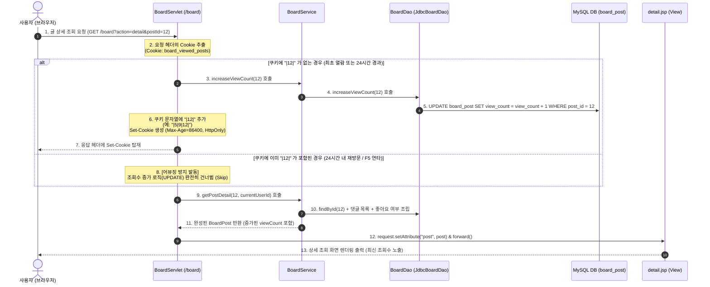

# [실습 & 설계 가이드] 게시판 조회수(View Count) 기능 및 쿠키 기반 중복 증가 방지 완벽 구현하기

이 문서는 기존 피드 및 리스트 게시판(`Survlet_practice`, Jakarta EE 10, Servlet 6.1, Tomcat 10+, MySQL, Gradle)에 **게시글 조회수(View Count)** 기능을 추가하고, 사용자의 새로고침(F5) 연타나 반복 조회로 인한 **조회수 어뷰징(중복 카운팅)을 HTTP 쿠키(Cookie)를 통해 24시간 동안 완벽하게 방어하는 풀스택 아키텍처 가이드**입니다.

기존의 `4.JSP_FEED_BOARD_GUIDE.md`와 동일하게, **초보자도 주석만 읽고 그대로 따라 구현할 수 있도록 DB DDL, DTO, DAO, Service, Controller, View(JSP), CSS 전 계층의 완성된 소스코드와 친절한 설계 해설**을 수록하였습니다.

> 💡 **수석 기획자 & 풀스택 아키텍트의 설계 노트**:  
> "게시판의 조회수 기능은 단순히 DB의 특정 숫자를 `+1` 하는 쉬운 작업처럼 보이지만, 실제 서비스에서는 **'언제 카운트할 것인가(Trigger Timing)'**, **'어떻게 새로고침 어뷰징을 방지할 것인가(Deduplication Strategy)'**, 그리고 **'서버 부하를 어떻게 통제할 것인가(Concurrency & Performance)'**라는 중요한 아키텍처적 고민이 수반됩니다.  
> 이번 실습에서는 서버의 메모리 부하를 주지 않으면서도 클라이언트별로 하루(24시간) 동안 중복 증가를 방지할 수 있는 **'HTTP Cookie 기반 중복 차단 알고리즘'**과 함께, 기존 피드형/리스트형 뷰와 연동되는 **'단독 게시글 상세 조회 뷰(Detail View)'**를 추가하여 한층 더 완성도 높은 게시판 플랫폼을 완성합니다."

---

## 📌 목차
1. [기획 개요 & 조회수 카운팅 전략 비교](#1-기획-개요--조회수-카운팅-전략-비교)
2. [화면 레이아웃 스케치 (와이어프레임)](#2-화면-레이아웃-스케치-와이어프레임)
3. [전체 동작 흐름 (시퀀스 다이어그램)](#3-전체-동작-흐름-시퀀스-다이어그램)
4. [프로젝트 구조 및 작업 파일 배치도](#4-프로젝트-구조-및-작업-파일-배치도)
5. [Step 1: 데이터베이스 스키마 확장 (`sql/board_schema.sql`)](#step-1-데이터베이스-스키마-확장-sqlboard_schemasql)
6. [Step 2: 데이터 모델 DTO 수정 (`BoardPost.java`)](#step-2-데이터-모델-dto-수정-boardpostjava)
7. [Step 3: 데이터 접근 DAO 인터페이스 및 JDBC 구현체 수정](#step-3-데이터-접근-dao-인터페이스-및-jdbc-구현체-수정)
   - 3.1 게시글 DAO 인터페이스 (`BoardDao.java`)
   - 3.2 게시글 JDBC DAO 구현체 (`JdbcBoardDao.java`)
8. [Step 4: 비즈니스 로직 Service 확장 (`BoardService.java`)](#step-4-비즈니스-로직-service-확장-boardservicejava)
9. [Step 5: 요청 처리 Controller 구현 (`BoardServlet.java`)](#step-5-요청-처리-controller-구현-boardservletjava)
10. [Step 6: 스타일시트 UI 보강 (`board.css`)](#step-6-스타일시트-ui-보강-boardcss)
11. [Step 7: 화면 UI 뷰 (JSP & JSTL)](#step-7-화면-ui-뷰-jsp--jstl)
   - 7.1 [신규] 단독 게시글 상세 페이지 (`board/detail.jsp`)
   - 7.2 [수정] 표 형태 게시글 목록 화면 (`board/list.jsp`)
   - 7.3 [수정] 타임라인 피드 화면 (`board/feed.jsp`)
12. [Step 8: 실행 및 동작 테스트 시나리오](#step-8-실행-및-동작-테스트-시나리오)
13. [핵심 개념 정리 & 자주 묻는 질문 (FAQ)](#핵심-개념-정리--자주-묻는-질문-faq)
   - Q1: 세션(HttpSession) 대신 왜 쿠키(Cookie)를 선택했나요?
   - Q2: 본인이 쓴 글을 본인이 읽을 때도 조회수를 올려야 하나요?
   - Q3: 여러 사용자가 동시에 같은 글을 읽으면 조회수가 꼬이지 않나요? (원자적 연산)
   - Q4: 대규모 포털에서는 조회수를 어떻게 집계하나요? (Redis Write-Behind)
   - [★심화] Q5: 댓글이나 게시글 등록 후 화면 이동 시 왜 포워드 대신 리다이렉트를 쓰나요? (새로고침 중복 등록 원리 & PRG 패턴)
   - [★심화] Q6: 댓글 등록 후 스크롤이 맨 위로 올라가는데, 포워드로 변경하면 다른 조치 없이도 스크롤 위치가 유지되나요?

---

## 1. 기획 개요 & 조회수 카운팅 전략 비교

### 📊 1. 조회수 중복 증가 방지 기술 비교

게시글을 열람할 때마다 무조건 DB에 `UPDATE board_post SET view_count = view_count + 1`을 실행하면, 악의적인 사용자나 새로고침(F5)을 반복하는 일반 사용자 때문에 순식간에 조회수가 수백 회 치솟게 됩니다. 이를 방어하기 위한 대표적인 전략 4가지를 비교합니다.

| 비교 항목 | 1. 단순 무조건 증가 | 2. 세션(HttpSession) 기반 | 3. 쿠키(Http Cookie) 기반 [★ 채택] | 4. Redis / DB 로그 기반 |
| :--- | :--- | :--- | :--- | :--- |
| **방어 메커니즘** | 방어 없음 (열람 시마다 무조건 `+1`) | 세션 메모리에 읽은 `postId` 목록 저장 | 브라우저 쿠키에 읽은 `postId` 저장 (`MaxAge=24h`) | 분산 캐시나 RDBMS 로그 테이블에 기록 |
| **새로고침(F5) 방어** | ❌ 불가 (누를 때마다 증가) | ✅ 가능 (세션 유지 시 방어) | ✅ 가능 (24시간 동안 방어) | ✅ 완벽 방어 |
| **브라우저 종료 후 재접속** | ❌ 불가 | ❌ 세션 종료 시 다시 증가 | ✅ 쿠키 유효시간(24시간) 동안 방어 유지 | ✅ 기간 설정에 따라 방어 유지 |
| **서버 메모리 부하** | 🟢 없음 | 🔴 사용자 수만큼 세션 메모리 점유 | 🟢 **클라이언트에 저장되므로 서버 부하 0** | 🟡 Redis/DB I/O 및 관리 비용 발생 |
| **구현 난이도** | 매우 낮음 | 낮음 | **보통 (순수 Servlet API로 구현 가능)** | 높음 (인프라 추가 필요) |

> **💡 본 실습의 설계 선택**:  
> 본 실습에서는 **쿠키(Cookie)**를 활용하여, 클라이언트의 브라우저에 `viewed_posts` 쿠키를 굽고 **유효기간 24시간(`60 * 60 * 24`)**을 부여합니다.  
> 쿠키 포맷은 `|1|5|12|`와 같은 구분자 파이프(`|`) 문자열을 사용하여 정밀하게 게시글 번호를 판별하고, 서버 메모리를 소모하지 않으면서 24시간 동안 동일 게시글의 중복 조회를 확실히 차단합니다.

---

### 🎯 2. 피드형(Feed) vs 리스트형(List) 게시판의 조회수 집계 시점 전략

현재 우리 프로젝트는 **타임라인 피드 뷰(`?view=feed`)**와 **표 목록 뷰(`?view=list`)**를 동시에 제공하고 있습니다. 여기서 중요한 설계 질문이 발생합니다:

> **Q. 피드 화면(`feed.jsp`)에 접속하면 글 20개가 한꺼번에 화면에 뜨는데, 20개 글의 조회수를 모두 +1 시켜야 할까요?**  
> **A. 절대 안 됩니다!**  
> 피드 목록을 새로고침할 때마다 20개 글의 조회수를 일제히 증가시키면 DB에 엄청난 `UPDATE` 쿼리 폭풍이 발생할 뿐만 아니라, 사용자가 실제로 글을 정독하지 않고 스크롤만 훑어본 경우에도 조회수가 왜곡됩니다.

따라서 우리는 다음과 같이 합리적이고 실무적인 아키텍처를 수립합니다:
1. **리스트 뷰(`list.jsp`)**: 제목을 클릭하면 **'단독 상세 페이지(`board/detail.jsp`)'**로 이동하며, 이때 **쿠키를 검사하여 중복이 아닐 때만 조회수를 1 증가**시킵니다.
2. **피드 뷰(`feed.jsp`)**: 각 피드 카드 상단 및 하단 액션바에 현재의 조회수(예: `👁️ 42`)를 실시간으로 노출합니다. 제목을 클릭하면 해당 글의 단독 상세 페이지로 이동하며 조회수를 정독 카운트로 집계할 수 있도록 연계합니다.
3. **단독 상세 뷰(`detail.jsp`) [신규 생성]**: 특정 게시글 1건의 제목, 본문, 고화질 사진, 작성자 정보, 실시간 조회수, 좋아요 토글, 인라인 댓글을 집중해서 볼 수 있는 상세 뷰를 제공합니다.

---

## 2. 화면 레이아웃 스케치 (와이어프레임)

### 🖥️ 1. 리스트형 목록 화면 (`board/list.jsp`) - 조회수 컬럼 추가

```text
+-----------------------------------------------------------------------------------+
|  [Logo] 교보 웹 포털       [🏠 대시보드]   [📝 TODO]   [📋 게시판]       백종민님 [로그아웃]  |
+-----------------------------------------------------------------------------------+
|                                                                                   |
|  📋 게시글 목록                                      보기 방식: [🖼️ 피드형] [📑 리스트형(선택)]|
|                                                                                   |
|  +-----------------------------------------------------------------------------+  |
|  | 번호 |                    제목                     | 작성자 |  작성일  | 좋아요 | 댓글 | 조회 | |
|  |------|---------------------------------------------|--------|----------|--------|------|------| |
|  |  12  | 오늘 점심에 파스타 먹었습니다 📷 (클릭 시 상세) | 김유진 | 10.13    |  ❤️ 5  | 💬 2 | 👁️ 84| |
|  |  11  | 서블릿과 JSP 실습 안내 공지사항              | 관리자 | 10.12    |  ❤️ 12 | 💬 4 | 👁️210| |
|  |  10  | 가을 하늘이 정말 맑고 예쁘네요               | 백종민 | 10.12    |  ❤️ 3  | 💬 1 | 👁️ 35| |
|  +-----------------------------------------------------------------------------+  |
+-----------------------------------------------------------------------------------+
```

---

### 🖥️ 2. 신규 단독 상세 보기 화면 (`board/detail.jsp`)

```text
+-----------------------------------------------------------------------------------+
|  [Logo] 교보 웹 포털                                             [← 목록으로]  [🏠 대시보드] |
+-----------------------------------------------------------------------------------+
|                                                                                   |
|  [ 단독 상세 카드 (최대 너비: 760px) ]                                                |
|  +-----------------------------------------------------------------------------+  |
|  |  [카테고리 / 게시글 #12]                                                     |  |
|  |  📌 오늘 점심에 파스타 먹었습니다! (글 제목)                                   |  |
|  |                                                                             |  |
|  |  👤 김유진 (@user1)  ·  2026.10.13 12:30  ·  👁️ 조회수 84회  [수정] [삭제]      |  |
|  |  -------------------------------------------------------------------------  |  |
|  |  광화문 교보문고 바로 옆 골목에 새로 오픈한 파스타 전문점에 다녀왔어요.           |  |
|  |  분위기도 아늑하고 면발도 쫄깃해서 정말 만족스러웠습니다. 팀원들과 추천드려요!      |  |
|  |                                                                             |  |
|  |  +-----------------------------------------------------------------------+  |  |
|  |  |                     [ 첨부된 고화질 이미지 영역 ]                      |  |  |
|  |  +-----------------------------------------------------------------------+  |  |
|  |                                                                             |  |
|  |  [ ❤️ 좋아요 5 ]      [ 💬 댓글 2개 ]                                        |  |
|  |  -------------------------------------------------------------------------  |  |
|  |  💬 댓글 목록:                                                               |  |
|  |    - 백종민: 위치가 어디인가요? 다음 회식 때 꼭 가보고 싶네요! (12:35)             |  |
|  |    - 박지성: 파스타 사진 비주얼이 예술이네요 👍 (12:40)                         |  |
|  |                                                                             |  |
|  |  +-------------------------------------------------------+ +---------------+ |  |
|  |  | 따뜻한 댓글을 남겨보세요...                           | | [댓글 등록]   | |  |
|  |  +-------------------------------------------------------+ +---------------+ |  |
|  +-----------------------------------------------------------------------------+  |
|                                                                                   |
+-----------------------------------------------------------------------------------+
```

---

### 🖥️ 3. 메인 타임라인 피드 화면 (`board/feed.jsp`) - 조회수 배지 노출

```text
  +-----------------------------------------------------------------------------+
  | [피드 카드]                                                                 |
  | 👤 김유진 · 2026.10.13 12:30                  [ 👁️ 84 ]   [ ⋯ 수정 / 삭제 ]  |
  | --------------------------------------------------------------------------- |
  | 📌 오늘 점심에 파스타 먹었습니다! (클릭하면 상세 페이지 이동)                    |
  | 광화문 교보문고 옆 맛집에서 다 같이 파스타 먹었어요! ...                         |
  | [이미지 영역]                                                               |
  | [ ❤️ 좋아요 5 ]     [ 💬 댓글 2 ]     [ 👁️ 조회수 84회 ]                     |
  +-----------------------------------------------------------------------------+
```

---

## 3. 전체 동작 흐름 (시퀀스 다이어그램)

사용자가 게시글 상세 보기를 요청했을 때, 컨트롤러(`BoardServlet`)가 클라이언트의 쿠키를 검사하여 중복 여부에 따라 조건부로 조회수를 증가시키는 전체 실행 흐름입니다.



---

## 4. 프로젝트 구조 및 작업 파일 배치도

작업 대상 파일은 총 9개(신규 생성 1개, 기존 수정 8개)입니다.

```text
Survlet_practice/
 ├── sql/
 │    └── board_schema.sql        [기존 수정] view_count 컬럼 추가 DDL 및 ALTER 스크립트
 └── src/
      └── main/
           ├── java/
           │    └── com/kyobo/web/
           │         ├── controller/
           │         │    └── BoardServlet.java    [기존 수정] 쿠키 중복 방지 알고리즘 및 action=detail 핸들러 추가
           │         ├── dao/
           │         │    ├── BoardDao.java        [기존 수정] increaseViewCount() 추상 메서드 추가
           │         │    └── JdbcBoardDao.java    [기존 수정] 조회수 UPDATE 쿼리 구현 및 SELECT 쿼리/매핑 수정
           │         ├── model/
           │         │    └── BoardPost.java       [기존 수정] viewCount 필드, Getter/Setter 추가
           │         └── service/
           │              └── BoardService.java    [기존 수정] 상세 조회 및 조회수 증가 비즈니스 로직 추가
           └── webapp/
                ├── assets/
                │    └── css/
                │         └── board.css            [기존 수정] 조회수 배지 및 상세 페이지 카드 스타일 추가
                └── WEB-INF/
                     └── views/
                          └── board/
                               ├── detail.jsp      [신규 생성] 단독 게시글 상세 페이지 (JSTL/EL)
                               ├── list.jsp        [기존 수정] 테이블에 '조회' 컬럼 추가 및 상세 링크 연결
                               └── feed.jsp        [기존 수정] 피드 카드 상단/하단에 조회수 표시 연동
```

---

## Step 1: 데이터베이스 스키마 확장 (`sql/board_schema.sql`)

### 📌 파일 역할
기존 `board_post` 테이블에 게시글 열람 횟수를 기록할 `view_count` 정수형 컬럼을 추가합니다.  
이미 실습 데이터가 저장된 상태라면 `ALTER TABLE` 문을 실행하고, 데이터베이스를 처음부터 새로 구성할 경우 테이블 정의문에 컬럼을 포함시킵니다.

- **파일 위치**: `sql/board_schema.sql`

```sql
-- ====================================================================
-- [기존 DB가 이미 구축되어 있는 경우]: 아래 ALTER 문을 실행합니다.
-- ====================================================================
USE kyobo;

-- 1. board_post 테이블에 view_count 컬럼 추가 (기본값: 0)
ALTER TABLE board_post 
ADD COLUMN view_count INT DEFAULT 0 COMMENT '게시글 누적 조회수' AFTER image_path;

-- 2. 기존 게시글들의 조회수를 임의의 테스트 값으로 초기화 (선택 사항)
UPDATE board_post SET view_count = 15 WHERE post_id = 1;
UPDATE board_post SET view_count = 42 WHERE post_id = 2;


-- ====================================================================
-- [DB를 처음부터 새로 생성하는 경우]: 아래의 통합 DDL을 실행합니다.
-- ====================================================================
USE kyobo;

CREATE TABLE IF NOT EXISTS board_post (
    post_id BIGINT AUTO_INCREMENT PRIMARY KEY COMMENT '게시글 고유 번호 (PK)',
    user_id VARCHAR(50) NOT NULL COMMENT '작성자 회원 아이디 (FK)',
    title VARCHAR(200) NOT NULL COMMENT '게시글 제목',
    content TEXT NOT NULL COMMENT '게시글 본문 내용 (엔터 개행 포함)',
    image_path VARCHAR(255) NULL COMMENT '업로드된 이미지의 웹 경로 (예: /assets/uploads/board/uuid.jpg)',
    view_count INT DEFAULT 0 COMMENT '게시글 누적 조회수 (신규 추가)',
    like_count INT DEFAULT 0 COMMENT '좋아요 누적 수 (조회 성능 최적화 캐시 컬럼)',
    comment_count INT DEFAULT 0 COMMENT '댓글 누적 수 (조회 성능 최적화 캐시 컬럼)',
    created_at TIMESTAMP DEFAULT CURRENT_TIMESTAMP COMMENT '최초 등록일시',
    updated_at TIMESTAMP DEFAULT CURRENT_TIMESTAMP ON UPDATE CURRENT_TIMESTAMP COMMENT '최종 수정일시',

    CONSTRAINT fk_board_post_member FOREIGN KEY (user_id) REFERENCES member(user_id) ON DELETE CASCADE,
    INDEX idx_board_post_created (created_at DESC)
) ENGINE=InnoDB DEFAULT CHARSET=utf8mb4 COLLATE=utf8mb4_0900_ai_ci COMMENT='피드 게시글 테이블';
```

---

## Step 2: 데이터 모델 DTO 수정 (`BoardPost.java`)

### 📌 파일 역할
게시글의 데이터를 객체 단위로 주고받기 위해 `viewCount` 필드와 해당 Getter, Setter 메서드를 추가합니다.

- **파일 위치**: `src/main/java/com/kyobo/web/model/BoardPost.java`

```java
package com.kyobo.web.model;

import java.io.Serializable;
import java.sql.Timestamp;
import java.util.ArrayList;
import java.util.List;

public class BoardPost implements Serializable {
    private static final long serialVersionUID = 1L;

    private Long postId;              // 게시글 고유 번호 (PK)
    private String userId;            // 작성자 회원 아이디 (FK)
    private String authorName;        // 작성자 실명/닉네임 (member 테이블 JOIN)
    private String title;             // 글 제목
    private String content;           // 글 본문
    private String imagePath;         // 업로드 이미지 경로 (예: /assets/uploads/board/uuid.png)
    
    // [신규 추가] 조회수 필드
    private int viewCount;            // 누적 조회수
    
    private int likeCount;            // 좋아요 누적 수
    private int commentCount;         // 댓글 누적 수
    private Timestamp createdAt;      // 작성 일시
    private Timestamp updatedAt;      // 수정 일시

    // [피드 및 상세 화면 구성을 위한 확장 필드]
    private boolean likedByMe;        // 현재 로그인한 사용자가 좋아요를 눌렀는지 여부
    private List<BoardComment> comments = new ArrayList<>(); // 해당 게시글에 달린 댓글 목록

    public BoardPost() {}

    public BoardPost(String userId, String title, String content, String imagePath) {
        this.userId = userId;
        this.title = title;
        this.content = content;
        this.imagePath = imagePath;
    }

    // --- Getter & Setter 메서드들 ---
    public Long getPostId() { return postId; }
    public void setPostId(Long postId) { this.postId = postId; }

    public String getUserId() { return userId; }
    public void setUserId(String userId) { this.userId = userId; }

    public String getAuthorName() { return authorName; }
    public void setAuthorName(String authorName) { this.authorName = authorName; }

    public String getTitle() { return title; }
    public void setTitle(String title) { this.title = title; }

    public String getContent() { return content; }
    public void setContent(String content) { this.content = content; }

    public String getImagePath() { return imagePath; }
    public void setImagePath(String imagePath) { this.imagePath = imagePath; }

    // [신규 추가] viewCount Getter & Setter
    public int getViewCount() { return viewCount; }
    public void setViewCount(int viewCount) { this.viewCount = viewCount; }

    public int getLikeCount() { return likeCount; }
    public void setLikeCount(int likeCount) { this.likeCount = likeCount; }

    public int getCommentCount() { return commentCount; }
    public void setCommentCount(int commentCount) { this.commentCount = commentCount; }

    public Timestamp getCreatedAt() { return createdAt; }
    public void setCreatedAt(Timestamp createdAt) { this.createdAt = createdAt; }

    public Timestamp getUpdatedAt() { return updatedAt; }
    public void setUpdatedAt(Timestamp updatedAt) { this.updatedAt = updatedAt; }

    public boolean isLikedByMe() { return likedByMe; }
    public void setLikedByMe(boolean likedByMe) { this.likedByMe = likedByMe; }

    public List<BoardComment> getComments() { return comments; }
    public void setComments(List<BoardComment> comments) { this.comments = comments; }
}
```

---

## Step 3: 데이터 접근 DAO 인터페이스 및 JDBC 구현체 수정

### 3.1 게시글 DAO 인터페이스 (`BoardDao.java`)
게시글 번호(`postId`)를 받아 해당 게시글의 `view_count`를 1 증가시키는 메서드 규격을 선언합니다.

- **파일 위치**: `src/main/java/com/kyobo/web/dao/BoardDao.java`

```java
package com.kyobo.web.dao;

import com.kyobo.web.model.BoardPost;
import java.sql.SQLException;
import java.util.List;
import java.util.Optional;

public interface BoardDao {
    // 1. 최신 게시글 목록 조회 (페이징: limit 개수, offset 시작위치)
    List<BoardPost> findAll(int limit, int offset) throws SQLException;

    // 2. 특정 게시글 1건 상세 조회
    Optional<BoardPost> findById(Long postId) throws SQLException;

    // 3. 신규 게시글 저장 (생성된 PK post_id 반환)
    Long save(BoardPost post) throws SQLException;

    // 4. 게시글 수정 (제목, 본문, 이미지)
    boolean update(BoardPost post) throws SQLException;

    // 5. 게시글 삭제
    boolean delete(Long postId) throws SQLException;

    // 6. 좋아요 개수 증감 (+1 또는 -1)
    void updateLikeCount(Long postId, int delta) throws SQLException;

    // 7. 댓글 개수 증감 (+1 또는 -1)
    void updateCommentCount(Long postId, int delta) throws SQLException;

    // [신규 추가] 8. 게시글 조회수 1 증가
    void increaseViewCount(Long postId) throws SQLException;
}
```

---

### 3.2 게시글 JDBC DAO 구현체 (`JdbcBoardDao.java`)
- `map(ResultSet rs)`에 `rs.getInt("view_count")` 바인딩을 추가합니다.
- `findAll`, `findById`의 SQL SELECT 문에 `p.view_count` 컬럼을 명시합니다.
- `increaseViewCount(Long postId)` 메서드를 구현하여 원자적(Atomic) 1 증가 SQL을 실행합니다.

- **파일 위치**: `src/main/java/com/kyobo/web/dao/JdbcBoardDao.java`

```java
package com.kyobo.web.dao;

import com.kyobo.web.config.ConnectionProvider;
import com.kyobo.web.model.BoardPost;

import java.sql.*;
import java.util.ArrayList;
import java.util.List;
import java.util.Optional;

public class JdbcBoardDao implements BoardDao {

    // ResultSet에서 BoardPost 객체로 매핑하는 헬퍼 메서드
    private BoardPost map(ResultSet rs) throws SQLException {
        BoardPost p = new BoardPost();
        p.setPostId(rs.getLong("post_id"));
        p.setUserId(rs.getString("user_id"));
        p.setAuthorName(rs.getString("author_name"));
        p.setTitle(rs.getString("title"));
        p.setContent(rs.getString("content"));
        p.setImagePath(rs.getString("image_path"));
        
        // [신규 추가] 조회수 컬럼 매핑
        p.setViewCount(rs.getInt("view_count"));
        
        p.setLikeCount(rs.getInt("like_count"));
        p.setCommentCount(rs.getInt("comment_count"));

        Timestamp cTs = rs.getTimestamp("created_at");
        if (cTs != null) p.setCreatedAt(cTs);

        Timestamp uTs = rs.getTimestamp("updated_at");
        if (uTs != null) p.setUpdatedAt(uTs);

        return p;
    }

    @Override
    public List<BoardPost> findAll(int limit, int offset) throws SQLException {
        // [수정] SELECT 절에 p.view_count 추가
        String sql = "SELECT p.post_id, p.user_id, m.name AS author_name, p.title, p.content, "
                + "       p.image_path, p.view_count, p.like_count, p.comment_count, p.created_at, p.updated_at "
                + "FROM board_post p "
                + "JOIN member m ON p.user_id = m.user_id "
                + "ORDER BY p.created_at DESC "
                + "LIMIT ? OFFSET ?";

        List<BoardPost> list = new ArrayList<>();
        try (Connection conn = ConnectionProvider.getConnection();
             PreparedStatement ps = conn.prepareStatement(sql)) {
            ps.setInt(1, limit);
            ps.setInt(2, offset);
            try (ResultSet rs = ps.executeQuery()) {
                while (rs.next()) {
                    list.add(map(rs));
                }
            }
        }
        return list;
    }

    @Override
    public Optional<BoardPost> findById(Long postId) throws SQLException {
        // [수정] SELECT 절에 p.view_count 추가
        String sql = "SELECT p.post_id, p.user_id, m.name AS author_name, p.title, p.content, "
                + "       p.image_path, p.view_count, p.like_count, p.comment_count, p.created_at, p.updated_at "
                + "FROM board_post p "
                + "JOIN member m ON p.user_id = m.user_id "
                + "WHERE p.post_id = ?";

        try (Connection conn = ConnectionProvider.getConnection();
             PreparedStatement ps = conn.prepareStatement(sql)) {
            ps.setLong(1, postId);
            try (ResultSet rs = ps.executeQuery()) {
                return rs.next() ? Optional.of(map(rs)) : Optional.empty();
            }
        }
    }

    @Override
    public Long save(BoardPost post) throws SQLException {
        String sql = "INSERT INTO board_post (user_id, title, content, image_path, view_count) VALUES (?, ?, ?, ?, 0)";
        try (Connection conn = ConnectionProvider.getConnection();
             PreparedStatement ps = conn.prepareStatement(sql, Statement.RETURN_GENERATED_KEYS)) {
            ps.setString(1, post.getUserId());
            ps.setString(2, post.getTitle());
            ps.setString(3, post.getContent());
            ps.setString(4, post.getImagePath());
            ps.executeUpdate();

            try (ResultSet gk = ps.getGeneratedKeys()) {
                if (gk.next()) {
                    return gk.getLong(1);
                }
            }
        }
        throw new SQLException("게시글 번호(PK)를 생성하지 못했습니다.");
    }

    @Override
    public boolean update(BoardPost post) throws SQLException {
        String sql = "UPDATE board_post SET title = ?, content = ?, image_path = ? WHERE post_id = ?";
        try (Connection conn = ConnectionProvider.getConnection();
             PreparedStatement ps = conn.prepareStatement(sql)) {
            ps.setString(1, post.getTitle());
            ps.setString(2, post.getContent());
            ps.setString(3, post.getImagePath());
            ps.setLong(4, post.getPostId());
            return ps.executeUpdate() > 0;
        }
    }

    @Override
    public boolean delete(Long postId) throws SQLException {
        String sql = "DELETE FROM board_post WHERE post_id = ?";
        try (Connection conn = ConnectionProvider.getConnection();
             PreparedStatement ps = conn.prepareStatement(sql)) {
            ps.setLong(1, postId);
            return ps.executeUpdate() > 0;
        }
    }

    @Override
    public void updateLikeCount(Long postId, int delta) throws SQLException {
        String sql = "UPDATE board_post SET like_count = GREATEST(0, like_count + ?) WHERE post_id = ?";
        try (Connection conn = ConnectionProvider.getConnection();
             PreparedStatement ps = conn.prepareStatement(sql)) {
            ps.setInt(1, delta);
            ps.setLong(2, postId);
            ps.executeUpdate();
        }
    }

    @Override
    public void updateCommentCount(Long postId, int delta) throws SQLException {
        String sql = "UPDATE board_post SET comment_count = GREATEST(0, comment_count + ?) WHERE post_id = ?";
        try (Connection conn = ConnectionProvider.getConnection();
             PreparedStatement ps = conn.prepareStatement(sql)) {
            ps.setInt(1, delta);
            ps.setLong(2, postId);
            ps.executeUpdate();
        }
    }

    // [신규 추가] 8. 조회수 1 증가 (원자적 연산으로 동시성 안전 보장)
    @Override
    public void increaseViewCount(Long postId) throws SQLException {
        String sql = "UPDATE board_post SET view_count = view_count + 1 WHERE post_id = ?";
        try (Connection conn = ConnectionProvider.getConnection();
             PreparedStatement ps = conn.prepareStatement(sql)) {
            ps.setLong(1, postId);
            ps.executeUpdate();
        }
    }
}
```

---

## Step 4: 비즈니스 로직 Service 확장 (`BoardService.java`)

### 📌 파일 역할
1. `increaseViewCount(Long postId)`: DAO에 조회수 1 증가 명령을 위임합니다.
2. `getPostDetail(Long postId, String currentUserId)`: 특정 글 1건에 대해 댓글 목록 및 로그인한 회원의 좋아요 여부까지 완벽히 조립하여 상세 화면에 전달합니다.

- **파일 위치**: `src/main/java/com/kyobo/web/service/BoardService.java`

```java
package com.kyobo.web.service;

import com.kyobo.web.dao.BoardDao;
import com.kyobo.web.dao.CommentDao;
import com.kyobo.web.dao.LikeDao;
import com.kyobo.web.model.BoardComment;
import com.kyobo.web.model.BoardPost;

import java.sql.SQLException;
import java.util.*;
import java.util.stream.Collectors;

/**
 * 유효성 검증(빈칸 체크), 본인 글/댓글 수정, 삭제 권한 검증.
 * 피드 목록 및 단독 상세 조회 조립, 조회수 증가 비즈니스 로직.
 */
public class BoardService {

    private final BoardDao boardDao;
    private final CommentDao commentDao;
    private final LikeDao likeDao;

    public BoardService(BoardDao boardDao, CommentDao commentDao, LikeDao likeDao) {
        this.boardDao = boardDao;
        this.commentDao = commentDao;
        this.likeDao = likeDao;
    }

    /**
     * [피드 목록 조회 - N+1 문제 해결 조립 로직]
     */
    public List<BoardPost> getFeedPosts(String currentUserId, int limit, int offset) throws SQLException {
        List<BoardPost> posts = boardDao.findAll(limit, offset);
        if (posts.isEmpty()) return posts;

        List<Long> postIds = posts.stream().map(BoardPost::getPostId).collect(Collectors.toList());

        // 일괄 좋아요 여부 및 일괄 댓글 조회
        Set<Long> likedPostIds = likeDao.findLikedPostIds(currentUserId, postIds);
        Map<Long, List<BoardComment>> commentMap = commentDao.findByPostIds(postIds);

        for (BoardPost p : posts) {
            p.setLikedByMe(likedPostIds.contains(p.getPostId()));
            p.setComments(commentMap.getOrDefault(p.getPostId(), Collections.emptyList()));
        }
        return posts;
    }

    /**
     * [신규 추가] 특정 게시글 1건 상세 조회 (댓글 + 좋아요 여부 포함)
     */
    public BoardPost getPostDetail(Long postId, String currentUserId) throws SQLException {
        BoardPost post = boardDao.findById(postId)
                .orElseThrow(() -> new IllegalArgumentException("존재하지 않는 게시글입니다. (번호: " + postId + ")"));

        // 단일 글 좋아요 여부 확인
        post.setLikedByMe(likeDao.exists(postId, currentUserId));

        // 단일 글 댓글 목록 조회
        Map<Long, List<BoardComment>> commentMap = commentDao.findByPostIds(Collections.singletonList(postId));
        post.setComments(commentMap.getOrDefault(postId, Collections.emptyList()));

        return post;
    }

    /**
     * [신규 추가] 게시글 조회수 1 증가
     */
    public void increaseViewCount(Long postId) throws SQLException {
        boardDao.increaseViewCount(postId);
    }

    // 신규 글 등록
    public Long createPost(String userId, String title, String content, String imagePath) throws SQLException {
        if (title == null || title.trim().isEmpty()) {
            throw new IllegalArgumentException("제목을 입력해주세요.");
        }
        if (content == null || content.trim().isEmpty()) {
            throw new IllegalArgumentException("본문 내용을 입력해주세요.");
        }
        BoardPost post = new BoardPost(userId, title.trim(), content.trim(), imagePath);
        return boardDao.save(post);
    }

    // 수정용 게시글 조회 (본인 글 검증)
    public BoardPost getPostForEdit(Long postId, String currentUserId) throws SQLException {
        BoardPost post = boardDao.findById(postId)
                .orElseThrow(() -> new IllegalArgumentException("존재하지 않는 게시글입니다."));
        if (!post.getUserId().equals(currentUserId)) {
            throw new SecurityException("본인이 작성한 글만 수정할 수 있습니다.");
        }
        return post;
    }

    // 글 수정 처리
    public void updatePost(Long postId, String currentUserId, String title, String content, String newImagePath) throws SQLException {
        BoardPost post = getPostForEdit(postId, currentUserId);
        post.setTitle(title.trim());
        post.setContent(content.trim());
        if (newImagePath != null && !newImagePath.isBlank()) {
            post.setImagePath(newImagePath);
        }
        boardDao.update(post);
    }

    // 글 삭제 처리
    public void deletePost(Long postId, String currentUserId) throws SQLException {
        BoardPost post = boardDao.findById(postId)
                .orElseThrow(() -> new IllegalArgumentException("존재하지 않는 게시글입니다."));
        if (!post.getUserId().equals(currentUserId)) {
            throw new SecurityException("본인이 작성한 글만 삭제할 수 있습니다.");
        }
        boardDao.delete(postId);
    }

    // 좋아요 토글
    public boolean toggleLike(Long postId, String currentUserId) throws SQLException {
        boolean alreadyLiked = likeDao.exists(postId, currentUserId);
        if (alreadyLiked) {
            likeDao.delete(postId, currentUserId);
            boardDao.updateLikeCount(postId, -1);
            return false;
        } else {
            likeDao.save(postId, currentUserId);
            boardDao.updateLikeCount(postId, +1);
            return true;
        }
    }

    // 댓글 등록
    public void addComment(Long postId, String currentUserId, String content) throws SQLException {
        if (content == null || content.trim().isEmpty()) {
            throw new IllegalArgumentException("댓글 내용을 입력해주세요.");
        }
        boardDao.findById(postId).orElseThrow(() -> new IllegalArgumentException("게시글이 존재하지 않습니다."));
        BoardComment c = new BoardComment(postId, currentUserId, content.trim());
        commentDao.save(c);
        boardDao.updateCommentCount(postId, +1);
    }

    // 댓글 삭제
    public void deleteComment(Long commentId, Long postId, String currentUserId) throws SQLException {
        BoardComment c = commentDao.findById(commentId)
                .orElseThrow(() -> new IllegalArgumentException("댓글이 존재하지 않습니다."));
        if (!c.getUserId().equals(currentUserId)) {
            throw new SecurityException("본인이 작성한 댓글만 삭제할 수 있습니다.");
        }
        commentDao.delete(commentId);
        boardDao.updateCommentCount(postId, -1);
    }
}
```

---

## Step 5: 요청 처리 Controller 구현 (`BoardServlet.java`)

### 📌 파일 역할
1. **쿠키 기반 중복 방지 알고리즘**:
   - 클라이언트의 `Cookie` 목록에서 `board_viewed_posts` 쿠키를 찾습니다.
   - 쿠키 값이 `|1|5|12|` 형태로 저장되므로, `|{postId}|`가 포함되어 있는지 검사합니다.
   - 포함되어 있지 않다면:
     - `boardService.increaseViewCount(postId)`를 호출하여 DB의 `view_count`를 1 증가시킵니다.
     - 쿠키 문자열에 `|{postId}|`를 덧붙여 **24시간(`60 * 60 * 24`) 유효기간**을 가진 쿠키로 응답 헤더에 탑재(`resp.addCookie`)합니다.
   - 이미 포함되어 있다면: 조회수 증가 쿼리를 전혀 실행하지 않고 패스(Skip)합니다.
2. **`action=detail` 액션 분기**:
   - `GET /board?action=detail&postId=...` 요청 시 위의 쿠키 검증 및 조회수 증가를 수행한 뒤 `WEB-INF/views/board/detail.jsp`로 포워딩합니다.

- **파일 위치**: `src/main/java/com/kyobo/web/controller/BoardServlet.java`

```java
package com.kyobo.web.controller;

import com.kyobo.web.dao.JdbcBoardDao;
import com.kyobo.web.dao.JdbcCommentDao;
import com.kyobo.web.dao.JdbcLikeDao;
import com.kyobo.web.model.BoardPost;
import com.kyobo.web.model.Member;
import com.kyobo.web.service.BoardService;
import jakarta.servlet.ServletException;
import jakarta.servlet.annotation.MultipartConfig;
import jakarta.servlet.annotation.WebServlet;
import jakarta.servlet.http.*;

import java.io.File;
import java.io.IOException;
import java.nio.file.Paths;
import java.util.List;
import java.util.UUID;

@WebServlet("/board")
@MultipartConfig(
        fileSizeThreshold = 1024 * 1024,      // 1MB 이상 시 임시 디스크 사용
        maxFileSize = 1024 * 1024 * 10,       // 업로드 파일 최대 10MB
        maxRequestSize = 1024 * 1024 * 20     // 전체 요청 최대 20MB
)
public class BoardServlet extends HttpServlet {

    private static final String VIEW_COOKIE_NAME = "board_viewed_posts";
    private static final int COOKIE_MAX_AGE_SECONDS = 60 * 60 * 24; // 24시간 (하루)

    private BoardService boardService;

    @Override
    public void init() {
        this.boardService = new BoardService(
                new JdbcBoardDao(),
                new JdbcCommentDao(),
                new JdbcLikeDao()
        );
    }

    @Override
    protected void doGet(HttpServletRequest req, HttpServletResponse resp) throws ServletException, IOException {
        Member loginUser = getLoginUser(req);
        if (loginUser == null) {
            resp.sendRedirect(req.getContextPath() + "/login");
            return;
        }

        String action = req.getParameter("action");
        String view = req.getParameter("view");
        if (view == null || view.isBlank()) {
            view = "feed"; // 기본 뷰는 타임라인 피드형
        }

        try {
            // [1] 수정 화면 이동
            if ("edit".equals(action)) {
                Long postId = Long.parseLong(req.getParameter("postId"));
                BoardPost post = boardService.getPostForEdit(postId, loginUser.getUserId());
                req.setAttribute("post", post);
                req.getRequestDispatcher("/WEB-INF/views/board/edit.jsp").forward(req, resp);
                return;
            }

            // [신규 추가] [2] 단독 게시글 상세 조회 화면 이동 + 쿠키 기반 조회수 증가
            if ("detail".equals(action)) {
                Long postId = Long.parseLong(req.getParameter("postId"));

                // 쿠키를 통한 24시간 중복 조회 검사 및 조건부 조회수 증가
                processViewCountWithCookie(req, resp, postId);

                // 상세 글 데이터 조회 (댓글, 좋아요 여부 조립)
                BoardPost post = boardService.getPostDetail(postId, loginUser.getUserId());
                req.setAttribute("post", post);
                req.getRequestDispatcher("/WEB-INF/views/board/detail.jsp").forward(req, resp);
                return;
            }

            // [3] 피드 / 리스트 목록 조회
            List<BoardPost> posts = boardService.getFeedPosts(loginUser.getUserId(), 20, 0);
            req.setAttribute("posts", posts);
            req.setAttribute("currentView", view);

            if ("list".equals(view)) {
                req.getRequestDispatcher("/WEB-INF/views/board/list.jsp").forward(req, resp);
            } else {
                req.getRequestDispatcher("/WEB-INF/views/board/feed.jsp").forward(req, resp);
            }

        } catch (Exception e) {
            throw new ServletException("게시판 조회 중 오류가 발생했습니다.", e);
        }
    }

    @Override
    protected void doPost(HttpServletRequest req, HttpServletResponse resp) throws ServletException, IOException {
        req.setCharacterEncoding("UTF-8");

        Member loginUser = getLoginUser(req);
        if (loginUser == null) {
            resp.sendRedirect(req.getContextPath() + "/login");
            return;
        }

        String action = req.getParameter("action");
        String currentUserId = loginUser.getUserId();
        String redirectTarget = req.getParameter("redirectTarget"); // detail 또는 feed 복귀 지원

        try {
            if ("create".equals(action)) {
                // 1. 피드 글 등록 + 사진 업로드
                String title = req.getParameter("title");
                String content = req.getParameter("content");
                Part filePart = req.getPart("imageFile");
                String savedImagePath = processImageUpload(filePart, req);

                boardService.createPost(currentUserId, title, content, savedImagePath);
                resp.sendRedirect(req.getContextPath() + "/board");

            } else if ("update".equals(action)) {
                // 2. 글 수정 처리
                Long postId = Long.parseLong(req.getParameter("postId"));
                String title = req.getParameter("title");
                String content = req.getParameter("content");
                Part filePart = req.getPart("imageFile");
                String newImagePath = processImageUpload(filePart, req);

                boardService.updatePost(postId, currentUserId, title, content, newImagePath);
                resp.sendRedirect(req.getContextPath() + "/board?action=detail&postId=" + postId);

            } else if ("delete".equals(action)) {
                // 3. 글 삭제 처리
                Long postId = Long.parseLong(req.getParameter("postId"));
                boardService.deletePost(postId, currentUserId);
                resp.sendRedirect(req.getContextPath() + "/board");

            } else if ("like".equals(action)) {
                // 4. 좋아요 토글 (PRG 패턴 + 이동 분기)
                Long postId = Long.parseLong(req.getParameter("postId"));
                boardService.toggleLike(postId, currentUserId);

                if ("detail".equals(redirectTarget)) {
                    resp.sendRedirect(req.getContextPath() + "/board?action=detail&postId=" + postId);
                } else {
                    resp.sendRedirect(req.getContextPath() + "/board#post-" + postId);
                }

            } else if ("comment".equals(action)) {
                // 5. 댓글 등록
                Long postId = Long.parseLong(req.getParameter("postId"));
                String commentContent = req.getParameter("commentContent");
                boardService.addComment(postId, currentUserId, commentContent);

                if ("detail".equals(redirectTarget)) {
                    resp.sendRedirect(req.getContextPath() + "/board?action=detail&postId=" + postId);
                } else {
                    resp.sendRedirect(req.getContextPath() + "/board#post-" + postId);
                }

            } else if ("commentDelete".equals(action)) {
                // 6. 댓글 삭제
                Long commentId = Long.parseLong(req.getParameter("commentId"));
                Long postId = Long.parseLong(req.getParameter("postId"));
                boardService.deleteComment(commentId, postId, currentUserId);

                if ("detail".equals(redirectTarget)) {
                    resp.sendRedirect(req.getContextPath() + "/board?action=detail&postId=" + postId);
                } else {
                    resp.sendRedirect(req.getContextPath() + "/board#post-" + postId);
                }
            }

        } catch (IllegalArgumentException | SecurityException e) {
            req.getSession().setAttribute("flashError", e.getMessage());
            resp.sendRedirect(req.getContextPath() + "/board");
        } catch (Exception e) {
            throw new ServletException("게시판 처리 중 오류 발생", e);
        }
    }

    /**
     * [조회수 중복 방지 핵심 메서드]
     * 쿠키를 검사하여 지난 24시간 동안 읽은 적이 없으면 DB 조회수를 1 올리고, 쿠키에 글 ID를 등록합니다.
     */
    private void processViewCountWithCookie(HttpServletRequest req, HttpServletResponse resp, Long postId) {
        try {
            Cookie[] cookies = req.getCookies();
            Cookie viewCookie = null;

            if (cookies != null) {
                for (Cookie c : cookies) {
                    if (VIEW_COOKIE_NAME.equals(c.getName())) {
                        viewCookie = c;
                        break;
                    }
                }
            }

            String targetToken = "[" + postId + "]";

            if (viewCookie == null) {
                // [케이스 1] 쿠키가 전혀 없는 첫 방문: 조회수 1 증가 및 새 쿠키 생성
                boardService.increaseViewCount(postId);

                Cookie newCookie = new Cookie(VIEW_COOKIE_NAME, targetToken);
                newCookie.setPath(req.getContextPath());
                newCookie.setMaxAge(COOKIE_MAX_AGE_SECONDS); // 24시간
                newCookie.setHttpOnly(true); // 자바스크립트 탈취 방지 (XSS 방어)
                resp.addCookie(newCookie);

            } else {
                // [케이스 2] 기존 쿠키가 있는 경우: 현재 글 ID가 포함되어 있는지 검사
                String cookieValue = viewCookie.getValue();

                if (!cookieValue.contains(targetToken)) {
                    // 읽은 적이 없는 글이므로 조회수 1 증가
                    boardService.increaseViewCount(postId);

                    // 기존 쿠키 값 뒤에 현재 글 번호 토큰 추가
                    viewCookie.setValue(cookieValue + targetToken);
                    viewCookie.setPath(req.getContextPath());
                    viewCookie.setMaxAge(COOKIE_MAX_AGE_SECONDS);
                    viewCookie.setHttpOnly(true);
                    resp.addCookie(viewCookie);
                }
                // 이미 [postId]가 포함되어 있다면(F5 새로고침 등) 조회수 증가 로직을 아무것도 실행하지 않음!
            }
        } catch (Exception e) {
            // 조회수 증가 실패가 전체 상세 조회를 중단시키지 않도록 에러 로깅만 진행
            getServletContext().log("조회수 증가 처리 중 오류 발생 (postId: " + postId + ")", e);
        }
    }

    private String processImageUpload(Part filePart, HttpServletRequest req) throws IOException {
        if (filePart == null || filePart.getSize() == 0) return null;

        String submittedName = Paths.get(filePart.getSubmittedFileName()).getFileName().toString();
        if (submittedName == null || submittedName.isBlank()) return null;

        String ext = "";
        int dot = submittedName.lastIndexOf('.');
        if (dot >= 0) ext = submittedName.substring(dot);

        String uniqueName = UUID.randomUUID().toString() + ext;
        String uploadDir = req.getServletContext().getRealPath("/assets/uploads/board");

        File dir = new File(uploadDir);
        if (!dir.exists()) dir.mkdirs();

        filePart.write(uploadDir + File.separator + uniqueName);
        return "/assets/uploads/board/" + uniqueName;
    }

    private Member getLoginUser(HttpServletRequest req) {
        HttpSession session = req.getSession(false);
        return (session != null) ? (Member) session.getAttribute("loginUser") : null;
    }
}
```

---

## Step 6: 스타일시트 UI 보강 (`board.css`)

### 📌 파일 역할
피드 및 상세 페이지에서 조회수를 시각적으로 깔끔하게 표시할 수 있는 **조회수 배지(`.view-badge`, `.view-count-text`)** 및 **단독 상세 페이지 전용 레이아웃 스타일**을 추가합니다.

- **파일 위치**: `src/main/webapp/assets/css/board.css` (기존 파일 하단에 추가)

```css
/* ==========================================================================
   조회수(View Count) 및 단독 상세 페이지(Detail) 확장 스타일
   ========================================================================== */

/* 피드 카드 헤더 및 상세 페이지 메타 영역의 조회수 배지 */
.view-badge {
    display: inline-flex;
    align-items: center;
    gap: 4px;
    padding: 3px 8px;
    background-color: #f1f5f9;
    color: #64748b;
    border-radius: 12px;
    font-size: 12px;
    font-weight: 600;
}

/* 피드 인터랙션 바 조회수 텍스트 */
.feed-view-count {
    font-size: 13px;
    color: #64748b;
    font-weight: 500;
    margin-left: auto; /* 우측 끝으로 밀기 */
    display: flex;
    align-items: center;
    gap: 4px;
}

/* 단독 상세 페이지 컨테이너 */
.detail-container {
    max-width: 760px;
    margin: 0 auto;
    padding-bottom: 60px;
}

/* 상세 페이지 헤더 타이틀 */
.detail-title {
    font-size: 24px;
    font-weight: 800;
    color: #1e293b;
    line-height: 1.4;
    margin: 12px 0 16px 0;
}

/* 상세 페이지 메타 정보 바 (작성자, 날짜, 조회수, 버튼) */
.detail-meta-bar {
    display: flex;
    justify-content: space-between;
    align-items: center;
    padding-bottom: 16px;
    border-bottom: 1px solid #e2e8f0;
    margin-bottom: 24px;
}

.detail-meta-left {
    display: flex;
    align-items: center;
    gap: 12px;
    font-size: 13px;
    color: #64748b;
}

/* 상세 페이지 본문 영역 */
.detail-content {
    font-size: 16px;
    line-height: 1.7;
    color: #334155;
    white-space: pre-wrap; /* 줄바꿈 엔터 보존 */
    margin-bottom: 24px;
    min-height: 100px;
}

/* 목록으로 돌아가기 버튼 */
.btn-back-list {
    display: inline-flex;
    align-items: center;
    gap: 6px;
    padding: 7px 14px;
    background: #ffffff;
    border: 1px solid #cbd5e1;
    border-radius: 6px;
    font-size: 13px;
    font-weight: 600;
    color: #475569;
    text-decoration: none;
    transition: all 0.2s;
}

.btn-back-list:hover {
    background: #f8fafc;
    border-color: #94a3b8;
    color: #1e293b;
}
```

---

## Step 7: 화면 UI 뷰 (JSP & JSTL)

### 7.1 [신규] 단독 게시글 상세 페이지 (`board/detail.jsp`)

### 📌 파일 역할
- 특정 게시글 1건의 제목, 본문, 이미지, 작성일, **조회수(👁️)**를 선명하게 보여줍니다.
- 이 페이지로 들어올 때 서블릿에서 쿠키를 검사해 중복이 아니면 조회수를 1 증가시킵니다.
- 좋아요 토글 및 댓글 등록/삭제 후에도 상세 화면으로 다시 머무를 수 있도록 `redirectTarget=detail` 파라미터를 지원합니다.

- **파일 위치**: `src/main/webapp/WEB-INF/views/board/detail.jsp` (신규 파일 생성)

```jsp
<%@ page contentType="text/html; charset=UTF-8" pageEncoding="UTF-8" %>
<%@ taglib prefix="c" uri="jakarta.tags.core" %>
<%@ taglib prefix="fmt" uri="jakarta.tags.fmt" %>

<!DOCTYPE html>
<html lang="ko">
<head>
    <meta charset="UTF-8">
    <title><c:out value="${post.title}" /> - 교보 게시판</title>
    <link rel="stylesheet" href="${pageContext.request.contextPath}/assets/css/todo.css">
    <link rel="stylesheet" href="${pageContext.request.contextPath}/assets/css/board.css">
</head>
<body>

<div class="detail-container">

    <!-- 상단 내비게이션 바 -->
    <div class="user-bar" style="margin-bottom:16px;">
        <div class="user-badge">
            👤 <strong>${sessionScope.loginUser.name}</strong> (${sessionScope.loginUser.userId})님
        </div>
        <div style="display:flex; gap:10px; align-items:center;">
            <a href="${pageContext.request.contextPath}/board?view=list" class="btn-back-list">📋 목록으로</a>
            <a href="${pageContext.request.contextPath}/main" class="nav-link" style="font-size:13px; text-decoration:none; color:#3182ce;">🏠 대시보드</a>
            <a href="${pageContext.request.contextPath}/logout" class="btn-logout">로그아웃</a>
        </div>
    </div>

    <!-- 본문 상세 카드 -->
    <article class="app-card" style="padding:32px;">

        <!-- 제목 -->
        <h1 class="detail-title"><c:out value="${post.title}" /></h1>

        <!-- 메타 정보 (작성자 + 작성일시 + 조회수 + 본인 글 관리메뉴) -->
        <div class="detail-meta-bar">
            <div class="detail-meta-left">
                <span style="font-weight:700; color:#1e293b;">👤 ${post.authorName}</span>
                <span>·</span>
                <span><fmt:formatDate value="${post.createdAt}" pattern="yyyy.MM.dd HH:mm" /></span>
                <span>·</span>
                <span class="view-badge">👁️ 조회수 ${post.viewCount}회</span>
            </div>

            <!-- 작성자 본인 글인 경우 수정/삭제 버튼 제공 -->
            <c:if test="${post.userId eq sessionScope.loginUser.userId}">
                <div class="post-owner-actions">
                    <a href="${pageContext.request.contextPath}/board?action=edit&postId=${post.postId}" class="btn-text">수정</a>
                    <form action="${pageContext.request.contextPath}/board?action=delete" method="post" style="display:inline;" onsubmit="return confirm('정말 게시글을 삭제하시겠습니까?');">
                        <input type="hidden" name="postId" value="${post.postId}">
                        <button type="submit" class="btn-text btn-delete">삭제</button>
                    </form>
                </div>
            </c:if>
        </div>

        <!-- 본문 내용 -->
        <div class="detail-content"><c:out value="${post.content}" /></div>

        <!-- 첨부 이미지 -->
        <c:if test="${not empty post.imagePath}">
            <div class="post-image-wrapper" style="margin-bottom:24px;">
                
            </div>
        </c:if>

        <!-- 인터랙션 바: 좋아요 토글 + 댓글 개수 -->
        <div class="feed-action-bar" style="margin-top:20px; padding-top:16px; border-top:1px solid #edf2f7;">
            <form action="${pageContext.request.contextPath}/board?action=like" method="post" style="margin:0;">
                <input type="hidden" name="postId" value="${post.postId}">
                <input type="hidden" name="redirectTarget" value="detail">
                <button type="submit" class="btn-action-like ${post.likedByMe ? 'liked' : ''}">
                    <c:choose>
                        <c:when test="${post.likedByMe}">❤️ 좋아요 ${post.likeCount}</c:when>
                        <c:otherwise>🤍 좋아요 ${post.likeCount}</c:otherwise>
                    </c:choose>
                </button>
            </form>
            <div class="comment-count-badge">
                💬 댓글 ${post.commentCount}개
            </div>
        </div>

        <!-- 댓글 목록 및 댓글 입력 영역 -->
        <div class="comment-section" style="margin-top:24px;">
            <h3 style="font-size:16px; font-weight:700; color:#334155; margin-bottom:12px;">💬 댓글 (${post.commentCount})</h3>

            <c:if test="${not empty post.comments}">
                <div class="comment-list" style="margin-bottom:16px;">
                    <c:forEach items="${post.comments}" var="comment">
                        <div class="comment-item">
                            <div class="comment-bubble">
                                <strong>${comment.authorName}</strong>: <c:out value="${comment.content}" />
                            </div>
                            <div class="comment-meta">
                                <fmt:formatDate value="${comment.createdAt}" pattern="MM.dd HH:mm" />
                                <c:if test="${comment.userId eq sessionScope.loginUser.userId}">
                                    <form action="${pageContext.request.contextPath}/board?action=commentDelete" method="post" style="display:inline;">
                                        <input type="hidden" name="commentId" value="${comment.commentId}">
                                        <input type="hidden" name="postId" value="${post.postId}">
                                        <input type="hidden" name="redirectTarget" value="detail">
                                        <button type="submit" class="btn-comment-del" title="댓글 삭제">✕</button>
                                    </form>
                                </c:if>
                            </div>
                        </div>
                    </c:forEach>
                </div>
            </c:if>

            <!-- 댓글 작성 폼 -->
            <form action="${pageContext.request.contextPath}/board?action=comment" method="post" class="comment-input-form">
                <input type="hidden" name="postId" value="${post.postId}">
                <input type="hidden" name="redirectTarget" value="detail">
                <input type="text" name="commentContent" class="comment-input" placeholder="따뜻한 댓글을 남겨주세요..." required>
                <button type="submit" class="btn-comment-submit">등록</button>
            </form>
        </div>

    </article>

</div>

</body>
</html>
```

---

### 7.2 [수정] 표 형태 게시글 목록 화면 (`board/list.jsp`)

### 📌 파일 역할
- 표(Table) 헤더와 바디에 **'조회' 컬럼**(`<th>조회</th>`, `<td>👁️ ${p.viewCount}</td>`)을 추가합니다.
- 글 제목을 클릭하면 기존 피드 앵커 이동 방식에서 **단독 상세 보기(`/board?action=detail&postId=${p.postId}`)**로 직관적으로 이동하도록 링크를 연결합니다.

- **파일 위치**: `src/main/webapp/WEB-INF/views/board/list.jsp`

```jsp
<%@ page contentType="text/html; charset=UTF-8" pageEncoding="UTF-8" %>
<%@ taglib prefix="c" uri="jakarta.tags.core" %>
<%@ taglib prefix="fmt" uri="jakarta.tags.fmt" %>

<!DOCTYPE html>
<html lang="ko">
<head>
    <meta charset="UTF-8">
    <title>게시판 목록 - 교보 웹 서비스</title>
    <link rel="stylesheet" href="${pageContext.request.contextPath}/assets/css/todo.css">
    <link rel="stylesheet" href="${pageContext.request.contextPath}/assets/css/board.css">
</head>
<body>

<div class="feed-container" style="max-width:960px;">

    <!-- 상단 내비게이션 바 -->
    <div class="user-bar">
        <div class="user-badge">
            👤 <strong>${sessionScope.loginUser.name}</strong> (${sessionScope.loginUser.userId})님
        </div>
        <div>
            <a href="${pageContext.request.contextPath}/main" class="nav-link" style="font-size:13px; text-decoration:none; color:#3182ce; margin-right:8px;">🏠 대시보드</a>
            <a href="${pageContext.request.contextPath}/logout" class="btn-logout">로그아웃</a>
        </div>
    </div>

    <!-- 헤더 & 뷰 전환 토글 -->
    <div class="feed-header-bar">
        <div>
            <h1 class="feed-title">📋 게시글 목록</h1>
            <p class="feed-subtitle">전체 게시글을 표 형태로 간결하게 확인합니다.</p>
        </div>
        <div class="view-toggle-group">
            <a href="${pageContext.request.contextPath}/board?view=feed" class="toggle-btn">🖼️ 피드형</a>
            <a href="${pageContext.request.contextPath}/board?view=list" class="toggle-btn active">📑 리스트형</a>
        </div>
    </div>

    <!-- 표(Table) 뷰 -->
    <div class="app-card" style="padding:0; overflow:hidden;">
        <table style="width:100%; border-collapse:collapse; text-align:left; font-size:14px;">
            <thead>
                <tr style="background:#f8fafc; border-bottom:1px solid #e2e8f0; color:#4a5568;">
                    <th style="padding:12px 16px; width:60px; text-align:center;">번호</th>
                    <th style="padding:12px 16px;">제목</th>
                    <th style="padding:12px 16px; width:100px;">작성자</th>
                    <th style="padding:12px 16px; width:105px;">작성일</th>
                    <th style="padding:12px 16px; width:65px; text-align:center;">좋아요</th>
                    <th style="padding:12px 16px; width:65px; text-align:center;">댓글</th>
                    <!-- [신규 추가] 조회수 헤더 -->
                    <th style="padding:12px 16px; width:70px; text-align:center;">조회</th>
                </tr>
            </thead>
            <tbody>
                <c:choose>
                    <c:when test="${empty posts}">
                        <tr>
                            <td colspan="7" style="padding:40px; text-align:center; color:#a0aec0;">등록된 게시글이 없습니다.</td>
                        </tr>
                    </c:when>
                    <c:otherwise>
                        <c:forEach items="${posts}" var="p">
                            <tr style="border-bottom:1px solid #edf2f7;">
                                <td style="padding:12px 16px; text-align:center; color:#a0aec0;">${p.postId}</td>
                                <td style="padding:12px 16px;">
                                    <!-- [수정] 제목 클릭 시 상세 페이지(detail)로 이동 -->
                                    <a href="${pageContext.request.contextPath}/board?action=detail&postId=${p.postId}" style="text-decoration:none; color:#2d3748; font-weight:600;">
                                        <c:out value="${p.title}" />
                                        <c:if test="${not empty p.imagePath}"><span style="font-size:12px;"> 📷</span></c:if>
                                    </a>
                                </td>
                                <td style="padding:12px 16px; color:#4a5568;">${p.authorName}</td>
                                <td style="padding:12px 16px; color:#a0aec0; font-size:12px;">
                                    <fmt:formatDate value="${p.createdAt}" pattern="yyyy.MM.dd" />
                                </td>
                                <td style="padding:12px 16px; text-align:center; color:#e53e3e;">❤️ ${p.likeCount}</td>
                                <td style="padding:12px 16px; text-align:center; color:#718096;">💬 ${p.commentCount}</td>
                                <!-- [신규 추가] 조회수 데이터 출력 -->
                                <td style="padding:12px 16px; text-align:center; color:#4a5568; font-weight:500;">
                                    👁️ ${p.viewCount}
                                </td>
                            </tr>
                        </c:forEach>
                    </c:otherwise>
                </c:choose>
            </tbody>
        </table>
    </div>

</div>

</body>
</html>
```

---

### 7.3 [수정] 타임라인 피드 화면 (`board/feed.jsp`)

### 📌 파일 역할
- 피드 카드 상단 헤더에 **조회수 배지(`👁️ ${post.viewCount}`)**를 노출합니다.
- 카드 하단 인터랙션 바 우측에도 `👁️ 조회수 ${post.viewCount}회`를 함께 표기합니다.
- 글 제목을 클릭하면 해당 글의 단독 상세 페이지(`/board?action=detail&postId=${post.postId}`)로 직접 이동할 수 있는 링크를 부여합니다.

- **파일 위치**: `src/main/webapp/WEB-INF/views/board/feed.jsp`

```jsp
<%@ page contentType="text/html; charset=UTF-8" pageEncoding="UTF-8" %>
<%@ taglib prefix="c" uri="jakarta.tags.core" %>
<%@ taglib prefix="fmt" uri="jakarta.tags.fmt" %>

<!DOCTYPE html>
<html lang="ko">
<head>
    <meta charset="UTF-8">
    <title>타임라인 피드 - 교보 웹 서비스</title>
    <link rel="stylesheet" href="${pageContext.request.contextPath}/assets/css/todo.css">
    <link rel="stylesheet" href="${pageContext.request.contextPath}/assets/css/board.css">
</head>
<body>

<div class="feed-container">

    <!-- 1. 상단 사용자 정보 바 -->
    <div class="user-bar">
        <div class="user-badge">
            👤 <strong>${sessionScope.loginUser.name}</strong> (${sessionScope.loginUser.userId})님 환영합니다!
        </div>
        <div style="display:flex; gap:10px; align-items:center;">
            <a href="${pageContext.request.contextPath}/main" class="nav-link" style="font-size:13px; text-decoration:none; color:#3182ce;">🏠 대시보드</a>
            <a href="${pageContext.request.contextPath}/logout" class="btn-logout">로그아웃</a>
        </div>
    </div>

    <!-- 2. 피드 타이틀 및 뷰 전환 토글 (Feed vs List) -->
    <div class="feed-header-bar">
        <div>
            <h1 class="feed-title">📰 타임라인 피드</h1>
            <p class="feed-subtitle">자유롭게 생각과 이미지를 공유해보세요.</p>
        </div>
        <div class="view-toggle-group">
            <a href="${pageContext.request.contextPath}/board?view=feed"
               class="toggle-btn ${currentView eq 'feed' ? 'active' : ''}">🖼️ 피드형</a>
            <a href="${pageContext.request.contextPath}/board?view=list"
               class="toggle-btn ${currentView eq 'list' ? 'active' : ''}">📑 리스트형</a>
        </div>
    </div>

    <!-- 3. 빠른 글쓰기 카드 (Quick Post Box) -->
    <div class="app-card write-card">
        <form action="${pageContext.request.contextPath}/board?action=create"
              method="post" enctype="multipart/form-data">
            <div class="form-group" style="margin-bottom:8px;">
                <input type="text" name="title" class="feed-input-title"
                       placeholder="어떤 소식을 전하고 싶으신가요? (제목)" required>
            </div>
            <div class="form-group" style="margin-bottom:8px;">
                <textarea name="content" class="feed-textarea" rows="3"
                          placeholder="${sessionScope.loginUser.name}님의 이야기를 적어보세요..." required></textarea>
            </div>
            <div class="write-card-footer">
                <label class="btn-upload-file">
                    📷 사진 첨부 <input type="file" name="imageFile" accept="image/*" style="display:none;" onchange="updateFileName(this)">
                </label>
                <span id="fileNameDisplay" class="file-name-text"></span>
                <button type="submit" class="btn-primary-post">게시하기</button>
            </div>
        </form>
    </div>

    <!-- 4. 타임라인 피드 카드 스트림 (JSTL c:forEach) -->
    <c:choose>
        <c:when test="${empty posts}">
            <div class="app-card" style="text-align:center; padding:40px; color:#718096;">
                아직 등록된 게시글이 없습니다. 첫 번째 이야기를 공유해보세요! ✨
            </div>
        </c:when>
        <c:otherwise>
            <c:forEach items="${posts}" var="post">
                <article class="feed-card" id="post-${post.postId}">

                    <!-- 피드 카드 상단 (작성자 + 작성시간 + 조회수 배지 + 본인 글 관리메뉴) -->
                    <div class="feed-card-header">
                        <div class="author-info">
                            <div class="avatar-circle">${post.authorName.substring(0, 1)}</div>
                            <div>
                                <div class="author-name">${post.authorName} <span class="author-id">(@${post.userId})</span></div>
                                <div class="post-time">
                                    <fmt:formatDate value="${post.createdAt}" pattern="yyyy.MM.dd HH:mm" />
                                </div>
                            </div>
                        </div>

                        <div style="display:flex; align-items:center; gap:10px;">
                            <!-- [신규 추가] 카드 상단 조회수 배지 -->
                            <span class="view-badge">👁️ ${post.viewCount}</span>

                            <!-- 작성자 본인에게만 수정/삭제 버튼 노출 -->
                            <c:if test="${post.userId eq sessionScope.loginUser.userId}">
                                <div class="post-owner-actions">
                                    <a href="${pageContext.request.contextPath}/board?action=edit&postId=${post.postId}" class="btn-text">수정</a>
                                    <form action="${pageContext.request.contextPath}/board?action=delete" method="post" style="display:inline;" onsubmit="return confirm('정말 삭제하시겠습니까?');">
                                        <input type="hidden" name="postId" value="${post.postId}">
                                        <button type="submit" class="btn-text btn-delete">삭제</button>
                                    </form>
                                </div>
                            </c:if>
                        </div>
                    </div>

                    <!-- 피드 카드 본문 -->
                    <div class="feed-body">
                        <!-- 제목 클릭 시 단독 상세 페이지로 이동 가능하도록 링크 제공 -->
                        <h2 class="post-title">
                            <a href="${pageContext.request.contextPath}/board?action=detail&postId=${post.postId}" style="color:inherit; text-decoration:none;">
                                <c:out value="${post.title}" />
                            </a>
                        </h2>
                        <div class="post-content"><c:out value="${post.content}" /></div>

                        <!-- 첨부 이미지가 있을 때만 렌더링 -->
                        <c:if test="${not empty post.imagePath}">
                            <div class="post-image-wrapper">
                                
                            </div>
                        </c:if>
                    </div>

                    <!-- 인터랙션 바: 좋아요 토글 + 댓글 수 + 실시간 조회수 -->
                    <div class="feed-action-bar">
                        <form action="${pageContext.request.contextPath}/board?action=like" method="post" style="margin:0;">
                            <input type="hidden" name="postId" value="${post.postId}">
                            <button type="submit" class="btn-action-like ${post.likedByMe ? 'liked' : ''}">
                                <c:choose>
                                    <c:when test="${post.likedByMe}">❤️ 좋아요 ${post.likeCount}</c:when>
                                    <c:otherwise>🤍 좋아요 ${post.likeCount}</c:otherwise>
                                </c:choose>
                            </button>
                        </form>
                        <div class="comment-count-badge">
                            💬 댓글 ${post.commentCount}개
                        </div>

                        <!-- [신규 추가] 우측 조회수 텍스트 -->
                        <div class="feed-view-count">
                            👁️ 조회수 ${post.viewCount}회
                        </div>
                    </div>

                    <!-- 인라인 댓글 목록 및 입력창 -->
                    <div class="comment-section">
                        <c:if test="${not empty post.comments}">
                            <div class="comment-list" style="margin-bottom:12px;">
                                <c:forEach items="${post.comments}" var="comment">
                                    <div class="comment-item">
                                        <div class="comment-bubble">
                                            <strong>${comment.authorName}</strong>: <c:out value="${comment.content}" />
                                        </div>
                                        <div class="comment-meta">
                                            <fmt:formatDate value="${comment.createdAt}" pattern="MM.dd HH:mm" />
                                            <c:if test="${comment.userId eq sessionScope.loginUser.userId}">
                                                <form action="${pageContext.request.contextPath}/board?action=commentDelete" method="post" style="display:inline;">
                                                    <input type="hidden" name="commentId" value="${comment.commentId}">
                                                    <input type="hidden" name="postId" value="${post.postId}">
                                                    <button type="submit" class="btn-comment-del" title="댓글 삭제">✕</button>
                                                </form>
                                            </c:if>
                                        </div>
                                    </div>
                                </c:forEach>
                            </div>
                        </c:if>

                        <!-- 댓글 입력 폼 -->
                        <form action="${pageContext.request.contextPath}/board?action=comment" method="post" class="comment-input-form">
                            <input type="hidden" name="postId" value="${post.postId}">
                            <input type="text" name="commentContent" class="comment-input" placeholder="따뜻한 댓글을 남겨주세요..." required>
                            <button type="submit" class="btn-comment-submit">등록</button>
                        </form>
                    </div>

                </article>
            </c:forEach>
        </c:otherwise>
    </c:choose>

</div>

<script>
    function updateFileName(input) {
        const display = document.getElementById('fileNameDisplay');
        if (input.files && input.files[0]) {
            display.innerText = '선택됨: ' + input.files[0].name;
        } else {
            display.innerText = '';
        }
    }
</script>

</body>
</html>
```

---

## Step 8: 실행 및 동작 테스트 시나리오

모든 코드 작성이 완료되었으면, 서버(Tomcat)를 재가동하여 아래 시나리오에 따라 기능과 쿠키 어뷰징 방지가 완벽히 작동하는지 검증합니다.

### 🧪 테스트 진행 순서

1. **DB 스키마 반영**:
   - MySQL Workbench 또는 CLI에서 `ALTER TABLE board_post ADD COLUMN view_count INT DEFAULT 0 AFTER image_path;` 실행을 확인합니다.
2. **로그인 및 게시판 접속**:
   - 브라우저를 열고 `http://localhost:8080/Survlet_practice/login`으로 접속하여 로그인합니다.
   - 메인 대시보드에서 `[자유 게시판]` 카드를 클릭하여 `/board`로 이동합니다.
3. **리스트 뷰에서 초기 조회수 확인**:
   - 상단 우측 `[📑 리스트형]` 토글을 클릭하여 리스트 페이지로 이동합니다.
   - 각 글의 우측 컬럼에 `👁️ 0` (또는 기존 설정값)이 정상적으로 렌더링되는지 확인합니다.
4. **상세 페이지 진입 & 최초 조회수 증가 검증**:
   - 임의의 게시글 제목을 클릭하여 상세 페이지(`/board?action=detail&postId=...`)로 진입합니다.
   - 상단 메타 바에 `👁️ 조회수 1회`로 증가했는지 확인합니다.
5. **🔥 [핵심] 새로고침(F5) 연타 시 어뷰징 방지 검증**:
   - 상세 페이지 화면에서 키보드 `F5`(새로고침)를 5~10회 연속으로 누릅니다.
   - **조회수가 계속 1에 머물고 더 이상 증가하지 않는 것을 확인**합니다! (쿠키 차단 성공)
6. **개발자 도구(F12) 쿠키 확인**:
   - 브라우저에서 `F12`를 누르고 **[Application] (또는 저장소) > [Cookies] > `http://localhost:8080`**을 선택합니다.
   - `board_viewed_posts`라는 이름의 쿠키가 존재하며, 값으로 `[1]` 또는 `[1][2]` 형태가 들어있고, 만료일이 현재 시간 기준 정확히 24시간 뒤로 잡혀있는지 확인합니다.
7. **쿠키 삭제 후 재조회 검증**:
   - 개발자 도구에서 `board_viewed_posts` 쿠키를 우클릭하여 삭제(Delete)합니다.
   - 다시 `F5`를 누르면, 비로소 조회수가 `2회`로 정상 증가하고 새 쿠키가 발급되는 것을 확인합니다.
8. **피드 뷰 복귀 및 연동 확인**:
   - 상단 내비게이션의 `[📋 목록으로]` 또는 `[🖼️ 피드형]`을 눌러 피드로 돌아갑니다.
   - 방금 읽었던 글의 피드 카드 상단 배지(`👁️ 2`)와 하단 텍스트(`👁️ 조회수 2회`)에 최신 수치가 실시간 반영되어 있는지 확인합니다.

---

## 핵심 개념 정리 & 자주 묻는 질문 (FAQ)

### Q1. 세션(HttpSession) 대신 왜 쿠키(Cookie)를 선택했나요?
> **A:**  
> 세션은 서버의 메모리(RAM)에 데이터를 보관합니다. 만약 동시 접속자 10만 명이 각각 수십 개의 글을 읽는다면 세션 메모리가 눈덩이처럼 불어나 OutOfMemoryError(OOM)가 발생할 위험이 있습니다. 또한 브라우저 창을 완전히 닫았다가 다시 열면 세션 ID가 끊겨 방어벽이 무력화됩니다.  
> 반면 **쿠키는 클라이언트(브라우저)의 로컬 스토리지에 저장**되므로 **서버의 메모리를 1바이트도 소모하지 않으며**, `setMaxAge(86400)`를 통해 브라우저를 껐다 켜도 24시간 동안 완벽하게 어뷰징을 방어할 수 있습니다.

### Q2. 본인이 쓴 글을 본인이 읽을 때도 조회수를 올려야 하나요?
> **A:**  
> 블로그나 커뮤니티의 정책에 따라 다릅니다. 만약 본인 글 조회수를 집계에서 제외하고 싶다면, `BoardServlet`의 `processViewCountWithCookie` 메서드 내부에서 아래 한 줄을 추가하면 됩니다:
> ```java
> // 본인이 작성한 글은 조회수 증가 대상에서 제외하는 옵션
> BoardPost post = boardDao.findById(postId).orElse(null);
> if (post != null && post.getUserId().equals(loginUser.getUserId())) {
>     return; // 본인 글이면 카운팅 패스!
> }
> ```

### Q3. 여러 사용자가 동시에 같은 글을 읽으면 조회수가 꼬이지 않나요? (동시성 동기화)
> **A:**  
> Java 코드에서 `int count = post.getViewCount() + 1;`을 계산한 뒤 DB에 UPDATE하면 심각한 동시성 문제(Race Condition)가 발생합니다.  
> 하지만 이번 실습에서 구현한 `JdbcBoardDao`의 SQL은 다음과 같습니다:
> ```sql
> UPDATE board_post SET view_count = view_count + 1 WHERE post_id = ?
> ```
> MySQL 데이터베이스 엔진은 행 레벨 락(Row-level Lock)을 사용하여 해당 레코드의 `+ 1` 연산을 **원자적(Atomic)**으로 순차 처리하므로, 수백 명이 동시에 접속해도 조회수 누락 없이 정확하게 1씩 누적됩니다.

### Q4. 유튜브나 페이스북처럼 수억 명이 이용하는 서비스에서도 이렇게 DB를 직접 UPDATE하나요?
> **A:**  
> 대규모 포털에서는 매초 수십만 번의 DB `UPDATE` 쿼리가 발생하면 디스크 I/O 병목이 발생합니다.  
> 따라서 실무 대용량 트래픽 환경에서는:
> 1. 조회 요청이 들어오면 초고속 인메모리 저장소인 **Redis(레디스)**의 `INCR board:view:12` 명령어로 메모리 상에서만 즉시 카운트를 올립니다.
> 2. 백그라운드 스케줄러(Spring Batch, Quartz)가 1분 또는 5분 주기로 Redis의 누적치를 모아서 MySQL DB에 일괄 동기화(Batch Write-Behind)하는 방식을 사용합니다.

---

### Q5. 댓글이나 게시글 등록 후 화면 이동 시 왜 포워드 대신 리다이렉트를 쓰나요? (새로고침 중복 등록 원리 & PRG 패턴)
> **A:**  
> 이 질문은 백엔드 웹 개발의 핵심 기본기인 **PRG(Post-Redirect-Get) 패턴**과 **브라우저의 새로고침(F5) 동작 원리**에 관한 내용입니다.
> 
> #### 1) 브라우저의 새로고침(F5) 동작 원리
> 브라우저의 새로고침(F5)은 단순히 화면을 다시 그리는 것이 아니라, **"브라우저가 서버에 보냈던 가장 마지막 HTTP 요청을 똑같이 다시 전송(Re-send)"**하는 동작입니다.
> 
> #### 2) 만약 포워드(Forward)로 처리했다면 발생하는 치명적 문제
> 포워드는 **서버 내부에서만 요청을 넘겨주는 방식**이므로 브라우저는 포워드가 일어났는지 전혀 모릅니다.
> ```text
> [브라우저]                                         [서버 (Tomcat)]
>     │                                                     │
>     │ 1. 댓글 등록 버튼 클릭 (POST)                           │
>     │ ─── (POST /board?action=comment) ───────────────>   │ 2. DB에 댓글 INSERT (1회차)
>     │                                                     │ 3. forward("feed.jsp") (서버 내부 전달)
>     │ 4. 화면 수신 (200 OK)                                │
>     │ <── (댓글 달린 피드 화면 출력) ───────────────────────── │
>     │                                                     │
>     │ ★ 브라우저가 기억하는 마지막 요청 = [POST /board?action=comment]
>     │                                                     │
>     │ 5. 사용자가 F5 (새로고침) 연타!                        │
>     │    "방금 보낸 POST 요청을 그대로 다시 보내자!"            │
>     │ ─── (POST /board?action=comment) ───────────────>   │ 6. DB에 또 댓글 INSERT (2회차 중복 발생! 💥)
> ```
> 포워드를 쓰면 브라우저의 마지막 요청이 `POST (등록)`로 남아있기 때문에, 사용자가 F5를 누를 때마다 동일한 댓글 등록 요청이 서버로 날아가 **동일한 댓글이 무한정 중복 등록**됩니다. *(가끔 웹서핑 중 "양식을 다시 제출하시겠습니까?"라는 브라우저 경고창이 뜨는 이유가 바로 이 포워드 구조 때문입니다.)*
> 
> #### 3) 리다이렉트(Redirect)를 통한 PRG 패턴 해결 원리
> 현재 우리 프로젝트의 [`BoardServlet.java` 131번째 줄](file:///C:/Users/user/Documents/GitHub/Survlet_practice/src/main/java/com/kyobo/web/controller/BoardServlet.java#L131)을 보면 다음과 같이 구현되어 있습니다:
> ```java
> // BoardServlet.java (action=comment 블록)
> boardService.addComment(postId, currentUserId, commentContent);
> resp.sendRedirect(req.getContextPath() + "/board#post-" + postId); // 302 Redirect 응답
> ```
> ```text
> [브라우저]                                         [서버 (Tomcat)]
>     │                                                     │
>     │ 1. 댓글 등록 (POST)                                  │
>     │ ─── (POST /board?action=comment) ───────────────>   │ 2. DB에 댓글 INSERT
>     │                                                     │ 3. 302 Redirect 응답 (/board)
>     │ 4. 302 응답 수신 ("새로운 GET 요청을 보내라!")         │
>     │ <── (Location: /board#post-1) ───────────────────── │
>     │                                                     │
>     │ 5. 브라우저가 스스로 새 GET 요청 전송                  │
>     │ ─── (GET /board#post-1) ─────────────────────────>  │ 6. 최신 목록 단순 조회
>     │ <── (200 OK + 화면 렌더링) ───────────────────────── │
>     │                                                     │
>     │ ★ 브라우저가 기억하는 마지막 요청 = [GET /board#post-1]
>     │                                                     │
>     │ 7. 사용자가 F5 (새로고침) 연타!                        │
>     │    "방금 보낸 GET 요청을 다시 보내자!"                  │
>     │ ─── (GET /board#post-1) ─────────────────────────>  │ 8. 안전한 단순 조회만 반복됨 (중복 등록 원천 차단! ✅)
> ```
> 리다이렉트를 사용하면 브라우저의 마지막 요청이 **`GET (단순 조회)`으로 완전히 교체**되므로, 이후 사용자가 새로고침을 아무리 눌러도 화면 조회만 반복될 뿐 데이터가 중복 등록되지 않습니다.

---

### Q6. 댓글 등록 후 스크롤이 맨 위로 올라가는데, 포워드로 변경하면 다른 조치 없이도 스크롤 위치가 유지되나요?
> **A:**  
> 결론부터 말씀드리면, **아닙니다! 포워드(`forward`)로 변경하더라도 다른 조치가 없다면 스크롤은 똑같이 페이지 맨 위(`scrollTop = 0`)로 올라갑니다.**
> 
> #### 1) 포워드로 해도 맨 위로 올라가는 이유 (브라우저 렌더링 원리)
> 포워드와 리다이렉트는 서버 내부의 제어 흐름 차이일 뿐, **브라우저 입장에서는 둘 다 새로운 HTML 문서를 처음부터 끝까지 통째로 내려받아 도화지에서부터 다시 그리는 '전체 페이지 새로고침(Full Page Reload)'**입니다.  
> 브라우저는 새로운 HTML 문서를 파싱하고 렌더링을 마치는 순간, **기본 동작으로 스크롤 위치를 최상단(Top)으로 초기화**합니다. 따라서 별도의 프론트엔드 조치가 없다면 포워드든 리다이렉트든 무조건 맨 위로 튕기게 됩니다.
> 
> #### 2) `#post-1` 해시 앵커가 붙어있는데도 스크롤이 튕기는 원인
> 현재 코드에서는 리다이렉트 주소 뒤에 `#post-1` 해시 앵커를 붙여 해당 글로 자동 스크롤을 시도합니다. 그런데도 스크롤이 어긋나거나 위로 올라가는 주된 이유는 **'이미지 비동기 로딩 타이밍 이슈'** 때문입니다:
> - 브라우저가 HTML을 읽고 `#post-1`의 높이 좌표로 스크롤을 이동한 직후, **상단에 있던 게시글들의 사진(이미지)들이 뒤늦게 로딩되면서 카드의 세로 높이가 실시간으로 늘어납니다.**
> - 이로 인해 처음에 계산했던 위치가 아래로 밀리거나 어긋나면서 스크롤 위치가 엉뚱한 곳으로 이동하게 됩니다.
> 
> #### 3) 실무 서비스(인스타그램, 페이스북, 유튜브)에서 스크롤을 1픽셀도 안 움직이게 유지하는 방법
> 
> | 해결 기술 | 동작 방식 | 적용 환경 |
> | :--- | :--- | :--- |
> | **1. 자바스크립트 스크롤 복원** | 댓글 전송 직전 `sessionStorage.setItem('scrollPos', window.scrollY)`로 현재 Y좌표를 저장하고, 페이지 로드 시 `window.scrollTo()`로 복원 | SSR 환경 (화면 깜빡임은 존재함) |
> | **2. 이미지 높이 사전 지정 (CSS)** | CSS에서 피드 이미지 래퍼에 `aspect-ratio: 16/9;` 또는 `min-height: 250px;`를 미리 지정하여 이미지가 늦게 떠도 레이아웃 밀림(CLS) 방지 | 해시 앵커 이동 정확도 대폭 향상 |
> | **3. AJAX / fetch 비동기 통신 [★ 실무 표준]** | 페이지 전체를 새로고침하지 않고, 자바스크립트로 댓글 데이터만 서버에 보낸 뒤 **화면의 댓글 목록 영역에 새 댓글 DOM만 쏙 끼워 넣음** | **페이지 새로고침 자체가 발생하지 않으므로 스크롤이 전혀 움직이지 않음** |

