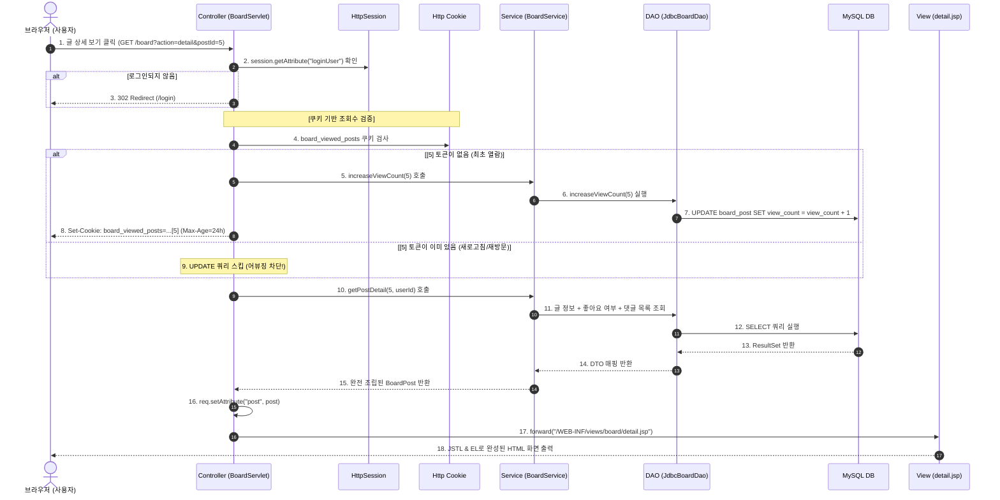

# 📘 [나만의 학습 & 복습 노트] Jakarta EE 서블릿/JSP 기반 MVC 풀스택 웹 애플리케이션 개발 총정리

> **📝 개발 일지 겸 공부 노트**:  
> 이 문서는 `Survlet_practice` 프로젝트를 직접 밑바닥부터 구축하며 학습한 **웹 애플리케이션의 동작 원리, MVC 아키텍처 계층 구조, 서블릿과 JSP의 역할, 그리고 각 기능별 핵심 기술과 트러블슈팅 경험**을 나중에 언제든 다시 꺼내보고 복습할 수 있도록 기록한 **자가 학습용 핸드북(Study Note)**입니다.

---

## 📌 목차
1. [프로젝트 발전 여정 (Roadmap & History)](#1-프로젝트-발전-여정-roadmap--history)
2. [전체 기술 스택 정리 & "왜 이걸 썼을까?"](#2-전체-기술-스택-정리--왜-이걸-썼을까)
3. [우리 프로젝트의 MVC 계층 구조 완벽 해부](#3-우리-프로젝트의-mvc-계층-구조-완벽-해부)
   - 3.1 MVC 각 계층의 역할과 책임
   - 3.2 Service와 DAO 계층을 따로 나눈 이유
   - 3.3 인터페이스(Interface)와 JDBC 구현체를 분리한 이유
   - 3.4 왜 JSP를 `WEB-INF/views/` 폴더에 숨겼을까? (보안 캡슐화)
4. [전체 요청-응답 라이프사이클 흐름도](#4-전체-요청-응답-라이프사이클-흐름도)
5. [기능별 동작 원리 & "어디서 뭘 썼는가?"](#5-기능별-동작-원리--어디서-뭘-썼는가)
   - 5.1 로그인/로그아웃과 HTTP 세션 관리
   - 5.2 중앙 게이트웨이 대시보드 라우팅
   - 5.3 TODO 관리와 사용자별 데이터 격리
   - 5.4 피드 게시판 & Multipart 파일 업로드
   - 5.5 좋아요 토글 & N+1 문제를 방어한 댓글 조립
   - 5.6 게시글 조회수 카운팅과 쿠키(Cookie) 기반 어뷰징 방지
6. [웹 백엔드 핵심 원리 총정리 (면접 & 실무 필수 개념)](#6-웹-백엔드-핵심-원리-총정리-면접--실무-필수-개념)
   - 6.1 포워드(`forward`) vs 리다이렉트(`sendRedirect`)
   - 6.2 PRG(Post-Redirect-Get) 패턴: 새로고침(F5) 중복 제출 원천 차단
   - 6.3 브라우저 렌더링과 페이지 스크롤 초기화/유지 원리
   - 6.4 `PreparedStatement`와 SQL 인젝션 방어
   - 6.5 `try-with-resources`와 DB 커넥션 누수 방지
7. [스프링(Spring Boot)으로 넘어갈 때의 대응 관계](#7-스프링spring-boot으로-넘어갈-때의-대응-관계)
8. [향후 확장해볼 만한 도전 과제](#8-향후-확장해볼-만한-도전-과제)

---

## 1. 프로젝트 발전 여정 (Roadmap & History)

이 프로젝트는 단순히 하나의 화면을 만드는 것에서 끝나지 않고, **웹 개발의 표준 MVC 아키텍처**를 단계별로 확장해 나가는 과정으로 진행되었습니다.

```text
[Step 0: 시작]
  index.html (정적 파일 맛보기)
       ▼
[Step 1: 회원 인증 기반 구축]
  LoginServlet + MemberDao + HttpSession (로그인/로그아웃 및 세션 검증)
       ▼
[Step 2: 첫 번째 비즈니스 기능]
  TodoServlet + TodoService + TodoDao (회원별 개인화된 할 일 CRUD)
       ▼
[Step 3: 아키텍처 리팩토링 - 대시보드 도입]
  MainServlet + main.jsp (단일 기능 직행 구조를 탈피하고 중앙 허브 게이트웨이 구축)
       ▼
[Step 4: SNS 타임라인 피드형 & 리스트형 게시판]
  BoardServlet + BoardService + 3개 DAO (글/사진 업로드, 댓글, 좋아요 토글)
       ▼
[Step 5: 정밀 조회수 집계 & 쿠키 어뷰징 방지]
  Cookie 기반 24시간 중복 방지 + 단독 상세 페이지(detail.jsp) 완성
```

* **처음 상태**: 로그인 성공 시 곧바로 TODO 화면으로만 튕기던 단일 목적 애플리케이션.
* **현재 상태**: 회원이 로그인하면 대시보드에서 원하는 서비스(TODO, 피드 게시판)를 선택할 수 있고, 게시판에서는 고화질 사진 업로드, 실시간 댓글/좋아요, 쿠키 기반 조회수 방어까지 갖춘 **완전한 엔터프라이즈급 MVC 포털 웹 애플리케이션**.

---

## 2. 전체 기술 스택 정리 & "왜 이걸 썼을까?"

| 기술 구분 | 사용 기술 | 버전 / 세부 사양 | 선정한 이유와 학습 포인트 |
| :--- | :--- | :--- | :--- |
| **Java Platform** | Java 17+ / Jakarta EE 10 | Servlet 6.1, JSP 3.0 | 과거 `javax.*`에서 최신 엔터프라이즈 표준인 `jakarta.*` 패키지 생태계 완벽 적응 |
| **WAS (서블릿 컨테이너)** | Apache Tomcat 10+ | Tomcat 10.1.x | Jakarta EE 10 스펙을 온전히 구동할 수 있는 표준 WAS |
| **빌드 & 의존성** | Gradle | `id 'war'` | 라이브러리 간편 관리 (`build.gradle`) 및 WAR 배포 아티팩트 빌드 |
| **데이터베이스** | MySQL 8.x | Connector/J 9.5.0 | 표준 RDBMS, 외래키 제약조건(`ON DELETE CASCADE`), 트랜잭션, 복합 PK 활용 |
| **DB 연결 관리** | 순수 JDBC (`DriverManager`) | `ConnectionProvider.java` | 커넥션 풀 라이브러리에 의존하기 전, 순수 JDBC 연결 라이프사이클과 자원 해제(`AutoCloseable`)를 직접 체험 |
| **뷰 템플릿 엔진** | JSP + JSTL + EL | JSTL 3.0.1, EL 3.0 | 스크립틀릿(`<% ... %>`)의 더러운 자바 코드를 몰아내고, 태그 라이브러리(`<c:forEach>`, `<c:if>`)와 EL(`${...}`)로 깔끔한 SSR 구현 |
| **파일 업로드** | Servlet Multi-part API | `@MultipartConfig`, `Part` | 외부 무거운 라이브러리(Commons FileUpload) 없이 서블릿 내장 표준 API로 10MB 이미지 업로드 처리 |
| **상태 관리 기술** | `HttpSession` & `Cookie` | Servlet 표준 | **로그인 인증 유지**는 보안상 안전한 세션에, **조회수 24시간 중복 방지**는 서버 메모리를 아끼는 쿠키에 분리 저장 |

---

## 3. 우리 프로젝트의 MVC 계층 구조 완벽 해부

우리 프로젝트는 전통적인 **MVC Model 2 아키텍처**를 엄격히 준수하며, 비즈니스 로직과 데이터베이스 접근을 각각 **Service**와 **DAO** 계층으로 명확히 책임을 분리했습니다.

```text
[ 브라우저 (Client) ]
       │ HTTP Request
       ▼
┌────────────────────────────────────────────────────────┐
│  CONTROLLER (서블릿 계층: com.kyobo.web.controller)     │
│  - LoginServlet, MainServlet, TodoServlet, BoardServlet│
│  - 역할: 요청 수신, 세션 검증, 파라미터 파싱, 응답 분기      │
└──────────────────────────────────┬─────────────────────┘
                                   │ 비즈니스 로직 위임
                                   ▼
┌────────────────────────────────────────────────────────┐
│  SERVICE (서비스 계층: com.kyobo.web.service)           │
│  - MemberService, TodoService, BoardService            │
│  - 역할: 유효성 검증, 권한 검사, N+1 방지 데이터 조립        │
└──────────────────────────────────┬─────────────────────┘
                                   │ DB 작업 요청
                                   ▼
┌────────────────────────────────────────────────────────┐
│  DAO (데이터 접근 계층: com.kyobo.web.dao)               │
│  - MemberDao, TodoDao, BoardDao, CommentDao, LikeDao   │
│  - 구현체: JdbcMemberDao, JdbcBoardDao, ...            │
│  - 역할: 순수 SQL 실행, ConnectionProvider 사용, ResultSet 매핑│
└──────────────────────────────────┬─────────────────────┘
                                   │ SQL 쿼리
                                   ▼
┌────────────────────────────────────────────────────────┐
│  DATABASE (MySQL Database: kyobo)                      │
│  - member, todo, board_post, board_comment, board_like │
└────────────────────────────────────────────────────────┘
```

---

### 3.1 MVC 각 계층의 역할과 책임

#### 1) Model (모델): `com.kyobo.web.model.*`
* **파일들**: [`Member.java`](file:///C:/Users/user/Documents/GitHub/Survlet_practice/src/main/java/com/kyobo/web/model/Member.java), [`TodoItem.java`](file:///C:/Users/user/Documents/GitHub/Survlet_practice/src/main/java/com/kyobo/web/model/TodoItem.java), [`BoardPost.java`](file:///C:/Users/user/Documents/GitHub/Survlet_practice/src/main/java/com/kyobo/web/model/BoardPost.java), [`BoardComment.java`](file:///C:/Users/user/Documents/GitHub/Survlet_practice/src/main/java/com/kyobo/web/model/BoardComment.java), [`BoardLike.java`](file:///C:/Users/user/Documents/GitHub/Survlet_practice/src/main/java/com/kyobo/web/model/BoardLike.java)
* **역할**: 데이터베이스 테이블의 1개 레코드를 자바 객체로 표현한 **DTO(Data Transfer Object) / VO(Value Object)**.
* **특징**:
  - 데이터 필드, Getter/Setter, 기본 생성자 위주로 구성.
  - `Serializable`을 구현하여 향후 세션 클러스터링이나 파일 직렬화에 대비.
  - 비즈니스 로직이나 SQL 코드는 일절 포함하지 않는 순수한 데이터 바구니.

#### 2) View (뷰): `src/main/webapp/WEB-INF/views/**`
* **파일들**: `login.jsp`, `main.jsp`, `todo/list.jsp`, `board/feed.jsp`, `board/list.jsp`, `board/detail.jsp`, `board/edit.jsp`
* **역할**: 컨트롤러가 넘겨준 데이터를 받아 사용자가 보는 최종 HTML 화면을 렌더링.
* **규칙**:
  - 자바 코드(`<% ... %>`)를 직접 쓰지 않고, 오직 **EL(`${post.title}`)**과 **JSTL(`<c:forEach>`, `<c:if>`)**로만 화면을 동적으로 구성함.
  - 데이터를 직접 조회하거나 가공하지 않고 오직 **출력(Presentation)**만 담당.

#### 3) Controller (컨트롤러): `com.kyobo.web.controller.*`
* **파일들**: [`LoginServlet.java`](file:///C:/Users/user/Documents/GitHub/Survlet_practice/src/main/java/com/kyobo/web/controller/LoginServlet.java), [`LogoutServlet.java`](file:///C:/Users/user/Documents/GitHub/Survlet_practice/src/main/java/com/kyobo/web/controller/LogoutServlet.java), [`MainServlet.java`](file:///C:/Users/user/Documents/GitHub/Survlet_practice/src/main/java/com/kyobo/web/controller/MainServlet.java), [`TodoServlet.java`](file:///C:/Users/user/Documents/GitHub/Survlet_practice/src/main/java/com/kyobo/web/controller/TodoServlet.java), [`BoardServlet.java`](file:///C:/Users/user/Documents/GitHub/Survlet_practice/src/main/java/com/kyobo/web/controller/BoardServlet.java)
* **역할**: 클라이언트의 HTTP 요청을 가장 먼저 마주하는 **현관문(Dispatcher)**.
* **책임**:
  1. 세션 검사 (로그인되어 있는 사용자인가?)
  2. 요청 파라미터(`req.getParameter()`) 및 업로드 파일(`req.getPart()`) 파싱
  3. 적절한 Service 계층 메서드 호출
  4. 처리 결과에 따라 `forward()`(화면 렌더링) 또는 `sendRedirect()`(페이지 전환) 결정

---

### 3.2 Service와 DAO 계층을 따로 나눈 이유

초보 개발자 시절에는 서블릿 안에서 직접 `Connection`을 열고 SQL을 날리는 경우가 많습니다. 하지만 우리 프로젝트는 **Service와 DAO를 철저히 분리**했습니다:

* **DAO (Data Access Object)**:
  - **책임**: 오직 **"DB 테이블에 SQL을 날리고 결과를 받아오는 것"**만 압니다.
  - 예: `save(post)`, `findById(id)`, `delete(id)`처럼 아주 단순하고 독립적인 CRUD 쿼리만 수행합니다.
* **Service (Business Service)**:
  - **책임**: **"실제 우리 서비스의 업무 규칙(비즈니스 로직)"**을 책임집니다.
  - 예:
    1. 글을 수정하려는 사람이 진짜 원작성자가 맞는지 검증 (`post.getUserId().equals(currentUserId)`)
    2. 제목이나 내용이 빈칸이면 예외 던지기 (`IllegalArgumentException`)
    3. 피드 화면을 만들 때 **게시글 20개 + 내가 좋아요 누른 글 목록 + 댓글 목록**을 메모리에서 한 번에 조립하기 (N+1 문제 해결)

> 💡 **배운 점**: DAO는 멍청하게 SQL만 날리고, Service가 똑똑하게 비즈니스 룰을 검사하고 조립함으로써 코드가 깔끔해지고 재사용성이 극대화됩니다!

---

### 3.3 인터페이스(Interface)와 JDBC 구현체를 분리한 이유

* **인터페이스**: [`BoardDao.java`](file:///C:/Users/user/Documents/GitHub/Survlet_practice/src/main/java/com/kyobo/web/dao/BoardDao.java) ("게시판 데이터 접근은 이런 메서드들을 제공해야 한다"는 약속/규격)
* **구현체**: [`JdbcBoardDao.java`](file:///C:/Users/user/Documents/GitHub/Survlet_practice/src/main/java/com/kyobo/web/dao/JdbcBoardDao.java) (순수 JDBC와 MySQL 문법으로 실제로 구현한 클래스)

> **왜 이렇게 했을까?**  
> 나중에 MySQL 대신 Oracle로 DB를 바꾸거나, 순수 JDBC 대신 MyBatis나 JPA로 데이터 접근 방식을 교체하더라도, `BoardService` 코드는 단 한 줄도 고칠 필요가 없습니다. 새 구현체인 `JpaBoardDao`를 만들어 끼워 넣기만 하면 되기 때문입니다 (**DIP: 의존성 역전 원칙**).

---

### 3.4 왜 JSP를 `WEB-INF/views/` 폴더에 숨겼을까? (보안 캡슐화)

* 브라우저 주소창에 `http://localhost:8080/Survlet_practice/login.jsp`라고 직접 쳐서 화면을 열 수 있다면 치명적인 보안 문제가 생깁니다. 로그인 검사 서블릿을 거치지 않고 내부 화면으로 직행할 수 있기 때문입니다.
* 톰캣(WAS)의 스펙상 **`WEB-INF/` 폴더 밑에 있는 모든 파일은 외부 브라우저의 직접 URL 호출이 물리적으로 100% 차단**됩니다.
* 오직 서버 내부의 컨트롤러 서블릿이 `request.getRequestDispatcher("/WEB-INF/views/...").forward(req, resp)`로만 열어줄 수 있으므로, **모든 요청이 무조건 컨트롤러의 세션/권한 검사를 거치도록 강제(보안 캡슐화)**할 수 있습니다.

---

## 4. 전체 요청-응답 라이프사이클 흐름도

클라이언트가 브라우저 버튼을 눌렀을 때부터 화면이 출력되기까지의 전 과정을 한눈에 정리한 시퀀스 다이어그램입니다.



---

## 5. 기능별 동작 원리 & "어디서 뭘 썼는가?"

### 5.1 로그인/로그아웃과 HTTP 세션 관리
* **관련 파일**: [`LoginServlet.java`](file:///C:/Users/user/Documents/GitHub/Survlet_practice/src/main/java/com/kyobo/web/controller/LoginServlet.java), [`LogoutServlet.java`](file:///C:/Users/user/Documents/GitHub/Survlet_practice/src/main/java/com/kyobo/web/controller/LogoutServlet.java), [`Member.java`](file:///C:/Users/user/Documents/GitHub/Survlet_practice/src/main/java/com/kyobo/web/model/Member.java), `login.jsp`
* **동작 원리**:
  1. `POST /login`: 사용자가 입력한 아이디와 비밀번호를 받아 [`MemberDao.findByUserId()`](file:///C:/Users/user/Documents/GitHub/Survlet_practice/src/main/java/com/kyobo/web/dao/MemberDao.java)로 일치 여부 확인.
  2. 일치하면 서버 메모리의 `HttpSession`에 `session.setAttribute("loginUser", member)` 저장.
  3. 브라우저에는 자동으로 `JSESSIONID` 쿠키가 발급되어 다음 요청부터 서버가 사용자를 기억함.
  4. 로그아웃(`GET /logout`): `session.invalidate()`를 호출하여 서버의 세션을 즉시 폭파하고 `/login`으로 리다이렉트.

---

### 5.2 중앙 게이트웨이 대시보드 라우팅
* **관련 파일**: [`MainServlet.java`](file:///C:/Users/user/Documents/GitHub/Survlet_practice/src/main/java/com/kyobo/web/controller/MainServlet.java), [`main.jsp`](file:///C:/Users/user/Documents/GitHub/Survlet_practice/src/main/webapp/WEB-INF/views/main.jsp)
* **동작 원리**:
  - 기존에는 로그인하자마자 곧바로 TODO 목록으로 직행하던 단절된 흐름을 개선.
  - 로그인 성공 시 `resp.sendRedirect("/main")`으로 보내고, [`MainServlet`](file:///C:/Users/user/Documents/GitHub/Survlet_practice/src/main/java/com/kyobo/web/controller/MainServlet.java)이 세션을 검증한 뒤 허브 대시보드 뷰(`main.jsp`)를 포워드.
  - 대시보드에서 카드형 버튼으로 `/todo`(할 일 관리) 또는 `/board`(자유 게시판)로 유연하게 이동.

---

### 5.3 TODO 관리와 사용자별 데이터 격리
* **관련 파일**: [`TodoServlet.java`](file:///C:/Users/user/Documents/GitHub/Survlet_practice/src/main/java/com/kyobo/web/controller/TodoServlet.java), [`TodoService.java`](file:///C:/Users/user/Documents/GitHub/Survlet_practice/src/main/java/com/kyobo/web/service/TodoService.java), [`JdbcTodoDao.java`](file:///C:/Users/user/Documents/GitHub/Survlet_practice/src/main/java/com/kyobo/web/dao/JdbcTodoDao.java), `todo/list.jsp`
* **동작 원리**:
  - 멀티 유저 환경에서 **"남의 할 일을 보거나 건드리지 못하게 하는 데이터 격리"** 학습.
  - 모든 SELECT/UPDATE/DELETE 쿼리에 `WHERE user_id = ?` 조건을 필수 포함.
  - 체크박스 클릭 시 `action=toggle` 요청으로 `is_done = NOT is_done` 상태 반전.

---

### 5.4 피드 게시판 & Multipart 파일 업로드
* **관련 파일**: [`BoardServlet.java`](file:///C:/Users/user/Documents/GitHub/Survlet_practice/src/main/java/com/kyobo/web/controller/BoardServlet.java), [`board.css`](file:///C:/Users/user/Documents/GitHub/Survlet_practice/src/main/webapp/assets/css/board.css), `board/feed.jsp`
* **동작 원리**:
  - 서블릿 상단에 `@MultipartConfig` 어노테이션 지정 (업로드 제한 10MB).
  - 글 작성 폼에 `enctype="multipart/form-data"` 지정.
  - 사용자가 업로드한 원본 파일명이 겹치지 않도록 `UUID.randomUUID().toString() + 확장자`로 고유 파일명을 생성하여 서버 디스크(`assets/uploads/board/`)에 안전하게 저장.

---

### 5.5 좋아요 토글 & N+1 문제를 방어한 댓글 조립
* **관련 파일**: [`CommentDao.java`](file:///C:/Users/user/Documents/GitHub/Survlet_practice/src/main/java/com/kyobo/web/dao/CommentDao.java), [`JdbcCommentDao.java`](file:///C:/Users/user/Documents/GitHub/Survlet_practice/src/main/java/com/kyobo/web/dao/JdbcCommentDao.java), [`LikeDao.java`](file:///C:/Users/user/Documents/GitHub/Survlet_practice/src/main/java/com/kyobo/web/dao/LikeDao.java), [`BoardService.java`](file:///C:/Users/user/Documents/GitHub/Survlet_practice/src/main/java/com/kyobo/web/service/BoardService.java)
* **동작 원리**:
  1. **좋아요 중복 차단**: DB 테이블 `board_like`의 기본키를 `PRIMARY KEY (post_id, user_id)` 복합키로 설정하여 1명이 1글에 1번만 좋아요 가능하도록 물리적 방어.
  2. **좋아요 토글 로직**: 이미 눌렀으면 `DELETE` & `like_count - 1`, 안 눌렀으면 `INSERT` & `like_count + 1`.
  3. **N+1 문제 방어 (초대박 튜닝 포인트!)**:
     - 피드에 글이 20개 있을 때 글마다 댓글을 따로 조회하면 쿼리가 `1 + 20 = 21번` 발생!
     - 우리 프로젝트는 [`findByPostIds(List<Long> postIds)`](file:///C:/Users/user/Documents/GitHub/Survlet_practice/src/main/java/com/kyobo/web/dao/CommentDao.java)에서 `IN (?, ?, ...)` 쿼리를 날려 **단 1번의 쿼리로 20개 글의 댓글을 일괄 수신** 후 메모리 `Map`으로 결합! (총 쿼리 3회로 종결)

---

### 5.6 게시글 조회수 카운팅과 쿠키(Cookie) 기반 어뷰징 방지
* **관련 파일**: [`BoardServlet.java`](file:///C:/Users/user/Documents/GitHub/Survlet_practice/src/main/java/com/kyobo/web/controller/BoardServlet.java), [`JdbcBoardDao.java`](file:///C:/Users/user/Documents/GitHub/Survlet_practice/src/main/java/com/kyobo/web/dao/JdbcBoardDao.java), `board/detail.jsp`
* **동작 원리**:
  - 세션에 저장하면 동시 접속자 증가 시 서버 RAM이 터지므로, 클라이언트 브라우저의 **쿠키(`board_viewed_posts`)**에 `[1][5][12]` 형태로 토큰을 저장.
  - 쿠키 유효시간을 `setMaxAge(86400)`(24시간)으로 설정하여 브라우저를 껐다 켜도 하루 동안 중복 카운트 방지.
  - `setHttpOnly(true)`를 주어 자바스크립트 XSS 공격으로 쿠키가 탈취되는 것을 원천 방어.

---

## 6. 웹 백엔드 핵심 원리 총정리 (면접 & 실무 필수 개념)

### 6.1 포워드(`forward`) vs 리다이렉트(`sendRedirect`)

| 비교 항목 | 포워드 (`forward`) | 리다이렉트 (`sendRedirect`) |
| :--- | :--- | :--- |
| **처리 주체** | **서버 내부**에서만 몰래 제어권을 넘김 | **브라우저에게** 다른 주소로 가라고 명령을 내림 |
| **HTTP 요청 횟수** | 최초 1회 요청으로 끝남 | 최초 요청 ➜ 302 응답 ➜ **2번째 새 요청 발생 (총 2회)** |
| **브라우저 주소창(URL)**| 바뀌지 않고 그대로 유지됨 | **최종 목적지 URL로 깔끔하게 변경됨** |
| **데이터 전달 방식** | `request.setAttribute()` 객체를 그대로 공유 가능 | request가 소멸하므로 파라미터나 세션을 써야 함 |
| **주요 사용처** | 단순 화면 출력, 검색 결과 조회 (SELECT) | **글 등록, 수정, 삭제, 로그인 등 상태 변경 (CUD)** |

---

### 6.2 PRG(Post-Redirect-Get) 패턴: 새로고침(F5) 중복 제출 원천 차단

> **💡 핵심 암기 포인트**:  
> 브라우저에서 `F5(새로고침)`는 화면을 단순히 새로 그리는 게 아니라 **"내가 서버에 보냈던 가장 마지막 HTTP 요청을 똑같이 다시 보내는 행위"**입니다!

* **포워드로 CUD를 처리했을 때의 대참사**:
  - `POST /board?action=comment` ➜ 서버가 `forward("feed.jsp")` 수행.
  - 브라우저 입장에서 마지막 요청은 여전히 `POST (댓글 등록)` 상태!
  - 사용자가 `F5`를 누를 때마다 방금 보낸 `POST`가 다시 날아가서 **똑같은 댓글이 10개, 20개 중복 등록됨**.
* **리다이렉트(PRG)로 해결한 원리**:
  - `POST /board?action=comment` ➜ 서버가 `sendRedirect("/board")` (302 응답) 전송.
  - 브라우저가 스스로 `GET /board` 요청을 새로 보냄.
  - 브라우저 메모리의 마지막 요청이 **`GET (단순 조회)`으로 완전히 덮어씌워짐**!
  - 이제 사용자가 `F5`를 연타해도 단순 화면 조회만 일어날 뿐 데이터가 중복 등록되지 않음.

---

### 6.3 브라우저 렌더링과 페이지 스크롤 초기화/유지 원리

> **Q. 댓글을 등록했을 때 스크롤이 중간에 있었는데, 포워드로 바꾸면 스크롤이 제자리에 유지될까요?**  
> **A. 전혀 아닙니다! 포워드든 리다이렉트든 둘 다 스크롤은 맨 위로 올라갑니다.**

* **이유**:
  - 포워드와 리다이렉트 모두 브라우저 입장에서는 새로운 HTML 문서를 처음부터 끝까지 통째로 내려받아 도화지에서부터 다시 그리는 **'전체 페이지 새로고침(Full Page Reload)'**입니다.
  - 브라우저는 새 HTML 문서를 다 그리면 기본 사양으로 스크롤을 맨 위(`scrollTop = 0`)로 초기화합니다.
* **실무 SNS(인스타그램, 유튜브)의 스크롤 유지 비결**:
  - 페이지 전체를 새로고침하지 않고, 자바스크립트의 **`fetch()` / AJAX 비동기 통신**을 사용하여 댓글 데이터만 서버에 보내고 **화면의 댓글 영역에 새 댓글 DOM만 쏙 끼워 넣습니다**.
  - 전체 새로고침이 아예 발생하지 않으므로 스크롤이 1픽셀도 움직이지 않는 것입니다.

---

### 6.4 `PreparedStatement`와 SQL 인젝션 방어

우리 프로젝트는 모든 DAO에서 일반 `Statement`를 배제하고 [`PreparedStatement`](file:///C:/Users/user/Documents/GitHub/Survlet_practice/src/main/java/com/kyobo/web/dao/JdbcBoardDao.java)를 사용했습니다:
* 일반 `Statement`로 문자열을 더하면(`"WHERE user_id = '" + id + "'"`), 악의적인 사용자가 `' OR '1'='1`을 입력하여 비밀번호 검증 없이 모든 계정을 탈취할 수 있습니다 (SQL Injection).
* `PreparedStatement`의 물음표(`?`) 치환자는 데이터베이스 엔진이 SQL 문법 구조를 미리 컴파일해 둔 뒤, 입력값은 오직 **순수한 리터럴 데이터(상수)**로만 취급하므로 **SQL 인젝션 공격이 물리적으로 100% 무력화**됩니다.

---

### 6.5 `try-with-resources`와 DB 커넥션 누수 방지

```java
try (Connection conn = ConnectionProvider.getConnection();
     PreparedStatement ps = conn.prepareStatement(sql)) {
    // SQL 실행
} // 블록이 끝나면 예외가 터지든 정상 종료되든 conn, ps가 자동으로 close() 됨!
```
* JDBC에서 `Connection`이나 `PreparedStatement`를 닫지 않으면 DB 커넥션 풀이 고갈되어 서버 전체가 멈추는 **커넥션 누수(Connection Leak)**가 발생합니다.
* Java 7부터 도입된 `AutoCloseable` 인터페이스 기반의 `try-with-resources` 문법을 사용하여 `finally { close(); }`의 지저분한 보일러플레이트 없이도 안전하게 자원을 자동 반납했습니다.

---

## 7. 스프링(Spring Boot)으로 넘어갈 때의 대응 관계

우리가 이번 순수 서블릿/JSP 프로젝트에서 손으로 직접 만든 구조는 사실 **현대 스프링 프레임워크의 내부 동작 원리와 1:1로 완벽히 매핑**됩니다!

| 우리 프로젝트 (순수 Servlet/JSP) | 스프링 프레임워크 (Spring MVC / Boot) | 설명 |
| :--- | :--- | :--- |
| `BoardServlet` (`@WebServlet`) | `@Controller`, `@RestController` | HTTP 요청을 매핑받는 핸들러 |
| `req.getParameter("title")` | `@RequestParam`, `@ModelAttribute` | 요청 파라미터 자동 바인딩 |
| `req.setAttribute("posts", list)` | `Model.addAttribute("posts", list)` | 뷰에 전달할 데이터 보관함 |
| `forward("/WEB-INF/views/...")` | `return "board/feed";` (ViewResolver) | 뷰 템플릿 포워딩 |
| `resp.sendRedirect("/board")` | `return "redirect:/board";` | PRG 리다이렉트 지시어 |
| `BoardService` 생성자 주입 | `@Service` + `@RequiredArgsConstructor` (DI/IoC) | 비즈니스 로직 빈(Bean) 등록 및 의존성 주입 |
| `JdbcBoardDao` | `@Repository` / Spring Data JPA / MyBatis | 데이터 접근 계층 |
| `ConnectionProvider` | `HikariDataSource` (커넥션 풀) | 스프링 부트 기본 커넥션 풀 |

> 💡 **학습의 가치**: 스프링의 수많은 마법 같은 어노테이션(`@GetMapping`, `@RequestParam`, `redirect:`)들이 내부에서 실제로 어떤 서블릿 코드로 돌고 있는지를 이제 명확하게 꿰뚫어 볼 수 있게 되었습니다!

---

## 8. 향후 확장해볼 만한 도전 과제

혼자 더 실력을 키우고 싶을 때 도전해볼 수 있는 다음 스텝들입니다:

1. **HikariCP 커넥션 풀 도입**:
   - 매번 `DriverManager.getConnection()`으로 DB 연결을 새로 맺지 않고, 미리 커넥션을 10개 만들어두고 재사용하는 HikariCP 연동해보기.
2. **AJAX 댓글 & 좋아요 비동기화**:
   - `fetch('/board?action=like&postId=1')`로 자바스크립트 비동기 호출을 처리하고 JSON을 반환받아 화면 새로고침 없이 하트 색깔과 숫자만 바꾸기.
3. **페이징(Paging) 네비게이션 & 무한 스크롤**:
   - `LIMIT 20 OFFSET ?` 쿼리를 자바스크립트 `IntersectionObserver`와 연동하여 스크롤이 바닥에 닿을 때 다음 글 20개 자동 로딩하기.
4. **Spring Boot로 마이그레이션**:
   - 현재 구축한 DB 스키마와 DTO, Service 로직을 그대로 들고 Spring Boot 프로젝트로 포팅해보기.
